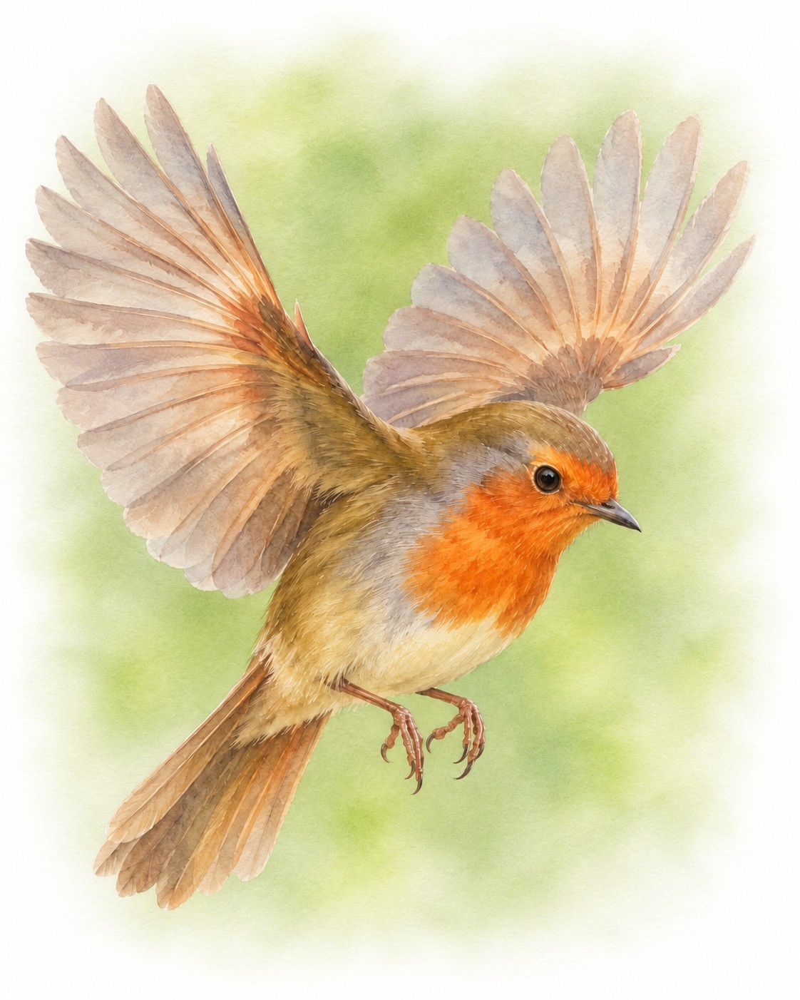

# MAG-S3: what a recording experiment needs to see the shape of the quantum compass

[](https://doi.org/10.5281/zenodo.24043500)

<p align="center"></p>

A simulation study of the recording experiment that could test the MAG-S2 prediction in birds. MAG-S2 predicted that neurons reading a radical-pair (cryptochrome) magnetic compass carry a population code shaped like the real projective plane RP², while a polarity-sensitive compass read by the same eyes and neurons gives a sphere. MAG-S3 models what a real recording adds: a weak and realistic yield pattern, few cells per session, Poisson spikes, slow drift of firing rates, gain noise shared by the cells of a session, and field rotations slow enough to avoid induction artefacts. It asks how many neurons, field directions and repeats an experiment needs to tell RP² from a sphere in 8 of 10 birds, how strongly each neuron must follow the field for that to fit into a few hours of recording, and whether the readout ever gives the RP² label to a polar code or to noise.

Author: Julia Ryzhkova (Siriona, siriona.one; ORCID 0009-0005-4194-6059).
Status: version 0.1.0, 7 November 2026. The protocol (v0.4), code and thresholds were frozen before the confirmatory run, and their SHA-256 were posted in Telegram at 18:28 UTC (https://t.me/attractordm/76); the run started at 18:28:57 UTC. The run with its verdicts is included. Archived on Zenodo: release v0.1.0, https://doi.org/10.5281/zenodo.24043500. Companion studies: MAG-S1, a shared quantum compass and the synchrony of a flock, https://doi.org/10.5281/zenodo.24032910; MAG-S2, the shape of the quantum compass signal, https://doi.org/10.5281/zenodo.24030614.

## The question

The MAG-S2 model set the signal-to-noise ratio of each neuron directly, recorded 100 neurons at once and turned the field into 600 directions. A living experiment differs in three ways.

- **The signal is weak.** Radical-pair models with 14–21 nuclei give a yield anisotropy of 0.1–0.3% (Atkins et al. 2019; Grüning et al. 2022), and how strongly a neuron changes its firing rate with the field has not been measured. MAG-S3 sets this modulation depth δ directly, from 10% to 100% peak to peak, and uses the yield pattern of Ren et al. (2021), whose narrow dip at 90° carries high even harmonics.
- **Cells are few.** A session gives a few cells with tetrodes and up to about a hundred with silicon probes, and in published recordings 7–16% of cells responded to the field. MAG-S3 models simultaneous recording, pseudo-populations pooled from probe sessions of 80 cells and from tetrode sessions of 6 cells, and a share f = 1 or f = 0.1 of tuned cells with selection by an ANOVA across directions.
- **Time is limited.** The field has to change smoothly, no faster than 100 µT/s (Fenton, Nath & Malkemper 2022), and settle before each counting window, so the number of directions and repeats sets the length of a session. The reference design, K = 800 directions in antipodal pairs, R = 4 repeats and a 2 s window, takes about 2.9 hours.

The same recording is read in two ways. The **antipodal test** asks whether the code is even, that is whether the population responds alike to n and −n: it splits each response into even and odd parts over the antipodal pairs, tests the odd energy with a sign-flip permutation test and calls the code even or polar from bootstrap bounds on the odd share ρ. **Topology** asks more: whether the code also tells all field axes apart and gathers them into one surface. It runs the frozen MAG-S2 pipeline (six principal components, persistent homology with Z₂ and Z₃ coefficients, an atlas of synthetic shapes recorded with the same noise as a gate) and labels the cloud RP², sphere, torus, Klein bottle, ring, point or "other".

## Results of the confirmatory run

The run took place on 7 November 2026 in Google Colab (TPU v6e-1 runtime, 44 processes): stage 1 built the maps on virtual birds 1–10 (5250 records in 525 cells), the frozen analysis chose the working points from them, and stage 2 tested the hypotheses on 100 new virtual birds, 101–200 (500 records). The input checks found nothing, the run is valid, and all five code invariants held. The frozen `analyze.py`, run again on the downloaded archive in the calibration environment, gave byte-identical working points and `results.json`.

| Check | Verdict | Numbers |
|---|---|---|
| Q1. The atlas is recognised in the reference design | met | point, ring, sphere and RP² recognised in 10 of 10 birds |
| Q2. Cell selection works | met | untuned cells pass in 4.9% of cases, tuned cells at δ = 40% in 97.6% |
| Q3. The spikes reproduce MAG-S2 | met | RP² in 10 of 10 birds at the depth that gives the median neuron a signal-to-noise ratio of 2 |
| Q4. The antipodal test does not confuse codes | met | a purely even code is called even and a purely polar code polar in 10 of 10 birds, with no swapped verdicts |
| H1. The realistic pattern keeps the shape | met | the compass is labelled RP² in 82 of 100 birds (exact 95% interval 0.731–0.890), the polar control a sphere in 100 of 100 (0.964–1); 17 of the other 18 birds get a Klein bottle |
| H2. A false RP² is rare | met | 0 of 100 for the polar control and for shuffled data in stage 2 (one-sided upper bound 0.030), 0 of 750 for each control over the main map, 0 of 250 in each recording mode, no cell with a false RP² in any bird |
| H3. Shared noise costs cells | not met | at 200 cells and δ = 40%, simultaneous recording with gain noise σ_g = 0.2 gives RP² in 44 of 100 birds and the pseudo-population of three probe sessions in none (77 point, 20 sphere, 3 other); the interval of the difference, 0.369–0.440, lies above zero, the opposite of the hypothesis |
| H4. The antipodal test is cheaper than topology | met | at δ = 40% topology needs 200 cells, and the antipodal test on 100 cells calls the code even in 100 of 100 birds (0.964–1) |
| H5. The antipodal test sees an odd part before topology | met | its threshold ε_ant = 0.05 lies below the topology threshold ε_top = 1; at ε = 0.05 it finds the odd part in 100 of 100 birds, and topology gives a sphere in none |

### What an experiment needs

N80 is the smallest number of tuned cells for which 8 of 10 birds get RP² with the atlas gate open (shape) or the verdict "even" (parity). Where the recording modes differ, the numbers read simultaneous / probe sessions / tetrode sessions. "Short sessions" is the separate antipodal map with K = 100 and R = 8, about 44 minutes per session.

| δ | Shape, f = 1 | Parity, f = 1 | Parity in short sessions, f = 1 | Shape, f = 0.1 | Parity, f = 0.1 | Parity in short sessions, f = 0.1 |
|---|---|---|---|---|---|---|
| 10% | > 400 | > 400 | > 400 | > 400 | > 400 | > 400 |
| 20% | > 400 | 50 / 100 / 50 | 400 / 100 / 100 | > 400 | > 400 / 400 / 400 | > 400 |
| 40% | 200 | 6 | 12 / 6 / 12 | 400 | 25 | 50 |
| 70% | 100 | 6 | 6 | 200 / 100 / 100 | 6 | 25 / 6 / 12 |
| 100% | 50 | 6 | 6 | 100 | 6 | 12 / 6 / 6 |

Parity needs about ten times fewer cells than shape. In nine cells of the map the compass already reached 8 of 10 birds while the atlas gate stayed closed, always because the synthetic RP² of the atlas was harder for the pipeline than the compass itself, so the shape numbers above are conservative.

The cheapest design within each of the three recording budgets fixed before the run (B1: one probe session, up to 150 cells and 3 hours; B2: up to 10 probe sessions of 80 cells and 30 hours; B3: up to 40 tetrode sessions and 40 hours):

| Budget | Shape: smallest δ and cheapest design | Parity: smallest δ and cheapest design |
|---|---|---|
| B1, f = 1 | 70%: 100 cells, one session, 2.9 h | 20%: 50 cells, one session, 2.9 h |
| B2, f = 1 | 40%: 200 cells, 3 probe sessions, 8.8 h | 20%: 100 cells, 2 short probe sessions, 1.5 h |
| B3, f = 1 | 100%: 50 cells, 9 tetrode sessions, 26.3 h | 20%: 50 cells, 9 tetrode sessions, 26.3 h |
| B1, f = 0.1 | does not fit | 70%: 6 tuned of 60 recorded cells, one session, 2.9 h |
| B2, f = 0.1 | does not fit | 40%: 25 tuned of 250 recorded cells, 4 probe sessions, 11.7 h |
| B3, f = 0.1 | does not fit | 70%: 6 tuned of 60 recorded cells, 10 tetrode sessions, 29.2 h |

The frozen ranking puts the number of sessions before their total length, so in two places a design with more but shorter sessions would take less time: two short tetrode sessions on 12 cells give the parity verdict in 1.5 h instead of one 2.9 h session (B3, f = 1, δ = 40%), and 20 short sessions give it in 14.6 h instead of 29.2 h (B3, f = 0.1, δ = 70%).

### Exploratory results

Everything in this section was computed after the run or comes from the exploratory maps of the protocol, and none of it changes a verdict.

- **Why H3 failed.** For birds 101–110 the H3 recordings were rebuilt with the frozen code (all 20 fingerprints match the run) and their principal components inspected (`code/scripts/explore_h3.py`, `results/exploratory/`). In a simultaneous recording the shared gain noise falls into the first component, which carries 24–26% of the variance and lies 0.94–0.99 in the gain series of the session. In a pseudo-population the noise splits between three sessions of 80, 80 and 40 cells; each part is as strong as the components of the shape, PCA mixes them, and the gain series take up about two of the six components the pipeline reads (summed squared projections 1.95–2.12). The likely reading is that too few dimensions remain for the shape, which as a code of quadratic forms spans five. Dividing each presentation by the true gain gives RP² in 10 of 10 simultaneous recordings and 9 of 10 pseudo-populations. Dividing it by the summed count of the cells of the same session in the same presentation, which a real experiment can do, gives RP² in 10 of 10 birds in both modes, against 7 of 10 and 0 of 10 without the correction. Small sessions escape the effect: in the main map at δ = 20% and 400 cells the tetrode pseudo-population gave RP² in 10 of 10 birds, simultaneous recording in 5 and probe sessions in none. The practical advice, to normalise each presentation by the summed count of its session before topology, needs its own confirmatory run.
- **Klein bottles.** At high signal-to-noise ratio part of the birds get a Klein bottle instead of RP² (4 of 10 at K = 600 and δ ≥ 70%, and at R = 16 or T = 5 s with δ = 40%). In this pipeline the Klein label means the RP² signature plus one extra H₁ bar. In the 17 Klein birds of the H1 cell the extra bar exceeds the threshold by only 1–23%, while in the RP² birds the second H₁ bar stays below it (85% of the threshold in the median bird). The label also appears without shared noise; its source is open, and the high even harmonics of the Ren et al. pattern are one candidate.
- **Polar admixture.** The antipodal test sees it first: at w = 0.1 it finds the odd part in 10 of 10 birds while all 10 keep RP², and at w = 0.3 no bird is called even (median ρ 0.13) while 7 keep RP². At w = 0.5 no bird keeps RP².
- **Odd admixture and the CISS anchor.** The antipodal test finds an odd part in no bird up to ε = 0.02 and in all 10 from ε = 0.05, still calling the code even up to ε = 0.1 (median ρ 0.034). Topology gives a sphere in 6 of 10 birds at ε = 0.5 and in 10 at ε = 1. A Haberkorn model with chirality-induced spin selectivity gives an equivalent ε of 2.5·10⁻⁴ to 1.1·10⁻³ at χ = 0.02π–0.1π for the MAG-S2 rates and 2.8·10⁻⁵ to 1.4·10⁻⁴ for the FAD–TrpD rates of Cry4a, at least 44 times below ε_ant.
- **Design.** At 200 cells in simultaneous recording, the number of directions matters most for the shape (at most 2 of 10 birds with RP² for K = 100 and 200 at any depth, up to 7 for K = 400, 10 for K = 600 at δ = 40%), while parity is seen with K = 10–20 in sessions of 2–5 minutes (9–10 of 10 birds at δ ≥ 70%). R = 16 repeats give RP² in 10 of 10 birds at δ = 20% in an 11.7 h session. A Fano factor of 1.5 and the MAG-S2 pattern change little, and response adaptation with τ_a = 2 s removes the shape at δ = 40%.

## What this means for an experiment

In the model the experiment is best built in two steps. The antipodal test establishes the parity of the code cheaply, with 6–12 cells and one session of about 44 minutes when neurons modulate by 40% or more, and it also notices polar and odd admixtures before topology does. The shape needs strong modulation and many cells: one probe session sees RP² from δ = 70%, δ = 40% needs 200 cells and three probe sessions, and with one tuned cell in ten the shape fits none of the three budgets. No false RP² appeared in the whole run, so in the model the RP² label arises neither from noise nor from a polar input. An RP² label in birds would show an axial code that tells all axes apart; tying it to the radical pair needs the controls named in the protocol (light dependence, radio-frequency noise in and outside the 75–85 MHz band, loss of cryptochrome 4). All numbers refer to the model and carry over to living birds only after the model is checked against biological data.

## Calibration and checks before the run

- **Calibration** on birds 1001–1010 (C7 on 2001–3000) looked only at neutral criteria. The first round moved the reference design to K = 800 and R = 4, because the frozen MAG-S2 pipeline recognised the RP² of the atlas in at most 5 of 10 birds at K = 100–400. The second round met all seven criteria after cell selection moved to a two-way ANOVA with repeats as blocks, and the repeat on the final code gave the same numbers to the last digit: the Ren pattern has its minimum at 90° with relative depth 0.254%, the Haberkorn solver agrees with MAG-S2 to 2·10⁻¹⁴, untuned cells pass selection in 4.7–5.3% of cases, the antipodal thresholds separate even, polar and noise codes, and the permutation test gave false odd findings in 51 and 45 of 1000 birds.
- **Blind code review** by a separate reviewer without access to results; the fixes added input and provenance checks to the analysis, a real rebuild test for I4, a dimensionless tolerance for I2 and a ranking of designs that ignores the random length of sessions.
- **Synthetic tests** of the analysis on worlds with known answers catch all 99 mutants of `analyze.py` (`results/checks/mutation_testing_analyze.txt`).
- **Environment check.** Colab was compared with the calibration environment on calibration birds before the freeze: on TPU v6e-1 219 of 225 values agree bitwise, 4 agree to 10⁻⁹ and 2 bitwise flags differ for the same reason, the last digits of the MAG-S2 pattern (`results/checks/env_check_comparison.txt`).
- **Blind pipeline check** on birds 9301–9302 in Colab, 18:00–18:21 UTC; only technical facts were printed and the output was deleted unseen.

## Limitations

- **Signal amplification.** δ is set directly. With a yield anisotropy near 0.25%, a modulation of 10–100% needs an amplification by a factor of hundreds in the retina and brain, which the model leaves aside; the maps answer the question of what an experiment sees for a given modulation.
- **Retina and neurons** come from MAG-S2, with cryptochromes aligned with the receptor axis, Poisson or Fano 1.5 spikes and the shared noise reduced to one gain factor; living neurons have bursts, state changes and richer correlations.
- **Other signals.** Vision, head direction and other inputs enter only as the polar admixture and as untuned cells. Induction artefacts of the coils are polar and in a living experiment would act like a polar admixture.
- **Directions in pairs.** The antipodal test needs n and −n, so topology sees K/2 axes; a design without the antipodal test could show K different axes in the same time.
- **CISS** is modelled by the simplest odd form, cos θ along the molecular axis, with its scale tied to the three-nucleus pair.
- **Pseudo-populations** pool sessions of one bird, as with a long-term implant.
- **Ten birds per map cell** give coarse thresholds (the exact lower bound at 8 of 10 is 0.44), so the confirmatory verdicts rest on the 100 birds of stage 2.
- **Fixed six components.** The topology pipeline reads six principal components, which makes it sensitive to how shared noise is spread over sessions (see "Why H3 failed").

## Reproduce

```
pip install -r code/requirements.txt
cd code
python3 -I test_analyze.py                                    # synthetic tests of the analysis
python3 -I mag_s3.py smoke --out OUT_SMOKE                    # technical check on bird 9311
python3 -I mag_s3.py physics --out OUT_PHYS                   # pattern, CISS anchor and calibration C1-C2
python3 -I mag_s3.py calibrate --out OUT_CAL --workers 8      # calibration C3-C7 on birds 1001-1010 and 2001-3000
bash scripts/pipeline.sh confirmatory OUT_PARENT              # physics, stage 1, working points, stage 2, final analysis
```

The confirmatory run took 45 minutes on 44 processes; `scripts/pipeline.sh` pauses at a time limit and continues where it stopped, and `notebooks/MAG-S3_colab.ipynb` runs the frozen files in Google Colab and checks their SHA-256 first. To recompute the verdicts from the published run:

```
mkdir RUN && tar -xzf results/confirmatory_run_v04/confirmatory_v04.tar.gz -C RUN
cd code
python3 -I analyze.py points ../RUN/confirmatory_v04/s1       # working points from stage 1
python3 -I analyze.py final ../RUN/confirmatory_v04/s1 ../RUN/confirmatory_v04/s2   # results.json, byte for byte
python3 -I scripts/explore_h3.py ../RUN/confirmatory_v04 101-110 OUT.json            # the exploratory check of H3
```

The code sets BLAS to one thread. Reruns are bitwise identical with the same BLAS kernel (OpenBLAS SkylakeX in the calibration environment and on TPU v6e-1) and agree to the last digits elsewhere. `SHA256SUMS.txt` lists every file of the release; verify with `sha256sum -c SHA256SUMS.txt`. `FREEZE.txt` holds the SHA-256 posted before the run.

| File | SHA-256 |
|---|---|
| `protocol/MAG-S3_protocol_v0.4_ru.md` (frozen) | `4ba5b51d1036a190e3560bc04cfc2aca49d433633a98daa242f679d61f058543` |
| `code/mag_s3.py` | `1df703af63a2af71a94385d33276ad39a422e9abaa040fdf4bcb618344e1f350` |
| `code/analyze.py` | `ecc6a15b77e4f4d1c07a4217439e0c97868b9a12971c9ada255f79840ef1d21f` |
| `code/test_analyze.py` | `7db7ee7c26c00b60e8ea902372c0cb24df9886b33d8aef3a5d798b00342ed272` |
| `code/mag_s2.py` (MAG-S2 v0.1.2) | `2352aefe0fe5974732c318b365f4fb5477ffc47fb78b12748bca2515465829c4` |
| `code/physics.json` (MAG-S2 v0.1.2) | `647bc0ccb1312991a1b772193cac39f4ced1481c591422c50659bb822a3100c5` |
| `results/confirmatory_run_v04/confirmatory_v04.tar.gz` | `323d36c145248bd2a3dd4fbe4df85ba01baf3ea1afef64306e1f053fd0f8a1da` |

## Files

- `protocol/MAG-S3_protocol_v0.4_ru.md` – the protocol frozen before the run (Russian)
- `protocol/MAG-S3_protocol_v0.4_with_results_ru.md` – the same text with the results section and one status paragraph added after the run
- `code/mag_s3.py` – yield pattern, neurons, spikes, experiment design, both readouts, CISS anchor, invariants, calibration and runs
- `code/analyze.py` – the frozen analysis: input checks, invariants, expectations, working points, hypotheses and exploratory maps
- `code/test_analyze.py` – synthetic tests of the analysis
- `code/mag_s2.py`, `code/physics.json` – frozen files of MAG-S2 v0.1.2; `code/mag_s2_bird1.json` – the extract of MAG-S2 bird 1 for invariant I1
- `code/scripts/pipeline.sh`, `code/scripts/env_check.py` – the run driver and the environment check (frozen)
- `code/scripts/make_colab_notebook.py`, `code/scripts/mutate_analyze.py` – the notebook builder and the mutation harness
- `code/scripts/explore_h3.py` – the exploratory check of H3 (after the run)
- `notebooks/MAG-S3_colab.ipynb` – the notebook that carried the frozen files to Colab
- `results/confirmatory_run_v04/` – the archive of the run (both stages, all records), `results.json`, working points, invariants, metadata and logs
- `results/calibration/` – the calibration rounds and the repeat on the final code
- `results/checks/` – environment checks and their comparison, the blind pipeline check, the smoke test and the mutation testing
- `results/exploratory/` – the output of the exploratory check of H3
- `figures/robin.jpg` – the European robin, the symbol of the study
- `FREEZE.txt` – the SHA-256 posted before the run
- `SHA256SUMS.txt` – SHA-256 of every file in the release

## Licence

Code (`code/*.py`, `code/scripts/*`) is released under the MIT License. Text, figures, the protocol and the results are released under CC BY 4.0 (https://creativecommons.org/licenses/by/4.0/).

## Citation

Ryzhkova, J. (2026). MAG-S3: what a recording experiment needs to see the shape of the quantum compass (v0.1.0). Zenodo. https://doi.org/10.5281/zenodo.24043500

See also `CITATION.cff`.

## References

- Atkins C., Bajpai K., Rumball J., Kattnig D. R. 2019. On the optimal relative orientation of radicals in the cryptochrome magnetic compass. Journal of Chemical Physics 151: 065103. https://doi.org/10.1063/1.5115445
- Chaplin T. A., Hagan M. A., Allitt B. J., Lui L. L. 2018. Neuronal correlations in MT and MST impair population decoding of opposite directions of random dot motion. eNeuro 5: ENEURO.0336-18.2018. https://doi.org/10.1523/ENEURO.0336-18.2018
- Chettih S. N. et al. 2024. Barcoding of episodic memories in the hippocampus of a food-caching bird. Cell 187. https://doi.org/10.1016/j.cell.2024.02.032
- Fenton G. E., Nath K., Malkemper E. P. 2022. Electrophysiology and the magnetic sense: a guide to best practice. Journal of Comparative Physiology A 208: 185–195. https://doi.org/10.1007/s00359-021-01517-y
- Gardner R. J. et al. 2022. Toroidal topology of population activity in grid cells. Nature 602: 123–128. https://doi.org/10.1038/s41586-021-04268-7
- Gerhards L., Deser A., Kattnig D. R., Matysik J., Solov'yov I. A. 2025. Weak radiofrequency field effects on biological systems mediated through the radical pair mechanism. Chemical Reviews 125: 8051–8088. https://doi.org/10.1021/acs.chemrev.5c00178
- Görtemaker K. et al. 2022. Direct interaction of avian cryptochrome 4 with a cone specific G-protein. Cells 11: 2043. https://doi.org/10.3390/cells11132043
- Grüning G. et al. 2022. Effects of dynamical degrees of freedom on magnetic compass sensitivity: a comparison of plant and avian cryptochromes. Journal of the American Chemical Society 144: 22902–22914. https://doi.org/10.1021/jacs.2c06233
- Kang L., Xu B., Morozov D. 2021. Evaluating state space discovery by persistent cohomology in the spatial representation system. Frontiers in Computational Neuroscience 15: 616748. https://doi.org/10.3389/fncom.2021.616748
- Leberecht B. et al. 2022. Broadband 75–85 MHz radiofrequency fields disrupt magnetic compass orientation in night-migratory songbirds consistent with a flavin-based radical pair magnetoreceptor. Journal of Comparative Physiology A 208: 97–106. https://doi.org/10.1007/s00359-021-01537-8
- Leberecht B. et al. 2023. Upper bound for broadband radiofrequency field disruption of magnetic compass orientation in night-migratory songbirds. PNAS 120: e2301153120. https://doi.org/10.1073/pnas.2301153120
- Luo J., Hore P. J. 2021. Chiral-induced spin selectivity in the formation and recombination of radical pairs: cryptochrome magnetoreception and EPR detection. New Journal of Physics 23: 043032. https://doi.org/10.1088/1367-2630/abed0b
- Ren Y., Hiscock H. G., Hore P. J. 2021. Angular precision of radical pair compass magnetoreceptors. Biophysical Journal 120: 547–555. https://doi.org/10.1016/j.bpj.2020.12.023
- Ryzhkova J. 2026. MAG-S2: the shape of the quantum compass signal (v0.1.2). Zenodo. https://doi.org/10.5281/zenodo.24030614
- Solov'yov I. A., Mouritsen H., Schulten K. 2010. Acuity of a cryptochrome and vision-based magnetoreception system in birds. Biophysical Journal 99: 40–49. https://pmc.ncbi.nlm.nih.gov/articles/PMC2895366
- Takahashi S. et al. 2022. Head direction cells in a migratory bird prefer north. Science Advances 8: eabl6848. https://doi.org/10.1126/sciadv.abl6848
- Tralie C., Saul N., Bar-On R. 2018. Ripser.py: a lean persistent homology library for Python. Journal of Open Source Software 3: 925. https://doi.org/10.21105/joss.00925
- Wong S. Y., Wei Y., Mouritsen H., Solov'yov I. A., Hore P. J. 2021. Cryptochrome magnetoreception: four tryptophans could be better than three. Journal of the Royal Society Interface 18: 20210601. https://doi.org/10.1098/rsif.2021.0601
- Xu J. et al. 2021. Magnetic sensitivity of cryptochrome 4 from a migratory songbird. Nature 594: 535–540. https://doi.org/10.1038/s41586-021-03618-9

The full list of sources is in the protocol.
