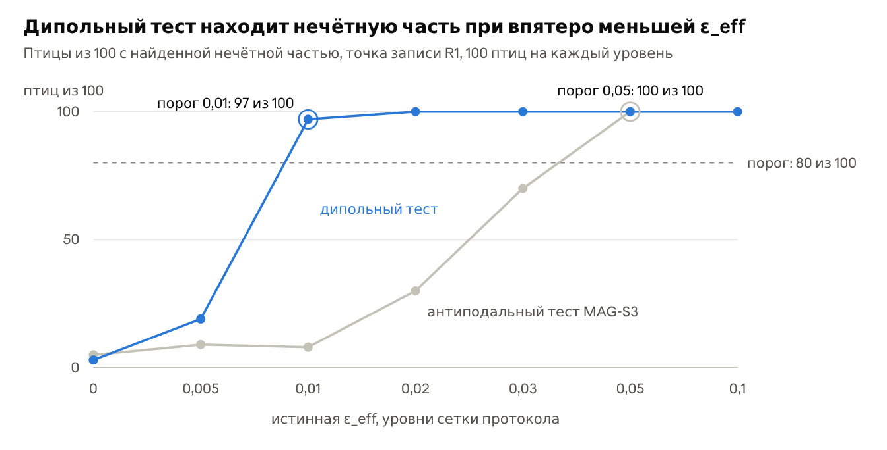

# MAG-S3b: CISS non-reciprocity, cryptochrome order and the blind inverse problem

[](https://doi.org/10.5281/zenodo.24100330)

<p align="center"></p>

A pre-registered simulation study of whether the odd part of a radical-pair compass code, the part that changes sign when the field is reversed, can carry the sign of the geomagnetic field to neurons through chirality-induced spin selectivity (CISS) in cryptochrome 4, and whether a recording experiment could see and measure it.

Author: Julia Ryzhkova (Siriona, siriona.one; ORCID 0009-0005-4194-6059).
Status: part of release v0.2.0 of this repository, 9 November 2026, archived on Zenodo as https://doi.org/10.5281/zenodo.24079875. The protocol (v0.4, in Russian), the code, the requirements and the Colab notebook were frozen at 08:49 UTC, and their SHA-256 were posted in Telegram (https://t.me/attractordm/78). The confirmatory run started at 08:46:33 UTC, three minutes before the freeze; see "Deviations" below. MAG-S3b builds on MAG-S3 (this repository, release v0.1.0, https://doi.org/10.5281/zenodo.24043500) and MAG-S2 (release v0.1.2, https://doi.org/10.5281/zenodo.24030614) and uses their code unchanged. Release v0.2.1 (10 November 2026) adds the notes after release listed in "Notes after release (v0.2.1)": exact consequences of the reciprocity criterion, one of which narrows the reading of the odd part as a trace of CISS, and works found by a source check. The frozen files, the run and the verdicts are those of v0.2.0. Release v0.2.1 is archived on Zenodo as https://doi.org/10.5281/zenodo.24100330.

## The question

MAG-S2 and MAG-S3 rest on the parity of the yield, Φ(n) = Φ(−n), and read any odd part of the neural code as a trace of CISS; since v0.2.1 this reading is limited to a pair that recombines spin-selectively only where it was born (note 2 of "Notes after release"). MAG-S3b asks four things on the MAG-S2 radical pair (flavin anion with N5 and N10, tryptophan cation with N1, anisotropic tensors from RadicalPy 1.0.9, 50 µT, J = D = 0) with the Cry4a rates of the MAG-S3 anchor.

1. **Physics.** Does the odd part measure the non-reciprocity between the birth and the recombination of the pair? Three phenomenological CISS forms are compared: a coherence form K, where CISS rotates the spin of one radical by an angle χ_b at birth and χ_r = χ_b(1 − m) at recombination (or about an axis turned by α), and two polarisation forms, P-same and P-LH. The CISS axis is tilted by β from the receptor axis. The grid has 225 cells (3 forms, 3 angles, mismatch m or axis angle α, 3–4 tilts, 3 rate sets) on 2000 field directions.
2. **Order.** Does the odd part reach the neuron only with polar order of the cryptochromes? The receptor has a polar order p (the share of molecules flipped across the membrane), an axial order S (a von Mises–Fisher spread of the molecular axis) and a free or fixed azimuth. With a free azimuth and p = 0 the odd part vanishes exactly.
3. **Inverse problem.** Does a blind estimate recover the effective odd admixture ε_eff from a MAG-S3 recording with honest 95% intervals? Seven levels of ε_eff from 0 to 0.1, three recording points (R1: the MAG-S3 reference design at modulation depth δ = 100%; R2: the same at δ = 40%; R3: short sessions at δ = 40%), 100 new virtual birds per level and point. The estimate knows the bird's retina and not its ε.
4. **Tests.** Is a dipole test, which reads only the part of the odd response that is linear in the field direction, more sensitive than the antipodal test of MAG-S3 on the same recordings?

## Results of the confirmatory run

The run took 25 minutes on 9 November 2026 in Google Colab (TPU v6e-1 runtime, 44 processes), from 08:46:33 to 09:11:39 UTC, on the 225 cells of the pair grid and 3500 records. All eight invariants held, the calibration gates C1 and C3 were open, and the run is valid. The six hypotheses are tested without a correction for multiplicity, as the protocol states.

| Check | Verdict | Numbers |
|---|---|---|
| H1. The odd part is proportional to the mismatch | not met | form K, Cry4a rates, β = 0: ε_mol departs from m·ε_mol(m = 1) by at most 1.2% at χ_b = 0.02π and 6.0% at 0.05π, and by 22%, 17.8% and 11.2% at χ_b = 0.1π for m = 0.1, 0.25 and 0.5 (threshold 15%) |
| H2. The coherence form is stronger than the polarisation forms | met | at equal triplet share, ε_mol of form K is 3.61·10⁻² and the larger polarisation form gives 1.43·10⁻⁴; ratio 253 (threshold 10) |
| H3. The non-reciprocity is visible in the reference design | not met | ε_eff of form K at χ_b = 0.1π is 0.0021, 0.0053 and 0.0107 for m = 0.1, 0.25 and 0.5, below the antipodal threshold 0.05 |
| H4. The projection of the odd dipole follows cos β | not met | d_odd·z at β = 45°, 80° and 90° departs from the cos β law by 82–126% of its value at β = 0 (threshold 10%); at 90° it keeps 1.18–1.26 of that value |
| H5. The estimate is calibrated | met | coverage 95.3% in R1, 92.5% in R2 and 93.7% in R3 (band 92.5–97.5%); at least 90, 91 and 88 of 100 birds per level (threshold 87); zero excluded in 6, 6 and 4 of 100 birds (threshold 10) |
| H6. The dipole test is more sensitive than the antipodal test | met | detection threshold 0.01 for the dipole test and 0.05 for the antipodal test in R1 |
| Q1. The MAG-S3 anchor is reproduced | met | to 3·10⁻¹⁰ (MAG-S2 rates) and 9·10⁻⁹ (Cry4a rates) |
| Q2. The harmonics are accurate | not met | the even residual at degree 10 stays below 0.11% of its SD at Cry4a rates and exceeds 1% in 13 of 75 cells at the auxiliary MAG-S2 rates (up to 1.87%); the dipole changes by at most 0.027% from degree 10 to 24 |
| Q3. The recording behaves as in MAG-S3 | met | the antipodal test finds the odd part at ε_eff = 0.05 in 100 of 100 birds |
| Q4. The response grows monotonically with the mismatch | met | at every χ_b and rate set |

R2 met H5 exactly at the lower edge of its band: 555 of 600 intervals covered the truth, and the exact Clopper–Pearson interval of that share, 90.1–94.5%, excludes 95%. In the reference design at δ = 40% the interval undercovers by 2–3 points; in R3, at the same δ, the exact interval includes 95%.

**Translation into physics.** A null result in R1 bounds ε_eff by 0.0010 (median over birds), in R2 by 0.0022 and in R3 by 0.0083. H1 and H4 failed, so the protocol translates the bound through the region of admissible combinations of mismatch Δχ, polar order p, tilt β and axial order S, taking ε_eff of every cell directly from the pair calculation. For form K at Cry4a rates with polar order (p = 1), R1 excludes every cell with Δχ ≥ 0.005π at any β and S; with p = 0.5 it excludes Δχ ≥ 0.01π. A single slope, used descriptively, gives Δχ·p·G(β) ≤ 0.014–0.015 rad at S = 1, about 0.8–0.9°. The polarisation forms give ε_eff of at most 1.8·10⁻⁴ for every β, p and S, and no recording point limits them.

**Exploratory maps.** Without the bird's retina the intervals near zero are 6–10 times wider (E3). With a fixed azimuth an apolar stack keeps an odd residual up to 0.43, found by the dipole test in every bird (E4). In the main cells of form K (Cry4a rates, β = 0) the dipole test sees almost all of the receptor's odd power (E5), and the amplitude transfer raises ε_eff by 2.7–2.9 times over the ratio transfer (E6). Axial disorder raises the ratio of the odd to the even part by 1.1–1.8 times (E7). An estimate that assumes S = 1 when the true S is 0.8 or 0.6 overestimates ε by 4% or 9%, and its coverage collapses at ε_eff ≥ 0.02 or ≥ 0.01; at ε_eff = 0 it still covers zero in 98 of 100 birds (E8).

The protocol with all numbers, the reading of each result and the interpretation is protocol/MAG-S3b_protocol_v0.4_with_results_ru.md (in Russian). The table of all 225 cells and the upper bound of every bird at ε_eff = 0 are in results/tables.

## What it means

In the model, a single pair that recombines where it was born, the odd part of the code is a direct trace of CISS non-reciprocity: it vanishes to 1.4·10⁻¹⁴ when the coherence form acts alike at birth and recombination, and it grows monotonically with the mismatch. It reaches the neuron with polar order or with a fixed azimuth, and its size depends most of all on the form of CISS. The direction of the odd dipole is set jointly by the hyperfine tensors and the CISS axis, so turning the axis across the receptor keeps the signal; for this pair, two of the three explanations of a null result named in the protocol remain (reciprocal CISS, an apolar stack with a free azimuth), and non-reciprocal CISS of the polarisation forms joins them. A neural experiment should use the dipole test: at ε_eff = 0.01, the level the coherence form reaches at Δχ of about 0.05π, it finds the odd part in 97 of 100 birds and the antipodal test in 8.

All numbers belong to a three-nucleus radical pair without spin relaxation, which gives an even anisotropy near 21% where models with 15–21 nuclei give 0.1–0.3%. The comparisons (which form is stronger, which test is more sensitive, what order does) are the most robust part of the result.

## Deviations

- **Start of the run.** Cell 5 of the notebook, the confirmatory run, started at 08:46:33 UTC right after the blind pipeline check in cell 4 ended, before the freeze at 08:49 UTC, before the Telegram post (link received at 08:51 UTC) and before the command to start at 08:53:05 UTC. It ran the files that were then frozen and published: the output metadata records the SHA-256 of eight of the sixteen published files, and the notebook checks the other code files against the SHA-256 embedded in it when it starts. Between 08:46 and 08:49 UTC the protocol received only its status line and its paragraph on the checks in Colab; no rule, threshold or grid changed, and no output was read before the run ended (FREEZE.txt). Future notebooks will ask for an explicit confirmation before the confirmatory cell.
- **BLAS threads.** The analysis step ran with 44 BLAS threads, because analyze_s3b.py does not pin the number of threads; every other step ran with one thread, as the protocol requires. A reanalysis with one thread reproduced every verdict and number except 27 values that differ in the last bit (results/checks/reanalysis_of_the_archive.txt).
- **Results section.** An independent check of the results section before release found nine slips in rounding and wording and several statements that needed narrowing; all are corrected, and the list is in results/checks/check_of_the_results_section.txt.

## Literature the protocol missed

Two works published before the registration bear on the reading of H4 and E4 and are not in the protocol's table of existing work.

- Cascone, Cupellini & Mennucci (2026), What computational simulations tell us about cryptochromes in magnetoreception, Biochemistry 65: 3311–3321, https://doi.org/10.1021/acs.biochem.6c00516. Which tryptophan, W_C or W_D, ends the electron-transfer chain remains open, and the answer depends on the starting structure. H4 shows that the hyperfine tensors set the direction of the odd dipole, so G(β) should be recomputed for both geometries. More realistic spin dynamics (fluctuating hyperfine couplings, more nuclei) suppress the orientation dependence at 50 µT, and ordered anchoring of Cry4 through its C-terminal tail is a precondition of a compass.
- Hore (2026), A hybrid compass mechanism combining radical pairs and magnetite crystals, PNAS 123: e2524093123, https://doi.org/10.1073/pnas.2524093123. The hybrid is an inclination compass, so it adds no odd part and does not mix with CISS in the dipole test; its even response differs from the Ren pattern used here.

## Notes after release (v0.2.1)

After release v0.2.0 a source check found works that bear on its reading, and an independent review of the release (Claude Fable 5.2) derived exact consequences of the reciprocity criterion. They were reproduced on code written independently of the review. The frozen protocol, the code, the run and the verdicts stay those of v0.2.0. Note 2 narrows a statement of the series: an odd part is a trace of CISS in a pair that recombines spin-selectively only where it was born. The scripts and logs are in results/checks/notes_after_release/. They use invented toy pairs (two electrons, two or three nuclei, random tensors, toy rates) and print residuals and pass/fail only; none of them uses the geometries or the rates of MAG-S3c, which is in preparation. The original toy checks of the review are in the subfolder independent_review/.

**1. Parity in a chain of sites** (independent review, reproduced here). Time reversal links the yield of a process that starts at one site and ends at another in a field B with the yield of the reverse process in −B, a reciprocity of the Onsager–Casimir type; the criterion of this release applies it to a single pair. The yield is therefore even whenever spin-selective recombination happens only at the birth site, through the birth projector, and that projector is invariant under time reversal, whatever acts in between: CISS at birth and at a hop, exchange, singlet–triplet dephasing, back hops. In a toy two-site chain the odd part of every yield stays below 3·10⁻¹⁵ in all these cases (two_site_parity.log). The condition on the projector matters: born and recombining through the same projector, form K keeps parity to 1.2·10⁻¹⁴, and a polarisation projector, whose singlet–triplet coherence is real, does not (tr_condition.log).

**2. An odd part without CISS** (independent review, reproduced here). If the pair can also recombine spin-selectively at a site other than its birth site, and the two sites differ in spin dynamics, the yield loses parity with no CISS anywhere. In the toy, with singlet birth at a bridge site, singlet recombination at both sites and spin-conserving hops, the odd part of the signalling yield reaches 46% of its spread over field directions at a bridge lifetime of 33 ns, and 32%, 3% and 0.3% at 5 ns, 0.5 ns and 50 ps. It vanishes when the bridge has only Zeeman and exchange terms. A second solver, two Sylvester equations in sequence without a Liouville matrix, agrees with the first to 8·10⁻¹⁵ for the case without back hops. This narrows two statements of the series: the note "Parity follows from the physics" of MAG-S3 v0.1.1 (without CISS the yield of any radical pair is even) and the reading in this release of the odd part as a direct trace of CISS. Both hold for a pair that recombines spin-selectively only where it was born. Which hopping schemes of cryptochrome matter is open. The pairs with W_A and W_B are short-lived and strongly exchange-coupled, which should keep the effect small, and the composite pair W_C ⇌ W_D with recombination from both pairs is the most direct candidate; Luo (2024, appendix D) and Ilott et al. (2025) model this hopping, and Luo does not discuss field inversion. An apolar stack with a free azimuth cancels an odd part of any origin, so the inclination compass survives this case too. A symmetry test that reads an odd part as CISS needs a control for this source: the odd part predicted without CISS for the hopping scheme of the sample.

**3. The model of Denton et al. (2026)** (independent review, reproduced here). In their operators one state, cos θ|S⟩ + i sin θ|T₀⟩, serves birth and both recombination channels, and the bridge carries only the shift δε and exchange, H_CS* = δε|ψ_θ⟩⟨ψ_θ| + 2J_Ex P_S. This state is invariant under time reversal, so the odd part needs exchange in the bridge and recombination from the terminal pair together. In the toy it vanishes at J = 0 and at k_CR2 = 0 for any θ and reaches 37% of the spread with both present (two_site_parity.log); a single pair born and recombining through this state keeps parity to 1.6·10⁻¹⁴ (reciprocal_coherence_zero.log). For their model this predicts that the field-inversion asymmetry of their appendix C vanishes as k_CR2 → 0.

**4. A crystal of point group 222.** The structure 6PU0 used for MAG-S3c crystallises in P2₁2₁2₁: the four molecules of the cell are related by rotations by 180° about the three cell axes. If the four are excited alike, the odd part of the yield of the crystal changes sign under each mirror of the cell. It therefore vanishes for every field in a cell plane, has no dipole part, and its lowest pattern is xyz, largest along the diagonals of the cell. A symmetry test on such a crystal needs fields off the cell planes and illumination that excites the four molecules alike, or a polar sample. On a toy pair the odd part of the crystal stays at 3.5·10⁻¹³ of the molecular odd part for fields in the cell planes (crystal_222.log).

**5. Reconstruction and split of the odd part** (independent review, checked here on a toy pair). For a pair that recombines through P_S, the yield at −n for any birth state ρ₀ follows from the singlet-born solution at n: Φ_R(−n; ρ₀) = k_R Tr[Θρ₀Θ⁻¹ X_S(n)], where X_S(n) is the time integral of the density matrix of a pair born in the singlet. One solution per field direction thus gives every such form and every CISS axis. For form K at m = 1 the odd part splits exactly into a coherence term, linear in the CISS axis, and an alignment term: odd(K) = sin χ cos χ · odd(C) + sin² χ · odd(A), with C = i(P_S σ − σ P_S), A = σ P_S σ and σ = n_CISS·σ_A. The incoherent control keeps only the alignment term, and the isotropic control cos² χ P_S + sin² χ P_T/3 has no odd part. Worst residuals: 2.6·10⁻¹⁴, 1.4·10⁻¹⁴ and 1.1·10⁻¹⁴ of the yield (reconstruction_check.log).

**Works found after release**

- Denton, Pearse, Kattnig & Smith (2026), Microscopic dissection of chirality-induced spin selectivity in cryptochrome, J. Chem. Phys. 165: 125101, https://doi.org/10.1063/5.0348452. CISS is derived for the chain FAD–W_B–W_C at formation and recombination. Spin–orbit coupling gives the state cos θ|S⟩ + i sin θ|T₀⟩, the imaginary singlet–triplet coherence of form K, and exchange in the W_B bridge turns part of it into polarisation. The model has two nuclei (N5, N1), a point dipole and no spin relaxation. The orientation-dependent anisotropy comes out about an order of magnitude below phenomenological polarisation models, with the largest effects at recombination rates of 10²–10³ µs⁻¹. Appendix C splits the yield over the sphere into even and odd parts, treats the inclination compass as a constraint on CISS and proposes oriented samples as a symmetry test. The paper does not give a reciprocity criterion, the order of cryptochromes or a translation of a recording into a bound.
- Cantarella, Phan Huu, Santini, Wasielewski, Chiesa & Carretta (2026), EPR as a probe for the mechanisms of chirality-induced spin selectivity in photoinduced charge transfer, arXiv:2610.10839, https://arxiv.org/abs/2610.10839. Real and imaginary singlet–triplet coherences, the polarisation forms and form K here, can be told apart only in aligned samples or at short times.
- Luo (2024), Sensitivity enhancement of radical-pair magnetoreceptors as a result of spin decoherence, J. Chem. Phys. 160: 074306, https://doi.org/10.1063/5.0182172. Random-field relaxation and singlet–triplet dephasing, the two relaxation models of MAG-S3c, can raise the directional sensitivity of a radical-pair compass; appendix D models hopping between the pairs with the third and fourth tryptophans.
- Ilott, Pearse, Tigg & Kattnig (2025), Electron hopping in cryptochrome: implications for radical pair magnetoreception and the role of the fourth tryptophan, J. Chem. Phys. 163: 024110. For the crystal structure of avian cryptochrome, hopping between W_C and W_D does not raise the sensitivity above that of a static pair with W_C.
- Golesworthy et al. (2023), Singlet–triplet dephasing in radical pairs in avian cryptochromes leads to time-dependent magnetic field effects, J. Chem. Phys. 159: 105102, https://doi.org/10.1063/5.0166675. Singlet–triplet dephasing at 3–6·10⁷ s⁻¹ in modified Cry4a of robin, pigeon and chicken, attributed to electron hopping between the second and third tryptophans.

**Correction.** "What it means" compared the even anisotropy of this pair with models of 14–21 nuclei; after the source check of MAG-S3 v0.1.1 the range is 15–21 nuclei, and the text above now says so.

## Contents

| Path | What it holds |
|---|---|
| FREEZE.txt | the freeze record: times, the Telegram post and the SHA-256 of the 16 frozen files |
| protocol/MAG-S3b_protocol_v0.4_ru.md | the frozen protocol, SHA-256 3970bee3… |
| protocol/MAG-S3b_protocol_v0.4_with_results_ru.md | the same text with the results section added after the run, and since v0.2.1 the notes after release |
| code/ | mag_s3b.py (pair, receptor, records, truth), estimate.py (dipole test and blind estimate), analyze_s3b.py (invariants, verdicts, maps), test_s3b.py (synthetic tests), scripts/ (pipeline, environment check, notebook builder, mutation testing), requirements.txt, and the frozen MAG-S3 v0.1.0 and MAG-S2 v0.1.2 files it imports |
| notebooks/MAG-S3b_colab.ipynb | the notebook of the run, with the code and the reference calibration embedded with their SHA-256 |
| results/calibration/ | calibration C1–C5 in three rounds (round3 is the reference on the final code), with tests, smoke run and mutation testing in round3/checks |
| results/checks/ | the environment check in Colab against the reference calibration, the blind pipeline check on seeds 9401–9402, the reanalysis and the check of the results section; notes_after_release/ holds the scripts and logs of the notes after release (v0.2.1) |
| results/confirmatory_run/ | the log of the run, results.json, estimates.sha256 and confirmatory_s3b_light.tar.gz (pair grid, receptor maps, records manifest, estimates, truth, results and logs) |
| results/tables/ | cells_H1_H4.csv, upper_bounds_per_bird.csv and the script that writes them from the archive |
| figures/test_power.png | the detection curves of both tests in R1 |
| SHA256SUMS.txt | SHA-256 of every file in this folder |

The 3500 spike records of the run (1.6 GB) are left out of the release; the frozen code regenerates them from their seeds with `mag_s3b.py generate`, and the archive is available from the author on request.

## Reproduce

Python 3.13.18 with `pip install -r code/requirements.txt` (NumPy 2.5.3, SciPy 1.18.1, RadicalPy 1.0.9). From code/:

```
python3 -I test_s3b.py --fast                                   # synthetic tests
python3 -I mag_s3b.py calibrate --out CAL --workers N           # calibration C1–C5
python3 -I scripts/env_check.py ../results/calibration/round3 CAL
bash scripts/pipeline.sh confirmatory OUT CAL                   # the full run; 25 minutes on 44 Colab processes
```

The notebook does the same in Google Colab after cells 1–4 pass. To repeat only the analysis, unpack the light archive and run analyze_s3b.py on it as in results/checks/reanalysis_of_the_archive.txt.

## Licence

Code is released under the MIT licence (LICENSE at the root of the repository); text, the protocol and the results are released under CC BY 4.0 (https://creativecommons.org/licenses/by/4.0/).
