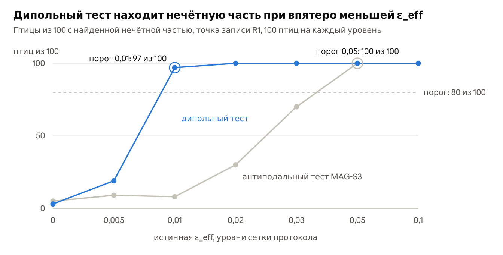

# MAG-S3b. Невзаимность CISS, порядок криптохромов и обратная задача – протокол

Nov 8, 2026 · @Julia Ryzhkova

## Статус

Версия 0.4 от 9 ноября 2026 года, заморожена перед подтверждающим прогоном после калибровки, слепой проверки кода и слепой проверки конвейера. MAG-S3b продолжает MAG-S3 (релиз v0.1.0, DOI 10.5281/zenodo.24043500) и MAG-S2 (релиз v0.1.2, DOI 10.5281/zenodo.24030614) и берёт их код без изменений.

Версия 0.2 включает блок интерпретации о каркасе CRY4 и полярности порядка. В рецептор добавлен осевой порядок S, появились инвариант I8, карты E7 и E8, критерий C5 и раздел «Интерпретация» с запрещённой областью.

Версия 0.3 учитывает внешнюю проверку текста и алгебры. Вывод из найденной нечётной части ослаблен до совместимости при оговорённых условиях, формы CISS сравниваются при равной доле триплета, H4 проверяет саму проекцию диполя, перевод в физику описан и для нелинейного случая, а у каждого уровня ε\_eff теперь свои птицы.

Версия 0.4 вносит итоги калибровки. Критерии C1–C4 выполнены с первого круга, C5 выполнен во втором круге после повышения степени разложения узора Ren с 60 до 200. Синтетические тесты изменили правило интервала оценки, а расчёт ячеек C2 изменил формулировку ожидания Q2; числа и причины собраны в разделе «Калибровка и пилот». Слепая проверка кода нашла ошибку в краевом случае H6, числа гипотез в слепой проверке конвейера и пробелы в тестах, а её расчёт показал, что пороги H5 проваливали бы и идеальную оценку; всё исправлено, а новые пороги H5 выбрал автор.

## Зачем этот опыт

MAG-S3b проверяет, что нечётная часть кода при обращении поля измеряет невзаимность рождения и рекомбинации пары и доходит до нейрона только при полярном порядке криптохромов. От ответа зависит, какую границу на CISS даст нулевой результат антиподального теста и что писать в письме в Ольденбург.

MAG-S2 и MAG-S3 опираются на чётность выхода Φ(n) = Φ(−n) и читали любую нечётную часть как след CISS. Якорь CISS в MAG-S3 был посчитан в форме поляризации и дал ε от 2,8·10⁻⁵ до 1,1·10⁻³, далеко ниже порога антиподального теста 0,05.

Проверка от обратного 8 ноября 2026 года дала два разведочных результата на игрушечной паре с тремя ядрами (N5, N1, H) в поле 50 мкТл.

1. **Взаимность.** Выход пары при поле B равен выходу обращённого процесса при поле −B, где состояние рождения и канал считывания меняются ролями. Поворот спина только при рождении дал ε ≈ 0,15 при χ = 0,1π, тот же поворот при рождении и рекомбинации дал ноль, а при частичном расхождении ε росла линейно, около 0,48 на радиан.
2. **Порядок.** В стопке дисков или ламелл наружного сегмента мембраны обращены к цитоплазме попеременно вверх и вниз. При таком порядке нечётная часть сокращается: полярный порядок дал ε = 0,39, неполярная стопка дала 2·10⁻³ при 12 азимутах и 6·10⁻⁵ при 24.

Эти расчёты сделаны до регистрации и входят в протокол как мотивация. Подтверждающие числа MAG-S3b считаются на паре MAG-S2 со скоростями Cry4a и только после заморозки кода.

## Что уже существует

Нарушение симметрии при обращении поля как подпись CISS уже описано на уровне молекулы. MAG-S3b добавляет к этому критерий взаимности, порядок молекул в рецепторе и слепое восстановление величины по записи.

| Что | Источник | Как использует MAG-S3b |
| --- | --- | --- |
| CISS при образовании и рекомбинации пары и потеря симметрии при обращении поля | [Luo & Hore 2021](https://doi.org/10.1088/1367-2630/abed0b) | форма P-LH; там же отмечено, что такой асимметрии в поведении птиц пока не наблюдали, а полярный ответ уже не исключает радикальную пару |
| Разложение выхода на симметричную и антисимметричную части при обращении поля как подпись CISS | [Gwynn, Adams & Petruccione 2026](https://arxiv.org/abs/2605.22130) | та же мера нечётной части; у них нарушение сильно ослабевает со вторым коллинеарным ядром |
| CISS, который создаёт когерентность синглета и триплета, в модели криптохрома | [arXiv:2505.01519](https://arxiv.org/abs/2505.01519) | опора формы K |
| Вклад CISS в криптохроме по ЭПР с временным разрешением | Kobori et al. 2026, J. Phys. Chem. Lett. ([doi](https://doi.org/10.1021/acs.jpclett.6c02747)) | экспериментальная опора для CISS в белке и движение триптофана как возможный источник невзаимности |
| Якорь CISS, запись и антиподальный тест | MAG-S3 ([DOI 10.5281/zenodo.24043500](https://doi.org/10.5281/zenodo.24043500)) | форма P-same, точки записи R1–R3, порог ε\_ант = 0,05 |
| Пара и сетчатка | MAG-S2 ([DOI 10.5281/zenodo.24030614](https://doi.org/10.5281/zenodo.24030614)); [Ritz, Adem & Schulten 2000](https://pmc.ncbi.nlm.nih.gov/articles/PMC1300674) | пара с тремя ядрами и оси молекул вдоль осей фоторецепторов |
| Упорядоченное связывание ErCry4a с мембраной наружного сегмента | [Majewska et al. 2025](https://pmc.ncbi.nlm.nih.gov/articles/PMC11934094) | C-концевой хвост, порядок α-спиралей S ≈ 0,51–0,60 и подвижность у поверхности; диапазон скана S |
| Связывание ErCry4a с G-белком колбочек и с бислоем | Görtemaker et al. 2022 ([doi](https://doi.org/10.3390/cells11132043)); Güzelsoy-Flügge et al. 2026 ([doi](https://doi.org/10.1111/febs.70425)) | мембранный вариант закрепления и аполярный порядок в стопке складок |
| CRY4 в наружных сегментах двойных и длинноволновых одиночных колбочек зарянки | Günther et al. 2018 ([запись](https://read.qxmd.com/read/29307554/double-cone-localization-and-seasonal-expression-pattern-suggest-a-role-in-magnetoreception-for-european-robin-cryptochrome-4)) | место, где задаются p и S |
| Кандидаты-посредники с микротрубочками | [Hochstoeger et al. 2020](https://pure.mpg.de/pubman/item/item_3251567_4/component/file_3251573/abb9110.pdf) | MAP1B и KIF2C среди примерно 90 предполагаемых партнёров голубиного CRY4, без отдельной проверки; полярный каркас остаётся гипотезой |
| Осевой компас зарянки | Wiltschko & Wiltschko 1972 ([doi](https://doi.org/10.1126/science.176.4030.62)) | запрещённая область в разделе «Интерпретация» |
| Поляризованный свет и компас | [Muheim et al. 2016](https://pmc.ncbi.nlm.nih.gov/articles/PMC4760820) | фотоселекция в разделе «Интерпретация» |
| Кинетика пары FAD–TrpD в Cry4a | Xu et al. 2021 ([doi](https://doi.org/10.1038/s41586-021-03618-9)); Wong et al. 2021 ([doi](https://doi.org/10.1098/rsif.2021.0601)) | скорости k\_R = 3,4·10⁵ с⁻¹ и k\_F = 5–10·10⁶ с⁻¹ |
| Спиновая динамика | RadicalPy 1.0.9, Antill & Vatai 2024 ([doi](https://doi.org/10.1021/acs.jctc.4c00887)) | решатель Хаберкорна для пары |
| Восстановление параметров и проверка покрытия | Wilson & Collins 2019; Talts et al. 2018 | схема слепого восстановления и критерии H5 |

В найденных работах симметрия обсуждается для отдельной молекулы. Критерий взаимности, гашение нечётной части в неполярной стопке мембран и перевод записи в границу на произведение Δχ·p·cos β выглядят новыми, и перед публикацией это проверит более широкий поиск.

## Физика пары

Нечётная часть выхода появляется, когда схема реакции теряет взаимность при обращении времени. MAG-S3b считает её на паре MAG-S2 в двух формах CISS с отдельными параметрами рождения и рекомбинации.

**Пара и кинетика.** Пара берётся из MAG-S2: анион флавина с ядрами N5 и N10 и катион триптофана с ядром N1, анизотропные тензоры из RadicalPy 1.0.9, поле 50 мкТл, J = D = 0. Кинетика та же, что в якоре MAG-S3: рекомбинация через проектор P\_rec со скоростью k\_R и уход в сигнальное состояние со скоростью k\_F из всех спиновых состояний. Выход рецептора равен выходу сигнального состояния, Φ = 1 − Φ\_R, поэтому нечётные части Φ и Φ\_R равны по модулю.

```latex
\frac{d\rho}{dt} = -i\,[H(\mathbf B),\rho] - \frac{k_R}{2}\{P_{rec},\rho\} - k_F\,\rho, \qquad \Phi_R = k_R\int_0^{\infty}\mathrm{Tr}\,[P_{rec}\,\rho(t)]\,dt
```

**Две формы CISS.** Форма K описывает поворот спина переносимого электрона вокруг оси переноса. Форма P описывает поляризацию, как у Luo & Hore, и входит в двух вариантах канала рекомбинации.

| Форма | Состояние рождения | Канал рекомбинации |
| --- | --- | --- |
| K, когерентность | U\_b P\_S U\_b†, U\_b = exp(−iχ\_b n\_b·σ\_A) | U\_r P\_S U\_r†, U\_r = exp(−iχ\_r n\_r·σ\_A) |
| P-same, как в MAG-S3 | cos(χ/2)\|S⟩ + sin(χ/2)\|T₀⟩ | то же состояние |
| P-LH, как у Luo & Hore | cos(χ/2)\|S⟩ + sin(χ/2)\|T₀⟩ | cos(χ/2)\|S⟩ − sin(χ/2)\|T₀⟩ |

В форме P состояние T₀ квантуется вдоль оси CISS n\_b. Угол β задаёт наклон n\_b к оси z молекулы, которая в сетчатке MAG-S2 лежит вдоль оси фоторецептора.

Здесь σ\_A – матрицы Паули электрона A, σ = 2S. Доля триплета в состоянии рождения равна q = sin²χ\_b в форме K и q = sin²(χ/2) в форме P, поэтому при равном угле форма K меняет состояние сильнее. Формы сравниваются при равной q: форме P с углом χ соответствует форма K с χ\_b = χ/2.

**Критерий взаимности.** Обращение времени Θ связывает выход процесса с выходом обращённого процесса в противоположном поле. Здесь Φ\[ρ₀ → O; K\] – интеграл Tr\[O ρ(t)\] для пары, рождённой в ρ₀, при операторе реакции K.

```latex
\Phi_{\mathbf B}\left[\rho_0 \to O;\,K\right] = \Phi_{-\mathbf B}\left[\Theta O\Theta^{-1} \to \Theta\rho_0\Theta^{-1};\,\Theta K\Theta^{-1}\right]
```

Выход чётен по полю, когда обращённый канал считывания совпадает с состоянием рождения, а оператор реакции сохраняется при обращении. Поворот спина U сохраняется при обращении времени, поэтому форма K с χ\_r = χ\_b и n\_r = n\_b даёт точно чётный выход при любом χ. Пилот на паре MAG-S2 со скоростями Cry4a подтвердил это до 5·10⁻¹⁵.

**Что считается невзаимностью.** В форме K невзаимность задают расхождение углов Δχ = χ\_b − χ\_r при общей оси и угол α между осями n\_b и n\_r; доля расхождения m = Δχ/χ\_b. В форме P-LH канал считывания взаимен, а оператор реакции переходит в оператор с состоянием рождения, поэтому нечётная часть идёт только от кинетики и исчезает, когда оба канала распадаются с одной скоростью. В форме P-same экспоненциальная модель даёт нулевую нечётную часть (MAG-S3 и пилот), и этот числовой факт входит в инварианты.

**Величины молекулы.** Выход считается на замкнутой сетке из 2000 направлений, как в MAG-S3. ε\_mol – половина размаха нечётной части, делённая на размах чётной. Разложение по сферическим гармоникам до степени 10, как в MAG-S2, даёт нечётный диполь молекулы d\_odd (гармоники степени 1) и долю нечётной мощности в степенях 3 и выше.

## Рецептор

Нечётная часть молекулы доходит до нейрона, умноженная на полярный порядок p, а осевой беспорядок гасит гармоники узора тем сильнее, чем выше их степень. Поэтому рецептор описывают два параметра порядка.

**Геометрия.** В MAG-S2 ось z молекулы лежит вдоль оси фоторецептора, а ось x – вдоль местного меридиана с разбросом 10° (Ritz, Adem & Schulten 2000). MAG-S3b добавляет к этой сетчатке три свойства.

- **Полярный порядок p.** Доля (1 + p)/2 молекул ориентирована как в MAG-S2, а доля (1 − p)/2 перевёрнута на 180° вокруг оси в плоскости мембраны, как белок на противоположной стороне складки. p = 1 соответствует полярному порядку, p = 0 – стопке, где мембраны обращены к цитоплазме попеременно вверх и вниз.
- **Осевой порядок S.** Ось z молекулы отклоняется от оси рецептора на угол ϑ по распределению фон Мизеса – Фишера с концентрацией κ, и S = ⟨P₂(cos ϑ)⟩. Уровни S = 1; 0,8; 0,6 и 0,4 соответствуют κ = ∞; 13,9; 6,3 и 3,6, а моменты ⟨P₁⟩ при них равны 1; 0,93; 0,84 и 0,73.
- **Азимут.** В режиме «свободный» азимут молекулы вокруг оси рецептора равномерен, как у белка, который вращается в плоскости мембраны. В режиме «закреплённый» он задан меридианом, как в MAG-S2, и переворот идёт вокруг оси x.

**Свободный азимут.** Усреднение по азимуту оставляет только гармоники с m = 0 относительно оси рецептора. Распределение оси умножает степень l на момент ⟨P\_l⟩\_κ = I\_{l+1/2}(κ) / I\_{1/2}(κ), а переворот умножает нечётные степени на p.

```latex
f(\theta) = \sum_{l} c_{l0}\,\langle P_l\rangle_{\kappa}\,\pi_l\,Y_{l0}(\theta), \qquad \pi_l = 1\ \text{при чётной } l, \qquad \pi_l = p\ \text{при нечётной } l
```

При p = 0 нечётная часть рецептора равна нулю точно при любом S. Из нечётного диполя молекулы выживает только проекция на ось рецептора, d\_odd·z, и гипотеза H4 проверяет, следует ли эта проекция за cos β.

**Закреплённый азимут.** Переворот вокруг оси x гасит только те нечётные компоненты, которые меняют знак при этом повороте. Остаток при p = 0 считает разведочная ветка E4 через полный трёхмерный узор и сетчатку MAG-S2.

**Перенос в нейронную модель MAG-S3.** Основная ветка берёт из MAG-S3 чётный узор Ren et al. и нечётную примесь ε·b·cos θ. При S < 1 узор Ren раскладывается по полиномам Лежандра до степени 200, каждая степень умножается на ⟨P\_l⟩\_κ, а примесь – на p·⟨P₁⟩\_κ. Узкий провал Ren несёт высокие чётные степени, поэтому беспорядок уменьшает его глубину сильнее, чем в ⟨P₂⟩ раз.

Эффективная примесь равна ε\_eff = p·g(S)·r·ε\_rec. Здесь ε\_rec – отношение коэффициента при cos θ к размаху чётной части рецептора при S = 1, а g(S) = ⟨P₁⟩\_κ / D(S), где D(S) – доля глубины провала, которая остаётся при порядке S. Нейронное усиление умножает чётную и нечётную части одинаково и в ε сокращается; карта E7 даёт D(S) и g(S). Множитель r = 1 − exp(−π²/(8c²)) = 0,9975 равен размаху чётной части узора Ren в единицах b, поэтому отношение нечётной части к чётной переносится в модель Ren точно.

Вариант с переносом абсолютной амплитуды делит амплитуду при cos θ на глубину провала Ren b = 1,27·10⁻³. Он идёт разведочной развёрткой E6, потому что пара с тремя ядрами даёт чётную анизотропию около 21%, а реалистичные пары – 0,1–0,3%.

**Биологическое прочтение порядка.** ErCry4a садится на модельную мембрану наружного сегмента C-концевым хвостом; порядок его α-спиралей равен 0,51 ± 0,12 по опыту и 0,60 ± 0,05 по молекулярной динамике, а у поверхности белок может вращаться и покачиваться (Majewska et al. 2025). Эти числа относятся к спиралям, поэтому для оси пары S остаётся свободным параметром до пересчёта через структуру. Если CRY4 одинаково садится на обе стороны складок, порядок аполярен и p ≈ 0. Полярный порядок требует полярного каркаса, например микротрубочек аксонемы при подходящей позе связывания, или несимметричного связывания со сторонами складки.

**Следствие для обратной задачи.** При выполненных H1 и H4 ε\_eff = s·Δχ·p·cos β·g(S), где наклон s даёт расчёт пары. Невзаимность, порядок и наклон оси входят в запись одним произведением, поэтому запись определяет только его, а нулевой результат даёт его верхнюю границу. Общий случай разобран в разделе «Анализ и правила решений».

## Обратная задача

Обратная задача проверяет, восстанавливает ли запись MAG-S3 величину ε\_eff вслепую и с честными интервалами. Заодно она сравнивает чувствительность дипольного теста и антиподального теста MAG-S3 на одних и тех же птицах.

&#91;embedded content: цепочка MAG-S3b · пять звеньев и граница слепоты\]

Каждое звено умножает нечётную часть на свой множитель, а граница слепоты отделяет запись от оценки.

**Порождение.** Виртуальная птица получает истинную ε\_eff из сетки {0; 0,005; 0,01; 0,02; 0,03; 0,05; 0,1} и проходит замороженную запись MAG-S3 без изменений: сетчатку, нейроны, расписание, дрейф, общий шум и счёт разрядов. Эта сетка задана заранее и от расчёта пары не зависит.

| Точка записи | Дизайн | δ | Настроенные клетки |
| --- | --- | --- | --- |
| R1 | опорный MAG-S3: K = 800, R = 4, T = 2 с, одновременная запись, σ\_g = 0,1 | 100% | 200 |
| R2 | тот же дизайн | 40% | 200 |
| R3 | короткие сессии MAG-S3: K = 100, R = 8 | 40% | 50 |

**Дипольный тест.** Нечётная часть отклика клетки на пару n и −n регрессируется на сам вектор n, и тест читает только эту дипольную часть. Её энергия считается перекрёстно по двум половинам повторов с весами MAG-S3, а p-значение даёт тот же перестановочный тест с заменой n и −n. Сложенная по пятну примесь ε·b·cos θ линейна по n, поэтому диполь несёт всю нечётную часть модели, а шум делится на 3 степени свободы вместо K/2.

Полярный вход тоже линеен по n, поэтому дипольный тест, как и антиподальный, отвечает на вопрос о чётности кода. Источник нечётной части различают контроли второй ступени MAG-S3: свет, радиошум 75–85 МГц и подавление Cry4.

**Оценка величины.** Оценка знает сетчатку и пятна нейронов птицы и не знает ε, базовых частот и глубин модуляции. Ожидаемый счёт клетки i равен c\_i + γ\_i·s\_i(n), где s\_i – знаковая сумма сигналов рецепторов её пятна, а γ\_i = r0\_i·δ\_i·T/R\_i содержит неизвестный размах R\_i, по которому MAG-S3 нормирует модуляцию. Чётная часть s\_i задана узором Ren, а нечётная равна ε·D(S)·V\_i·n, где V\_i – сумма осей рецепторов пятна с весами и знаком клетки. Наклон γ̂\_i даёт регрессия чётной части счёта на чётную часть s\_i со свободным членом, и этот наклон уже включает R\_i, поэтому оценку не нужно повторять. ε̂ даёт взвешенный метод наименьших квадратов для нечётной части D\_ip = ε·γ\_i·t\_ip, где t\_ip = D(S)·V\_i·n\_p.

```latex
\hat\varepsilon = \frac{\sum_i w_i\,\hat\gamma_i \sum_p t_{ip} D_{ip}}{\sum_i w_i\,\hat\gamma_i^{2} \sum_p t_{ip}^{2}}
```

Веса w\_i те же, что в MAG-S3. Стандартную ошибку SE даёт бутстреп из 1000 выборок по парам направлений, и в каждой выборке γ̂ подгоняется заново. 95% интервал равен ε̂ ± t\_{P−1}(0,975)·√(P/(P−1))·SE, как в кластерно-робастной оценке с P кластерами (Cameron & Miller 2015). Отрицательная оценка и отрицательные концы интервала записываются как 0, и в отчёт идёт верхняя граница. Клетки не перевыбираются, потому что ε описывает птицу, а оценка идёт при её записанных клетках.

**Слепота.** Генератор, оценка и анализ идут отдельными шагами. Генератор пишет записи и отдельно файл истины, оценка запускается в каталоге без файла истины, а её выход хэшируется до того, как анализ откроет истину. Код всех трёх шагов замораживается до прогона.

**Перевод в физику.** Интервал для ε\_eff делится на наклон s из расчёта пары и даёт интервал для произведения Δχ·p·cos β, отдельно для каждой формы, уровня χ\_b и набора скоростей. Разведочный вариант E3 обходится без сетчатки птицы и показывает цену такого незнания. Он делит перекрёстную энергию диполя на её ожидание на единицу ε², а ожидание строится из чётной модуляции каждой клетки, очищенной от шума счёта по повторам, и из среднего κ² = |V|²/Var(s\_even) по клеткам 100 калибровочных птиц 7001–7100; интервал для ε² даёт тот же бутстреп по парам с правилом t. Ветка E8 так же проверяет оценку, когда истинный осевой порядок S меньше 1, а оценка считает его равным 1.

## Инварианты, ожидания и гипотезы

Проверки идут на трёх уровнях, как в MAG-S3. Нарушение любого инварианта делает прогон недействительным, ожидания проверяют конвейер, а шесть гипотез отвечают на вопрос протокола.

### Инварианты

| Проверка | Что утверждает | Критерий |
| --- | --- | --- |
| I1 | Замороженные файлы те же, что в релизах | SHA-256 файлов mag\_s3.py, analyze.py, mag\_s2.py и physics.json совпадают с релизом MAG-S3 v0.1.0 (DOI 10.5281/zenodo.24043500) |
| I2 | Без CISS выход чётен | при χ = 0 во всех формах и наборах скоростей наибольшая нечётная часть выхода меньше 10⁻¹² |
| I3 | Взаимная форма K чётна | при χ\_r = χ\_b и n\_r = n\_b наибольшая нечётная часть меньше 10⁻¹² при всех χ\_b, β и скоростях |
| I4 | Экспоненциальная модель формы P-same чётна | при равных скоростях каналов наибольшая нечётная часть меньше 10⁻¹², как в MAG-S3 |
| I5 | Неполярная стопка гасит нечётную часть | при свободном азимуте и p = 0 нечётная часть f(θ) меньше 10⁻¹², а при p = 0,5 она равна половине значения при p = 1 до 10⁻¹² |
| I6 | Решатель верен | решатель Хаберкорна совпадает с шагами по времени до 10⁻⁶ в одной ячейке каждой формы |
| I7 | Оценка слепа | каталог оценки не содержит файла истины, а хэш выхода оценки записан до первого чтения истины |
| I8 | Порядок без CISS невидим | при ε\_eff = 0 нейронные ответы при p = 1 и p = 0 с одним и тем же S совпадают до 10⁻¹² |

### Ожидания

| Проверка | Что ожидается | Критерий |
| --- | --- | --- |
| Q1 | Якорь MAG-S3 воспроизводится | ε\_mol формы P-same совпадают с E5 MAG-S3 до 10⁻⁶ относительно: 1,12·10⁻³ при χ = 0,1π и скоростях MAG-S2, 1,43·10⁻⁴ при скоростях Cry4a |
| Q2 | Гармоники точны | чётная часть раскладывается до степени 10 с невязкой не больше 1% её стандартного отклонения, а нечётный диполь d\_odd меняется меньше чем на 1% при переходе от степени 10 к степени 24; невязки нечётной части при обеих степенях идут в отчёт |
| Q3 | Запись ведёт себя как в MAG-S3 | в R1 при ε\_eff = 0,05 антиподальный тест находит нечётную часть не меньше чем у 80 птиц из 100 |
| Q4 | Отклик растёт с невзаимностью монотонно | в форме K функция F, то есть ε\_eff при p = 1, β = 0 и S = 1, растёт с m на всех уровнях χ\_b и наборах скоростей |

### Гипотезы

H1–H4 касаются детерминированных расчётов пары и рецептора и проверяются один раз. H5 и H6 проверяются на 100 новых виртуальных птицах в каждой ячейке. Каждый уровень ε\_eff получает свои зёрна, от 5001–5100 при ε\_eff = 0 до 5601–5700 при ε\_eff = 0,1, а три точки записи и ветка E8 берут одних и тех же птиц.

**H1. Нечётная часть пропорциональна невзаимности.** В форме K при β = 0 и скоростях Cry4a для каждого χ\_b значения ε\_mol при m = 0,1; 0,25 и 0,5 отличаются от m·ε\_mol(m = 1) не больше чем на 15%. Тогда граница на ε переводится в границу на Δχ одним наклоном s.

**H2. Форма когерентности сильнее формы поляризации.** Формы сравниваются при равной доле триплета q = sin²(0,05π) ≈ 0,025, β = 0 и скоростях Cry4a. ε\_mol формы K при χ\_b = 0,05π и m = 1 хотя бы в 10 раз больше наибольшей из ε\_mol форм P-same и P-LH при χ = 0,1π. На игрушечной паре пилота это отношение было 12–15, а сравнение при равном χ идёт в отчёт описательно.

**H3. Невзаимность видна в опорном дизайне.** При p = 1, свободном азимуте, β = 0 и скоростях Cry4a ε\_eff формы K достигает порога антиподального теста MAG-S3 ε\_ант = 0,05 при χ\_b = 0,1π и m ≤ 0,5, то есть при Δχ ≤ 0,05π.

**H4. Проекция нечётного диполя следует за cos β.** В форме K при m = 1 и скоростях Cry4a для каждого χ\_b проекция нечётного диполя молекулы на ось рецептора d\_odd·z при β = 45°, 80° и 90° отличается от d\_odd·z(β = 0)·cos β не больше чем на 10% от |d\_odd·z(β = 0)|. Тогда нечётная часть рецептора следует за cos β и в окрестности 90°.

**H5. Оценка калибрована.** Шесть ненулевых уровней дают 600 независимых птиц, потому что у каждого уровня свои зёрна. В каждой точке записи R1–R3 95% интервалы ε̂ накрывают истинную ε\_eff у 92,5–97,5% этих птиц и не меньше чем у 87 птиц из 100 на каждом уровне. При ε\_eff = 0 интервал до обрезки нулём исключает ноль, то есть лежит целиком выше или целиком ниже нуля, не больше чем у 10 птиц из 100. Пороги взяты из биномиальных допусков: оценка с точным 95% покрытием проходит H5 целиком с вероятностью 0,95, а оценка с покрытием 92% или 98% проходит её с вероятностью не больше 0,003.

**H6. Дипольный тест чувствительнее антиподального.** В R1 порог обнаружения дипольного теста не больше половины порога антиподального теста на тех же птицах. Порог теста – наименьшая ε\_eff сетки, при которой он находит нечётную часть хотя бы у 80 птиц из 100. Если антиподальный тест на сетке до 80 птиц не доходит, его порог лежит выше 0,1, и гипотеза выполнена при пороге дипольного теста не выше 0,05, а при большем непроверяема. Когда до 80 птиц не доходит только дипольный тест, гипотеза не выполнена, а когда не доходит ни один, она непроверяема.

H6 проверяется только при выполненной калибровке C1, а H5 – при выполненной C3. Остальные гипотезы закрываются только своими инвариантами.

### Разведочные карты

- **E1, карта пары.** ε\_mol, ε\_rec, направление d\_odd и доли нечётной мощности по степеням для всех ячеек.
- **E2, граница нулевого опыта.** Верхняя 95% граница ε̂ при ε\_eff = 0 в R1–R3 и соответствующая граница на Δχ·p·cos β для каждой формы, набора скоростей и уровня S. Карта читается вместе с запрещённой областью из раздела «Интерпретация».
- **E3, оценка без знания сетчатки.** Покрытие и ширина интервалов, когда оценка берёт средние по калибровочным птицам.
- **E4, закреплённый азимут.** Остаток нечётной части при p = 0 в трёхмерном узоре MAG-S2 и его обнаружение дипольным тестом. Переворот вокруг оси x оставляет от нечётного диполя молекулы только компоненту d\_x вдоль местного меридиана. Карта даёт остаток нечётной части смеси двух сторон складки по разложению до степени 24, его перенос ε\_x = r·d\_x/(размах чётной части рецептора) и число птиц из 100 с ε\_eff = 0 в точке R1, у которых дипольный тест находит этот остаток; рядом стоит порог дипольного теста из H6.
- **E5, высокие нечётные гармоники.** Доля нечётной мощности молекулы и рецептора в степенях 3 и выше при разложении до степеней 10 и 24, невязка нечётной части при обеих степенях и цена высоких гармоник для дипольного теста.
- **E6, перенос амплитуды.** Те же карты при переносе абсолютной амплитуды вместо отношения.
- **E7, осевой порядок.** D(S) и g(S) для узора Ren при S = 1; 0,8; 0,6 и 0,4 и те же величины для узора пары MAG-S2.
- **E8, оценка при неверном S.** Записи R1 при S = 0,8 и 0,6 и семи уровнях ε\_eff на тех же зёрнах 5001–5700; смещение и покрытие ε̂, когда оценка считает S = 1 и когда знает истинное S.

## Дизайн

Расчёт пары занимает 225 ячеек на полной сетке направлений и 27 проверок взаимности, обратная задача – 2100 записей для гипотез и 1400 записей ветки E8. Весь прогон стоит около 7 процессорных часов.

**Расчёт пары.**

| Фактор | Уровни |
| --- | --- |
| Форма | K; P-same; P-LH |
| χ\_b, для формы P – χ | 0,02π; 0,05π; 0,1π, как в MAG-S3 |
| Доля расхождения m, форма K | 0,1; 0,25; 0,5; 1. При m = 0 идёт проверка I3 на 40 направлениях |
| Угол между осями α, форма K при m = 0 | 30° и 90° |
| Наклон оси CISS β | 0°, 45° и 90° в плоскости xz молекулы; для формы K при m = 1 ещё 80° |
| Скорости k\_F и k\_R, с⁻¹ | основные, Cry4a: 5·10⁶ и 3,4·10⁵; ещё 10⁷ и 3,4·10⁵ и масштаб MAG-S2 10⁶ и 10⁶ |
| Сетка направлений | 2000, замкнутая по антиподам, как в MAG-S3 |

Форма K даёт 3 уровня χ\_b × 6 сочетаний m и α × 3 наклона × 3 набора скоростей, то есть 162 ячейки, и ещё 9 ячеек с наклоном 80° при m = 1. Формы P-same и P-LH дают по 27 ячеек.

**Рецептор.** Свободный азимут считается для всех ячеек при p = 1; 0,5 и 0 и S = 1; 0,8; 0,6 и 0,4 по гармоникам, без новых решений уравнения. Закреплённый азимут ветки E4 считается для формы K при m = 1, χ\_b = 0,1π, трёх наклонах и скоростях Cry4a.

**Обратная задача.** Семь уровней ε\_eff × три точки записи × 100 птиц дают 2100 записей. Зёрна разведены по задачам.

| Зёрна | Назначение |
| --- | --- |
| 1001–1010 | калибровка, только нейтральные критерии |
| 6001–7000 | калибровка C1 ложных находок дипольного теста |
| 7001–7100 | средняя геометрия для ветки E3 |
| 9401–9402 | слепая проверка конвейера, выход удаляется непросмотренным |
| 5001–5700 | гипотезы H5 и H6 и карты E2, E3 и E8; у каждого уровня ε\_eff свои 100 птиц |

**Бюджет.** Пилот дал 30 мс на одно решение уравнения Хаберкорна в пространстве размерности 108, поэтому расчёт пары стоит около 3,8 процессорного часа. Запись одной птицы занимает 0,2 с в R1 и 0,1 с в R3, а оба теста и оценка с бутстрепом занимают 0,17 с в R1 и 0,05 с в R3; на обратную задачу и ветку E8 заложено 3 часа. На двух ядрах рабочей машины прогон займёт около 4 часов, в Colab на 44 ядрах, как MAG-S3, – около 15 минут.

## Анализ и правила решений

Вердикты считает замороженный код без ручного вмешательства. Единица анализа для H1–H4 – ячейка расчёта пары, для H5 и H6 – виртуальная птица.

- **Порядок.** Расчёт пары, затем рецептор, затем порождение записей, слепая оценка и только потом анализ, который открывает файл истины после проверки I7.
- **Вердикты.** Инварианты получают «в порядке» или «ошибка», ожидания и гипотезы – «критерий выполнен», «критерий не выполнен» или «гипотеза непроверяема» с причиной. Прогон действителен, когда все восемь инвариантов в порядке, и каждый вердикт идёт в отчёт вместе с числами, из которых он следует.
- **H1–H4.** Это детерминированные числа, и вердикт следует из них прямо. Отчёт даёт таблицу всех ячеек сетки.
- **H5.** Покрытие считается по птицам с точным 95% интервалом Клоппера–Пирсона; интервал приводится в отчёте, а вердикт выносится по точечной доле.
- **H6.** Оба теста идут на одних и тех же записях. Нечётная часть найдена, когда перестановочный p не больше 0,05 при 1000 перестановках, как в MAG-S3. Антиподальный тест берётся из замороженного mag\_s3.py без изменений.
- **Перевод в физику.** Запись ограничивает величину Q = p·G(β)·g(S)·F(Δχ). Здесь F(Δχ) – ε\_eff при p = 1, β = 0 и S = 1 как функция расхождения для данной формы, уровня χ\_b и скоростей, а G(β) – отношение d\_odd·z при наклоне β к его значению при β = 0, при выполненной H4 близкое к cos β. При выполненной H1 F = s·Δχ с наклоном s = F(χ\_b)/χ\_b в радианах, и верхняя граница ε̂ становится границей на произведение Δχ·p·cos β·g(S) для каждого из четырёх уровней S. Если H1 не выполнена, отчёт даёт область допустимых сочетаний Δχ, p, β и S, а Q4 проверяет монотонность F. Граница на одно Δχ требует независимо известных S, p и β и существует только при p·G(β) ≠ 0; при p = 0 или G(β) = 0 запись оставляет Δχ свободным.
- **Верхняя граница.** Верхняя граница ε\_eff равна ε̂ + t\_{P−1}(0,95)·√(P/(P−1))·SE. Здесь ε̂ берётся до обрезки нулём, а граница обрезается после, поэтому она сохраняет одностороннее 95% покрытие. Отчёт даёт её для каждой птицы при ε\_eff = 0 и медиану по птицам в каждой точке записи.
- **Множественность.** Шесть гипотез проверяются без поправки, и отчёт это указывает.
- **После прогона.** Код, пороги и сетки не меняются, а всё посчитанное позже помечается как разведочное.

## Интерпретация

Нечётная часть в нейронном коде требует сразу невзаимного CISS и полярного порядка. Поведение зарянок запрещает область, где к ним добавляется передача знака поля в поведение.

**Запрещённая область.** Компас зарянки определяет направление по наклону силовых линий и безразличен к их полярности (Wiltschko & Wiltschko 1972). Нарушения симметрии при обращении поля, которое предсказывает CISS, в поведенческих опытах пока не наблюдали (Luo & Hore 2021). Поэтому запрещено сочетание трёх условий: заметной невзаимности CISS, полярного порядка с заметной проекцией оси CISS на ось рецептора и передачи знака поля в поведение.

Птице достаточно нарушить любое одно из трёх условий. Граница области размыта, потому что порог, с которого птица заметила бы асимметрию, неизвестен, а MAG-S3b заканчивается на нейронном коде; карта E2 читается с этим ограничением качественно.

**Смысл исходов нейронного опыта.** Нечётная часть в нейронах, зависящих от Cry4, при осевом поведении птицы говорит, что знак поля в мозге есть и отбрасывается дальше по цепочке. С невзаимным CISS и полярной организацией молекул она совместима при оговорённых условиях: свободном азимуте, исключённых полярных входах и артефактах и зависимости от света, радиошума и Cry4. Сама зависимость от Cry4 оставляет конкретный спиновый механизм открытым, а при закреплённом азимуте нечётный остаток возможен и при p = 0 (ветка E4). Нулевой результат даёт верхнюю границу произведения Δχ·p·cos β·g(S) и совместим с взаимным CISS, аполярным порядком и осью CISS поперёк оси рецептора; выбрать между ними помогают опыты над порядком.

**Топология.** Сфера S² вместо RP² требует двух условий сразу: механизма, нечётного по полю, и полярного порядка. Связка «складки дают RP², аксонема даёт S²» без первого условия остаётся необоснованной.

**Фотоселекция.** Свет отбирает молекулы через диполь перехода FAD, и этот отбор осевой по природе. Он добавляет осевую направленность и оставляет p прежним, поэтому при аполярном порядке нечётная часть остаётся погашенной. Опыт Muheim et al. (2016) с поляризованным светом согласуется с ролью фотоселекции качественно.

**Опыты, которые измеряют порядок.**

- Поляризационная микроспектрофотометрия флавина в одиночных наружных сегментах даёт осевой порядок диполя FAD, а полярность в ней сокращается.
- Криоэлектронная томография с усреднением субтомограмм определяет ориентацию и полярность отдельных молекул, хотя для белка размером с CRY4 это трудная задача.
- Экспансионная или иммуноэлектронная микроскопия с метками CRY4, ацетилированного тубулина и мембран складок показывает, ближе CRY4 к складкам или к аксонеме.
- Совместная седиментация ErCry4a с микротрубочками проверяет прямое связывание с каркасом. Кандидаты-посредники MAP1B и KIF2C найдены в интерактоме голубя, где CRY4 обогащён в синапсах наружного плексиформного слоя (Hochstoeger et al. 2020), поэтому их перенос на зарянку требует проверки.

Эти опыты дают S, p и ориентацию оси независимо от нейронного опыта. При p·cos β ≠ 0 они превращают границу на произведение в границу на Δχ.

**Вопросы экспериментаторам.**

- Группе Моуритсена: как CRY4 распределён в наружном сегменте двойной колбочки относительно аксонемы и складок, и проверяли ли связывание CRY4 зарянки с микротрубочками.
- Авторам Majewska et al. (2025): можно ли по траекториям молекулярной динамики получить распределение ориентации кольца FAD и концевого триптофана относительно нормали к мембране. Оно переводит S спиралей в S оси пары.

## Калибровка и пилот

Пилот 8 ноября 2026 года считал только время и точные нули, а калибровка проверяет исправность частей до заморозки. Пилот и калибровка считают только величины, на которые гипотезы не опираются.

**Пилот.** На паре MAG-S2 со скоростями Cry4a пространство имеет размерность 108, и одно решение уравнения Хаберкорна занимает 30 мс. Наибольшая нечётная часть равна 6·10⁻¹⁵ при χ = 0, 4·10⁻¹⁵ и 5·10⁻¹⁵ у взаимной формы K при χ = 0,1π с осью вдоль z и с наклонной осью и 3·10⁻¹⁶ у формы P-same в экспоненциальной модели. Запись одной птицы занимает 0,2 с в опорном дизайне и 0,1 с в коротких сессиях.

**Расчёты до протокола.** Числа на игрушечной паре из раздела «Зачем этот опыт» посчитаны до регистрации и мотивируют H1–H3. Пороги H1–H4 выбраны с их учётом; порог H3 опирается на ε\_ант из MAG-S3, а пороги H5 и H6 – на стандартный уровень покрытия и правила MAG-S3.

| Критерий | Цель |
| --- | --- |
| C1. Ложные находки дипольного теста | на 1000 птицах с чисто чётным кодом, зёрна 6001–7000, в R1 и в R1 при δ = 10% тест находит нечётную часть у 3,6–6,4% птиц |
| C2. Сетка направлений достаточна | удвоение сетки до 4000 направлений меняет ε\_mol меньше чем на 1% у формы P-same при χ = 0,1π и у формы K при m = 1 и χ\_b = 0,02π со скоростями MAG-S2, которые гипотезы не используют |
| C3. Оценка верна без шума | на калибровочных птицах 1001–1010 с ожидаемыми разрядами вместо случайных, при σ\_g = 0 и без дрейфа, ε̂ совпадает с истинной ε\_eff до 2% при ε\_eff = 0,02 и 0,1 в R1, а бутстреп даёт конечные интервалы во всех записях |
| C4. Степени гармоник достаточно | разложение до степени 12 меняет ε\_rec меньше чем на 1% в ячейках C2 |
| C5. Разложение узора Ren точно | разложение по полиномам Лежандра до степени 200 воспроизводит узор с невязкой не больше 10⁻⁴·b, а степень 240 меняет D(S) меньше чем на 0,1% при S = 0,4 |

Полоса 3,6–6,4% в C1 равна номинальным 5% плюс-минус две стандартные ошибки доли при 1000 птицах, как C7 в MAG-S3. Если критерий не выполнен, исправляется код или правило, и причина записывается в этот раздел.

### Итоги калибровки

Калибровка прошла 9 ноября 2026 года в два круга. Первый круг проверил все пять критериев на первой версии кода, второй повторил их на коде после исправлений, и числа C1–C4 в нём совпали с первым кругом до бита.

| Критерий | Результат | Вердикт |
| --- | --- | --- |
| C1 | дипольный тест нашёл нечётную часть у 37 птиц из 1000 при δ = 100% и у 44 при δ = 10%, p-значения равномерны (критерий Колмогорова – Смирнова, p = 0,37 и 0,61); антиподальный тест MAG-S3 на тех же записях нашёл 51 и 60 | выполнен |
| C2 | удвоение сетки меняет ε\_mol на −0,23% у P-same и на −0,08% у K | выполнен |
| C3 | ε̂ совпадает с ε\_eff до 4·10⁻¹⁶ во всех 20 записях, интервалы конечны | выполнен |
| C4 | степень 12 меняет ε\_rec на −0,033% у P-same и на −0,015% у K | выполнен |
| C5 | при степени 60 невязка 3,1·10⁻⁴·b, вся на полюсах; при степени 200 невязка 9,5·10⁻⁵·b, а степень 240 оставляет D(0,4) прежним | выполнен во втором круге |

**C5 и степень разложения.** Узор Ren имеет излом на полюсах, потому что θ − 90° = −arcsin(cos θ) теряет гладкость на сфере при θ = 0 и π, и ряд Лежандра сходится там как 1/L. Вдали от полюсов, при |cos θ| < 0,99, невязка уже при степени 60 равна 9·10⁻⁶·b. Степень поднята до 200, а проверочная до 240. При S < 1 порядок подавляет степени выше 40, и сглаженные ряды степени 60 и 300 совпадают до последнего бита, поэтому замена оставляет числа ветки E8 прежними.

**Интервал оценки.** Синтетические миры с известным ответом из test\_s3b.py показали две поправки к правилу v0.3. Бутстреп по клеткам и парам вместе накрыл истинную ε в 200 мирах из 200: независимый шум счёта входит в него трижды, через клетки, через пары и через их сочетание. Процентильный интервал бутстрепа по парам смещён вниз, потому что каждая выборка заново подгоняет γ и шум γ занижает ε второй раз, и промахи сверху шли в два с лишним раза чаще промахов снизу. Новое правило берёт из бутстрепа по парам только стандартную ошибку и строит интервал ε̂ ± t\_{P−1}(0,975)·√(P/(P−1))·SE. В мирах из 60 клеток на 100 пар и из 50 клеток на 50 пар, как в R3, оно накрыло истину в 93,8–95,8% из 400 миров при ε = 0,03 и 0,1. Эти миры собраны вручную без нейронной модели, а H5 проверит правило уже на ней.

**Формула оценки.** Регрессия чётной части на чётный шаблон со свободным членом даёт наклон γ\_i вместе с неизвестным размахом модуляции, поэтому повтор оценки из v0.3 не нужен. Взвешенный метод наименьших квадратов восстанавливает ε точно при любой геометрии пар, а проекция диполей из v0.3 совпадала с ним только при NᵀN ∝ I. Множитель r = 0,9975 переносит отношение нечётной части к чётной в модель Ren точно.

**Ожидание Q2.** Ячейки C2 показали, что нечётная часть несёт тонкую угловую структуру выше степени 30. В ячейке K её невязка на проверочной сетке равна 17% стандартного отклонения при степени 10, 6,8% при степени 20 и 4,3% при степени 28, а сетка из 2000 направлений дальше её не разрешает; у P-same невязка 3,9% при степени 10. Диполь при этом меняется меньше чем на 0,02% от степени 10 до 32, а чётная часть раскладывается с невязкой 0,3% уже при степени 10. В редакции v0.3 Q2 мерил бы саму физику узора, поэтому в v0.4 он проверяет чётную невязку и устойчивость диполя, а невязки нечётной части при степенях 10 и 24 идут в отчёт вместе с картой E5.

**Инварианты до прогона.** На коде второго круга наибольшая нечётная часть равна 1,2·10⁻¹⁴ в I2, 1,4·10⁻¹⁴ в I3 и 3·10⁻¹⁶ в I4, решатель Хаберкорна расходится с шагами по времени с шагом 0,25 нс на 1,4·10⁻⁷ в I6, а I8 даёт точный ноль. Эти числа проверяют код и гипотез не касаются; прогон посчитает их заново.

**Мутационная проверка.** scripts/mutate\_estimate.py вносит в estimate.py 13 ошибок по одной: убирает свободный член регрессии, меняет знак и масштаб нечётного шаблона, примешивает нечётную часть к чётному шаблону, подставляет чётную часть вместо нечётной, возвращает бутстреп по клеткам и парам, сужает интервал до 90%, уравнивает веса, берёт обе половины повторов из одной, снимает проекцию с нуля теста, поднимает порог до 0,10, сдвигает поток направлений и связывает перестановки двух половин. test\_s3b.py ловит 12 из 13. Уцелевшая мутация равносильна исходному коду: связанные перестановки образуют подгруппу всех перестановок, и тест остаётся точным.

**Время.** Запись одной птицы в R1 занимает 0,06 с, оба теста и оценка с бутстрепом 0,17 с, а C1 на 2000 записях занял 217 с на двух ядрах.

### Слепая проверка кода

Независимый рецензент 9 ноября получил только снимок кода и текст версии 0.4, а считать величины, на которые опираются гипотезы, ему запрещалось. Операторы форм, кинетику, сетку из 225 ячеек, гармоники, перенос в рецептор, совпадение записей с MAG-S3 и формулу оценки он проверил сам и нашёл верными; на 30 тестовых птицах ε̂ в R1 смещена на −0,03% ± 0,18%. Его находки исправлены так.

- **H6 за пределами сетки.** Код признавал H6 выполненной при любом пороге дипольного теста, если антиподальный тест не доходил до 80 птиц из 100. Теперь этот случай решает правило из текста H6.
- **H5.** Код судил об исключении нуля по обрезанному интервалу, и интервал целиком ниже нуля превращался в \[0, 0\]. Кроме того, при порогах v0.4 идеально откалиброванная оценка проходила H5 лишь с вероятностью 0,63–0,77, потому что 18 проверок по уровням вместе проходят с вероятностью 0,81. Автор выбрал двустороннее правило нуля и биномиальные допуски из текста H5; расчёт вероятностей идёт по чистой биномиальной модели без данных исследования.
- **Слепая проверка конвейера.** Она считала полную сетку со скоростями Cry4a, то есть держала до заморозки точные числа H1–H4, и удаляла выход только при успехе. Теперь она и дымовой прогон считают сетку на подменённых скоростях той же цены, а выход удаляется при любом завершении, кроме паузы. Два дымовых прогона 9 ноября до этого исправления успели посчитать ячейки Cry4a на сетке из 60 направлений; их выход удалён непросмотренным, а в журналах остались только технические факты.
- **Тесты.** Шесть мутаций оценки проходили все тесты, в том числе p-значение без единицы в числителе и знаменателе, которое даёт около 5,5% ложных находок и укладывается в полосу C1. Добавлены тесты с известным ответом для правила t, верхней границы, формулы p-значения, тождества перестановочного нуля, ветки E8, подменённых скоростей и краёв правил H2–H6 и Q1. Мутационная проверка выросла до 19 мутаций, и тесты ловят все 18 настоящих, включая шесть уцелевших у рецензента.
- **Мелкие исправления.** H5 и H6 открываются только по калибровке того же кода, версия протокола в метаданных стала 0.4, сверка окружения получила абсолютный порог 10⁻¹², а ноутбук останавливается после сбоя ячейки 3 и проверяет, что эталонная калибровка сделана вложенным кодом. Записи при S < 1 проверяют частоты, а анализ признаёт прогон действительным только на сетке из 2000 направлений и со скоростями протокола. Q1 сверяется на двух наборах скоростей, как в тексте, а карты E1, E2, E5, E6 и E7 дополнены до своих описаний: доли нечётной мощности по степеням, граница для каждого уровня S и область допустимых сочетаний, доля нечётной мощности, невидимая дипольному тесту, карты переноса амплитуды и g(S) для узора пары.
- **Повтор на исправленном коде.** Калибровка совпала со вторым кругом во всех 2297 числах, дымовой прогон прошёл все шаги со всеми восемью инвариантами в порядке, а все синтетические тесты проходят.

### Повтор калибровки в Colab и слепая проверка конвейера

9 ноября ноутбук MAG-S3b\_colab.ipynb повторил калибровку в Google Colab на TPU v6e-1 с 44 ядрами, с тем же Python 3.13.18, теми же версиями пакетов и тем же ядром OpenBLAS SkylakeX. Сверка с эталонной калибровкой дала 2225 одинаковых чисел и 72 совпавших до 10⁻⁹, все 72 – округление порядка 10⁻¹⁶ в бесшумных оценках C3, и ни одного расхождения. Слепая проверка конвейера на зёрнах 9401–9402 с подменёнными скоростями прошла все шаги с кодом 0: сетка пары с инвариантами заняла 12 минут, все восемь инвариантов в порядке, вердикты и карты на месте, а выход удалён непросмотренным. После этого протокол, код и ноутбук заморожены, а их SHA-256 опубликованы в Telegram до прогона.

## Ограничения

Главное ограничение – перенос с пары из трёх ядер на реалистичную пару, и все числа MAG-S3b читаются при этом условии.

- **Пара с тремя ядрами.** Она даёт чётную анизотропию около 21%, а модели с 14–21 ядром – 0,1–0,3%. Перенос отношения нечётной части к чётной остаётся допущением, и E6 показывает вторую крайность, перенос амплитуды. Путь к паре с 15–20 ядрами и релаксацией лежит через MolSpin или тензорные сети (Hino et al. 2026).
- **Формы CISS феноменологические.** Углы до 0,1π и вид операторов поворота заданы, а микроскопическая теория связывает их со спин-орбитальной связью и энергией туннелирования. Протокол сравнивает формы между собой и с порогом опыта, а величину CISS в криптохроме оставляет опыту.
- **Спиновая релаксация и движение белка.** Модель считает спины без релаксации, а белок неподвижным. Механизм группы Кобори с хиральным вращением триптофана опирается на движение, и его вклад в невзаимность остаётся следующим шагом.
- **Порядок в рецепторе.** Свободный азимут, переворот на противоположной стороне складки и распределение фон Мизеса – Фишера идеализируют стопку складок; закреплённый азимут ветки E4 даёт другую крайность. Значения S ≈ 0,5–0,6 измерены для α-спиралей ErCry4a на модельной мембране (Majewska et al. 2025), и для оси пары их ещё предстоит пересчитать через структуру. Реальная ориентация криптохромов в наружных сегментах остаётся неизмеренной.
- **Нейронная модель MAG-S3.** Глубина модуляции задаётся напрямую, а усиление в сетчатке и мозге остаётся за рамками модели, как и в MAG-S3.
- **Оценка знает сетчатку птицы.** Живой опыт знает её только статистически, и цену этого показывает E3.
- **Диполь общий у CISS и артефактов.** Полярный вход, индукция и магнетит тоже дают дипольную нечётную часть. Дипольный тест устанавливает нарушение чётности, а его источник устанавливают контроли второй ступени.
- **Одна напряжённость поля.** Все расчёты идут при 50 мкТл.
- **Слепота и общие шумы записей.** Слепота оценки процедурная: зерно записи задаёт её уровень через таблицу зёрен этого протокола, и слепоту держит замороженный код, в котором estimate.py этой таблицей не пользуется. Записи R1, R2 и E8 одной птицы делят расписание, общий шум усиления и дрейф, как в MAG-S3, и независимы только их пуассоновские счёты; H5 судит каждую точку записи отдельно, и такая связь точек её вердикта не искажает.

## Код и порядок работы

MAG-S3b добавляет четыре новых файла к замороженному коду MAG-S3 и MAG-S2 и проходит тот же путь от калибровки до публикации, что MAG-S3.

| Файл | Что делает |
| --- | --- |
| mag\_s3b.py, новый | расчёт пары в формах K, P-same и P-LH, гармоники, рецептор, порождение записей и файла истины |
| estimate.py, новый | дипольный тест и оценка ε̂ с бутстрепом; читает только записи |
| analyze\_s3b.py, новый | инварианты, вердикты и карты; открывает истину после проверки I7 |
| test\_s3b.py, новый | синтетические тесты с известным ответом и мутационная проверка оценки |
| mag\_s3.py, analyze.py, mag\_s2.py, physics.json | замороженные файлы MAG-S3 v0.1.0 и MAG-S2 v0.1.2, сверка SHA-256 при каждом запуске |

Окружение то же, что в MAG-S3: Python 3.13.18, NumPy 2.5.3, SciPy 1.18.1 и RadicalPy 1.0.9, BLAS в один поток. Каждый прогон записывает в метафайл хэши всех файлов, параметры и версии пакетов.

**Состояние кода.** mag\_s3b.py, estimate.py, analyze\_s3b.py и test\_s3b.py написаны вместе с ветками E3 и E4, все синтетические тесты проходят, а scripts/mutate\_estimate.py проверяет тесты оценки мутациями. scripts/pipeline.sh ведёт прогон по шагам с паузой по времени, scripts/env\_check.py сравнивает калибровку новой среды с эталонной число за числом, а scripts/make\_colab\_notebook.py вшивает файлы с их SHA-256 в ноутбук MAG-S3b\_colab.ipynb. Подтверждающий прогон пойдёт в Google Colab на TPU v6e-1, как в MAG-S3. Ноутбук повторяет там калибровку со сверкой окружения и слепую проверку на зёрнах 9401–9402, а после команды «запускай» считает прогон частями по полчаса и после каждой части кладёт архив на Google Диск. Ноутбук собирается из замороженных файлов при заморозке, и его SHA-256 публикуется вместе с их хэшами.

1. Код, синтетические тесты и калибровка C1–C5.
2. Слепая проверка кода отдельным рецензентом и повтор калибровки на финальном коде.
3. Слепая проверка конвейера на зёрнах 9401–9402 с удалением выхода. Сетка пары в ней считается на подменённых скоростях той же цены, которых протокол нигде не использует, поэтому проверка не держит ни одного числа H1–H4 и Q1–Q4, а выход удаляется при любом завершении, кроме паузы по времени.
4. Заморозка и публикация SHA-256 протокола и кода в Telegram.
5. Подтверждающий прогон после команды «запускай», затем результаты в этом документе.
6. Публикация на GitHub и Zenodo: папка mag\_s3b в репозитории quantum-compass-recording и релиз v0.2.0, если автор не выберет отдельный репозиторий.

## Результаты подтверждающего прогона

Подтверждающий прогон 9 ноября 2026 года действителен: все восемь инвариантов в порядке, калибровочные ворота C1 и C3 открыты, а сетка и скорости совпадают с протоколом. Гипотезы H2, H5 и H6 выполнены, H1, H3 и H4 не выполнены. Ожидания Q1, Q3 и Q4 выполнены, а Q2 не выполнено в 13 ячейках со вспомогательными скоростями MAG-S2.

Раздел добавлен после прогона. Текст выше него остался в замороженной редакции v0.4, чей SHA-256 `3970bee37b2b13d5c9dd0d7ab1e567428efa6b7d09034e2af60af3a54ce00964` опубликован в Telegram во время прогона, до того как кто-либо увидел его выход (см. «Отклонение по времени»), а всё посчитанное после прогона помечено как разведочное.

Протокол, код, ноутбук, калибровка, проверки и архив прогона опубликованы 9 ноября 2026 года в папке mag\_s3b репозитория quantum-compass-recording, релиз v0.2.0, DOI [10.5281/zenodo.24079875](https://doi.org/10.5281/zenodo.24079875).

### Проверка прогона

- Все выходные файлы записаны замороженным кодом. SHA-256 файлов mag\_s3b.py и estimate.py в метаданных выхода совпадают с опубликованными, все 225 ячеек пары несут хэш замороженного mag\_s3b.py, а файлы MAG-S3 и MAG-S2 прошли сверку I1.
- Слепота соблюдена: хэш выхода оценки записан в 09:11:34 UTC, файл истины открыт в 09:11:38, и estimates.sha256 совпадает с выходом.
- Замороженный analyze\_s3b.py, запущенный заново на рабочей машине по записям, оценкам и истине из архива прогона, повторил results.json: все вердикты и числа совпали, кроме 27 значений границы E2 при S = 0,8, которые разошлись в последнем знаке, на 6·10⁻¹⁶ относительно. Шаг анализа в Colab шёл с 44 потоками BLAS, потому что analyze\_s3b.py, в отличие от mag\_s3b.py и estimate.py, число потоков не закрепляет, а повтор шёл с одним потоком; остальные шаги прогона шли в один поток, как требует протокол.
- Прогон шёл в Google Colab на TPU v6e-1 с 44 ядрами, на Python 3.13.18, NumPy 2.5.3, SciPy 1.18.1 и RadicalPy 1.0.9, и занял 25 минут.

**Отклонение по времени.** Ячейка 5 ноутбука запустилась в 08:46:33 UTC сразу вслед за ячейкой 4, раньше заморозки в 08:49, публикации SHA-256 в Telegram ([пост](https://t.me/attractordm/78), ссылка пришла в 08:51) и команды «запускай» в 08:53:05. Прогон шёл на тех самых файлах, которые затем заморожены и опубликованы: хэши восьми файлов кода в метаданных выхода совпадают с опубликованными, а остальные файлы кода ноутбук сверяет со вшитыми в него SHA-256 при каждом запуске. Правила после старта не менялись, выход до конца прогона в 09:11:39 никто не видел, а журнал впервые прочитан в 09:14. Следующие ноутбуки будут требовать явного подтверждения перед подтверждающей ячейкой.

### Гипотезы

Прогон подтвердил перевес формы когерентности (H2), калибровку оценки (H5) и чувствительность дипольного теста (H6). Линейность по m, видимость антиподальным тестом и закон cos β не подтвердились (H1, H3 и H4). Шесть гипотез проверены без поправки на множественность, как записано в протоколе.

| Гипотеза | Что получено | Порог | Вердикт |
| --- | --- | --- | --- |
| H1, линейность по m | при χ\_b = 0,02π и 0,05π ε\_mol отходит от m·ε\_mol(m = 1) не больше чем на 1,2% и 6,0%; при χ\_b = 0,1π – на 22% при m = 0,1, на 17,8% при m = 0,25 и на 11,2% при m = 0,5 | 15% | не выполнена |
| H2, когерентность против поляризации | ε\_mol формы K при χ\_b = 0,05π и m = 1 равна 3,61·10⁻², у P-same и P-LH при χ = 0,1π – 1,43·10⁻⁴ и 1,09·10⁻⁴; отношение 253 | 10 | выполнена |
| H3, видимость в опорном дизайне | ε\_eff формы K при χ\_b = 0,1π равна 0,0021, 0,0053 и 0,0107 при m = 0,1; 0,25 и 0,5 | 0,05 | не выполнена |
| H4, закон cos β | d\_odd·z при β = 45°, 80° и 90° отходит от закона на 82–126% модуля d\_odd·z при β = 0; при β = 90° проекция равна 1,18–1,26 её значения при β = 0 | 10% | не выполнена |
| H5, калибровка оценки | покрытие 95,3% в R1, 92,5% в R2 и 93,7% в R3; наименьшее число накрытых птиц на уровне 90, 91 и 88; ноль исключён у 6, 6 и 4 птиц из 100 | 92,5–97,5%; 87; 10 | выполнена |
| H6, дипольный тест против антиподального | порог дипольного теста 0,01, антиподального 0,05 | не больше половины порога антиподального | выполнена |

**H1.** Нелинейность сидит в компонентах диполя поперёк оси рецептора и в чётной части молекулы: при χ\_b = 0,1π и m = 0,1 модуль d\_odd на 19,7% ниже линейного закона, а размах чётной части на 6,6% больше, чем при m = 1. Проекция d\_odd·z выше линейного закона на 6,2%, а размах чётной части рецептора больше своего значения при m = 1 на 5,6%; в отношении эти сдвиги почти сокращаются, и, по разведочному пересчёту после прогона, F линейна по m: отношение F(m)/(m·F(1)) отходит от единицы не больше чем на 1,9% во всех девяти сочетаниях χ\_b и скоростей. По правилу протокола граница на Δχ всё равно идёт через область допустимых сочетаний, а граница с одним наклоном s приводится ниже описательно.

**H2.** На паре MAG-S2 отношение вышло 253 против 12–15 на игрушечной паре пилота. При равном χ = 0,1π форма K даёт 6,77·10⁻², в 474 раза больше P-same.

**H3.** Даже при Δχ = 0,05π форма K остаётся в 4,7 раза ниже порога антиподального теста, а при m = 1 F равна 0,021. Порог 0,05 переходит только набор быстрых скоростей при χ\_b = 0,1π и m = 1, где F = 0,061.

**H4.** Направление и модуль нечётного диполя зависят от того, как ось CISS стоит относительно тензоров сверхтонкого взаимодействия. При β = 0 и χ\_b = 0,1π единичный вектор диполя равен (0,35; 0,87; 0,34) и смотрит в основном вдоль оси y молекулы. При β = 90° он поворачивается почти точно против оси x, (−0,995; −0,005; 0,10), а его модуль растёт в 3,9 раза. Проекция на ось рецептора поэтому сохраняется и при оси CISS поперёк оси рецептора, и G(β) берётся из расчёта пары: при χ\_b = 0,1π G равен 1,52 при 45°, 1,32 при 80° и 1,18 при 90°. Сигнал рецептора растёт с наклоном сильнее проекции, в 1,34–2,33 раза при m = 1, потому что при наклоне сужается размах чётной части рецептора, до 0,56 его значения при β = 0.

**H5.** R2 прошла по нижнему краю полосы: интервалы накрыли истину у 555 птиц из 600, а точный интервал Клоппера–Пирсона для этой доли, 90,1–94,5%, не включает 95%. Недопокрытие ровное по уровням, от 91 до 94 птиц из 100, так что в опорном дизайне при δ = 40% интервал накрывает истину на 2–3 пункта реже номинала. В R1 и R3 интервалы Клоппера–Пирсона, 93,3–96,9% и 91,4–95,5%, включают 95%, а вердикт по правилу протокола выносится по точечной доле.

**H6.** Дипольный тест находит нечётную часть при впятеро меньшей ε\_eff: при 0,01 у 97 птиц из 100 против 8 у антиподального. При ε\_eff = 0 он дал 3 ложные находки из 100, антиподальный – 5. Кривые обоих тестов показывает график ниже.

### Чувствительность тестов



*results.json подтверждающего прогона, H6 · точка записи R1, 7 уровней ε\_eff по 100 птиц*

Оба теста идут на одних и тех же записях R1, и порог каждого равен наименьшему уровню сетки, на котором кривая доходит до 80 птиц из 100.

### Ожидания и инварианты

Три ожидания из четырёх выполнены: якорь MAG-S3 воспроизведён, антиподальный тест ведёт себя как в MAG-S3, а F монотонна по m. Q2 не выполнено из-за чётной невязки в части ячеек со вспомогательными скоростями MAG-S2.

| Проверка | Что получено | Вердикт |
| --- | --- | --- |
| Q1 | ε\_mol формы P-same совпадает с якорем MAG-S3 до 3·10⁻¹⁰ относительно при скоростях MAG-S2 и до 9·10⁻⁹ при скоростях Cry4a | выполнено |
| Q2 | чётная невязка при степени 10 не выше 0,11% стандартного отклонения во всех ячейках со скоростями Cry4a и быстрыми скоростями; в 13 из 75 ячеек со скоростями MAG-S2 она выше 1%, до 1,87%; диполь меняется от степени 10 к степени 24 не больше чем на 0,027% | не выполнено |
| Q3 | антиподальный тест в R1 при ε\_eff = 0,05 нашёл нечётную часть у 100 птиц из 100 при пороге 80 | выполнено |
| Q4 | F растёт с m на всех трёх уровнях χ\_b и при всех трёх наборах скоростей | выполнено |

**Q2.** Все 13 ячеек с чётной невязкой выше 1% относятся к форме K со скоростями MAG-S2, χ\_b = 0,05π или 0,1π и наклонной осью CISS, а худшая из них – K при χ\_b = 0,1π, m = 0,1 и β = 90°. При скоростях MAG-S2 пара живёт дольше, узор несёт более тонкую угловую структуру, и степень 10 передаёт её с невязкой до 1,9% стандартного отклонения. Гипотезы H1–H4 считаются на скоростях Cry4a, поэтому провал Q2 их вердиктов не касается, а ячейки MAG-S2 в картах читаются с этой оговоркой. Невязка нечётной части в долях её стандартного отклонения имеет медиану 9·10⁻⁴ и максимум 0,20 при степени 10 и медиану 6·10⁻⁶ и максимум 0,063 при степени 24; максимумы снова дают ячейки со скоростями MAG-S2.

**Инварианты.** Все восемь инвариантов в порядке. Наибольшая нечётная часть равна 1,2·10⁻¹⁴ в I2, 1,4·10⁻¹⁴ в I3 и 3·10⁻¹⁶ в I4. В I5 нечётная часть при p = 0 равна нулю точно, а при p = 0,5 совпадает с половиной значения при p = 1 до 1·10⁻¹⁶. Решатель Хаберкорна расходится с шагами по времени на 1,4·10⁻⁷ в I6 при допуске 10⁻⁶, а I8 даёт точный ноль. I1 и I7 прошли без замечаний.

### Перевод в физику и граница нулевого опыта

Нулевой опыт в опорном дизайне R1 ограничивает ε\_eff сверху значением 0,0010 по медиане птиц, а в R2 и R3 – значениями 0,0022 и 0,0083. H1 и H4 не выполнены, поэтому граница переходит в физику через область допустимых сочетаний Δχ, p, β и S: для каждой ячейки пары, включая наклонные, ε\_eff берётся из расчёта напрямую, без закона cos β. Сочетание допустимо, когда его ε\_eff не выше медианы верхней границы; из 2700 сочетаний 225 ячеек пары с 12 уровнями p и S R1 допускает 1602, R2 – 1789, а R3 – 2175.

**Форма K, скорости Cry4a.** При полярном порядке p = 1 запись R1 исключает все ячейки с Δχ ≥ 0,005π при любом β и любом S. Допустимой остаётся только Δχ = 0,002π, а при наклонной оси и S = 0,4 исключена и она. Из 72 сочетаний с повёрнутой осью рекомбинации (m = 0, α = 30° и 90°) при p = 1 допустимы только 4, все при χ\_b = 0,02π, α = 30° и β = 45°. При p = 0,5 исключены все Δχ ≥ 0,01π, а Δχ = 0,005π допустима при β = 0 и при наклонной оси в основном при S = 1. При p = 0 и свободном азимуте нечётная часть рецептора равна нулю, и запись оставляет Δχ свободным. В R3 при p = 1 и β = 0 исключены все Δχ ≥ 0,05π, а Δχ = 0,025π – только при S = 0,4.

**Граница с одним наклоном, описательно.** Наклон s формы K со скоростями Cry4a равен 0,073; 0,071 и 0,067 на радиан при χ\_b = 0,02π; 0,05π и 0,1π. Медиана верхней границы, делённая на s·g(S), даёт границу на произведение Δχ·p·G(β), и диапазон в каждой клетке идёт по трём уровням χ\_b.

| Точка записи | Медиана верхней 95% границы ε\_eff | Δχ·p·G(β) при S = 1, рад | при S = 0,8, рад | при S = 0,6, рад | при S = 0,4, рад |
| --- | --- | --- | --- | --- | --- |
| R1 | 0,0010 | 0,0139–0,0152 | 0,0124–0,0135 | 0,0106–0,0115 | 0,0084–0,0091 |
| R2 | 0,0022 | 0,0305–0,0332 | 0,0271–0,0295 | 0,0232–0,0252 | 0,0183–0,0200 |
| R3 | 0,0083 | 0,114–0,124 | 0,101–0,110 | 0,086–0,094 | 0,068–0,075 |

В R1 при S = 1 граница равна примерно 0,0045π, или 0,8–0,9°. По разведочной линейности F из пояснения к H1 при β = 0 эта граница согласуется с областью допустимых сочетаний до 2%, а для наклонной оси она консервативна, потому что сигнал рецептора при наклоне растёт сильнее G(β).

**Формы поляризации.** P-same и P-LH дают при скоростях Cry4a ε\_eff не выше 1,8·10⁻⁴ при любых β, p и S, и ни одна точка записи не исключает ни одного их сочетания. При β = 0, p = 1 и S = 1 их ε\_eff лежит между 3·10⁻⁶ и 2,4·10⁻⁵, и под запрет R1 они попали бы лишь при множителе p·G(β)·g(S) больше 41.

**С запрещённой областью.** Поведение зарянок исключает только сочетание трёх условий: заметной невзаимности CISS, полярного порядка с проекцией оси CISS на ось рецептора и передачи знака в поведение. Нулевой нейронный опыт в R1 исключит сочетание первых двух уже на уровне кода, то есть ε\_eff выше 0,001, что бы мозг ни делал со знаком дальше. Ненулевой результат при осевом поведении покажет, что знак поля в коде есть и отбрасывается после сетчатки.

**Границы по птицам.** Верхняя 95% граница при ε\_eff = 0 равна нулю у 7 птиц из 100 в R1 и у 4 в R2 и R3. Её квартили равны 0,00065 и 0,00129 в R1, 0,00144 и 0,00317 в R2 и 0,0058 и 0,0112 в R3, а наибольшие значения – 0,0023, 0,0049 и 0,022. Границы каждой птицы и таблица всех 225 ячеек пары для H1–H4 лежат в релизе, в папке mag\_s3b/results.

### Разведочные карты

Для живого опыта важнее всего E4 и E8: закреплённый азимут оставляет нечётную часть и при аполярном порядке, а ошибка в S портит интервалы при ненулевой ε. Карты заданы протоколом заранее и читаются как разведочные.

- **E3, оценка без знания сетчатки.** Покрытие остаётся консервативным, у 96–100 птиц из 100 в R1 и у 99–100 в R3, а интервалы шире: в R1 в 8,4 раза при ε\_eff = 0 и в 1,3 раза при 0,1, в R2 в 1,9–9,6 раза, в R3 в 2,2–5,9 раза. В R2 при ε\_eff = 0,1 покрытие падает до 81 птицы из 100 при средней оценке 0,1035. Без знания сетчатки медианная ширина интервала около нуля больше в 6–10 раз, а верхнюю границу для E3 протокол отдельно не считает.
- **E4, закреплённый азимут.** При p = 0 переворот вокруг оси x оставляет остаток ε\_x = 0,022 при β = 0, −0,21 при β = 45° и −0,43 при β = 90°. Дипольный тест нашёл его у 100 птиц из 100 при всех трёх наклонах, а порог теста из H6 равен 0,01. В модели аполярная стопка гасит нечётную часть при свободном азимуте и оставляет её при закреплённом; промежуточные режимы протокол не считал.
- **E5, высокие нечётные гармоники.** В основных ячейках формы K со скоростями Cry4a и β = 0 степени 3 и выше несут 1,5–2,7% нечётной мощности молекулы и 0,4–0,5% мощности рецептора, так что дипольный тест видит почти всю нечётную часть рецептора. У P-same при β = 0 и 45° на степени 3 и выше приходится 78–94% её малой нечётной мощности в рецепторе, а при β = 90° – 4–5%, у P-LH при β = 0 около 27%, а в ячейках со скоростями MAG-S2 медиана этой доли равна 12%.
- **E6, перенос амплитуды.** В основных ячейках формы K ε\_eff при переносе амплитуды в 2,7–2,9 раза выше, чем при переносе отношения. В R1 перенос амплитуды допускает 1286 сочетаний из 2700 вместо 1602, а оба переноса сразу – 1275.
- **E7, осевой порядок.** Для узора Ren D(S) равна 0,82; 0,64 и 0,44, а g(S) – 1,13; 1,32 и 1,66 при S = 0,8; 0,6 и 0,4. Для узора пары g(S) по ячейкам лежит в пределах 1,16–1,19; 1,39–1,43 и 1,79–1,83. Беспорядок гасит чётный узор быстрее диполя, поэтому отношение нечётной части к чётной растёт с падением S.
- **E8, оценка при неверном S.** Оценка, которая считает S = 1, завышает ε̂ на 4% при истинном S = 0,8 и на 9% при S = 0,6. Интервалы при этом узкие, и покрытие рушится: при S = 0,8 до 63 птиц из 100 при ε\_eff = 0,02 и до 0 при 0,1, при S = 0,6 до 59 уже при 0,01 и до 0 начиная с 0,03. Оценка, знающая истинное S, накрывает истину у 92–98 птиц из 100. При ε\_eff = 0 обе оценки накрывают ноль у 98 птиц из 100, поэтому для нулевого опыта ошибка в S почти безвредна.

### Что это значит

Нечётная часть кода в модели измеряет невзаимность CISS: при взаимной форме K она равна нулю до 1,4·10⁻¹⁴, а F растёт с невзаимностью монотонно. До нейрона она доходит при полярном порядке или при закреплённом азимуте, а сильнее всего её величина зависит от формы CISS. Все числа относятся к паре с тремя ядрами, и перенос на реалистичную пару остаётся главным ограничением, как записано в разделе «Ограничения».

- **Физика CISS.** Форма когерентности даёт в 250–470 раз больше нечётной части, чем формы поляризации, а формы поляризации запись не ограничивает ни при каком порядке. Невзаимность через направление оси работает так же, как через угол: поворот оси рекомбинации на 30° при χ\_b = 0,1π даёт F = 0,013. Для нейронного опыта вопрос о CISS в криптохроме поэтому сводится к одному: создаёт ли он когерентность синглета и триплета по-разному при рождении и рекомбинации.
- **Геометрия пары.** Нечётный диполь задают тензоры сверхтонкого взаимодействия вместе с осью CISS, и при оси поперёк рецептора проекция диполя остаётся на уровне 1,18–1,26 от значения при β = 0, а сигнал рецептора даже вырастает в 1,3–2,1 раза. Из трёх объяснений нулевого результата в разделе «Интерпретация» для пары с тремя ядрами остаются два, взаимный CISS и аполярный порядок при свободном азимуте, а к ним добавляется невзаимный CISS в форме поляризации, которую запись не видит.
- **Порядок криптохромов.** При закреплённом азимуте нечётная часть доходит до нейрона и при p = 0, с ε\_x до 0,43, так что в модели аполярная стопка гасит её только при свободном вращении молекул в плоскости мембраны. Опытам над порядком нужно мерить вместе с S и p и азимутальную свободу CRY4. Осевой беспорядок поднимает отношение нечётной части к чётной в 1,1–1,8 раза.
- **Живой опыт.** Антиподальный тест MAG-S3 видит форму K со скоростями Cry4a лишь при χ\_b = 0,1π и наклонной оси CISS, где ε\_eff в 23 сочетаниях доходит до 0,05–0,14, и больше половины из них дают ячейки с повёрнутой осью рекомбинации; при β = 0 и S = 1 F не выше 0,021. Дипольный тест с порогом 0,01 находит форму K при β = 0 уже с Δχ около 0,05π, поэтому нейронный опыт должен идти с ним. Нулевой результат в опорном дизайне ограничит Δχ·p·G(β)·g(S) значением 0,014–0,015 рад, если оценка знает сетчатку птицы; без этого знания интервал около нуля шире в 6–10 раз.
- **Оценка величины.** Слепая оценка калибрована, хотя в R2 накрывает истину на 2–3 пункта реже номинала. При ненулевой ε она требует независимо измеренного S: принятое S = 1 при истинном 0,6 завышает ε̂ на 9% и обнуляет покрытие начиная с ε\_eff = 0,03.
- **Письмо в Ольденбург.** Нулевой результат антиподального теста исключает только край сетки, поэтому в письмо идёт предложение дипольного теста и оценки ε̂ с интервалом. К нему добавляются вопросы о порядке: S, p и азимутальная свобода CRY4 в наружных сегментах двойных колбочек. Для перевода границы в Δχ нужна ещё ориентация оси CISS относительно тензоров пары, и её можно оценить по пути переноса электрона в структуре Cry4a.

## Источники

- Antill L. M., Vatai E. 2024. RadicalPy: a tool for spin dynamics simulations. J. Chem. Theory Comput. [doi](https://doi.org/10.1021/acs.jctc.4c00887)
- Chirality-bolstered quantum Zeno effect enhances radical pair-based magnetoreception. 2025. [arXiv:2505.01519](https://arxiv.org/abs/2505.01519)
- Görtemaker K. et al. 2022. Direct interaction of avian cryptochrome 4 with a cone specific G-protein. Cells 11: 2043. [doi](https://doi.org/10.3390/cells11132043)
- Günther A. et al. 2018. Double-cone localization and seasonal expression pattern suggest a role in magnetoreception for European robin cryptochrome 4. Curr. Biol. [запись](https://read.qxmd.com/read/29307554/double-cone-localization-and-seasonal-expression-pattern-suggest-a-role-in-magnetoreception-for-european-robin-cryptochrome-4)
- Güzelsoy-Flügge Ü. et al. 2026. A supramolecular assembly of cone-specific G-protein and cryptochrome 4a on lipid bilayer. FEBS J. [doi](https://doi.org/10.1111/febs.70425)
- Gwynn T., Adams B., Petruccione F. 2026. Conditional enhancement of radical pair dynamics via chiral state preparation. [arXiv:2605.22130](https://arxiv.org/abs/2605.22130)
- Hino et al. 2026. Introduction to modeling radical pair quantum spin dynamics with tensor networks. J. Chem. Phys. 164. [doi](https://doi.org/10.1063/5.0314129)
- Hochstoeger T. et al. 2020. The biophysical, molecular, and anatomical landscape of pigeon CRY4: a candidate light-based quantal magnetosensor. Sci. Adv. 6: eabb9110. [doi](https://doi.org/10.1126/sciadv.abb9110)
- Kobori Y. et al. 2026. Chirality-induced spin selectivity in photoinduced charge-separations of cryptochrome: potential role in magnetoreception. J. Phys. Chem. Lett. [doi](https://doi.org/10.1021/acs.jpclett.6c02747)
- Leberecht B. et al. 2022. Broadband 75–85 MHz radiofrequency fields disrupt magnetic compass orientation in night-migratory songbirds consistent with a flavin-based radical pair magnetoreceptor. J. Comp. Physiol. A 208: 97–106. [doi](https://doi.org/10.1007/s00359-021-01537-8)
- Luo J., Hore P. J. 2021. Chiral-induced spin selectivity in the formation and recombination of radical pairs: cryptochrome magnetoreception and EPR detection. New J. Phys. 23: 043032. [doi](https://doi.org/10.1088/1367-2630/abed0b)
- Majewska M. et al. 2025. European robin cryptochrome-4a associates with lipid bilayers in an ordered manner, fulfilling a molecular-level condition for magnetoreception. ACS Chem. Biol. 20: 592–606. [doi](https://doi.org/10.1021/acschembio.4c00576)
- Muheim R. et al. 2016. Polarized light modulates light-dependent magnetic compass orientation in birds. PNAS 113. [PMC](https://pmc.ncbi.nlm.nih.gov/articles/PMC4760820)
- Ren Y., Hiscock H. G., Hore P. J. 2021. Angular precision of radical pair compass magnetoreceptors. Biophys. J. 120: 547–555. [doi](https://doi.org/10.1016/j.bpj.2020.12.023)
- Ritz T., Adem S., Schulten K. 2000. A model for photoreceptor-based magnetoreception in birds. Biophys. J. 78: 707–718. [PMC](https://pmc.ncbi.nlm.nih.gov/articles/PMC1300674)
- Ryzhkova J. 2026. MAG-S2: the shape of the quantum compass signal (v0.1.2). Zenodo. [doi](https://doi.org/10.5281/zenodo.24030614)
- Ryzhkova J. 2026. MAG-S3 (v0.1.0). Zenodo. [doi](https://doi.org/10.5281/zenodo.24043500)
- Talts S. et al. 2018. Validating Bayesian inference algorithms with simulation-based calibration. [arXiv:1804.06788](https://arxiv.org/abs/1804.06788)
- Wilson R. C., Collins A. G. E. 2019. Ten simple rules for the computational modeling of behavioral data. eLife 8: e49547. [doi](https://doi.org/10.7554/eLife.49547)
- Wiltschko W., Wiltschko R. 1972. Magnetic compass of European robins. Science 176: 62–64. [doi](https://doi.org/10.1126/science.176.4030.62)
- Wong S. Y. et al. 2021. Cryptochrome magnetoreception: four tryptophans could be better than three. J. R. Soc. Interface 18: 20210601. [doi](https://doi.org/10.1098/rsif.2021.0601)
- Xu J. et al. 2021. Magnetic sensitivity of cryptochrome 4 from a migratory songbird. Nature 594: 535–540. [doi](https://doi.org/10.1038/s41586-021-03618-9)
