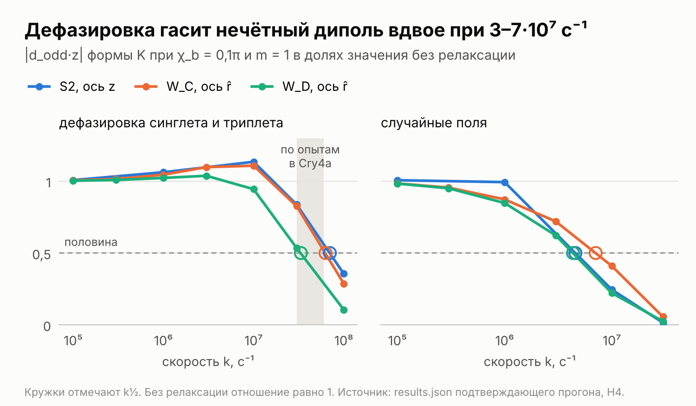
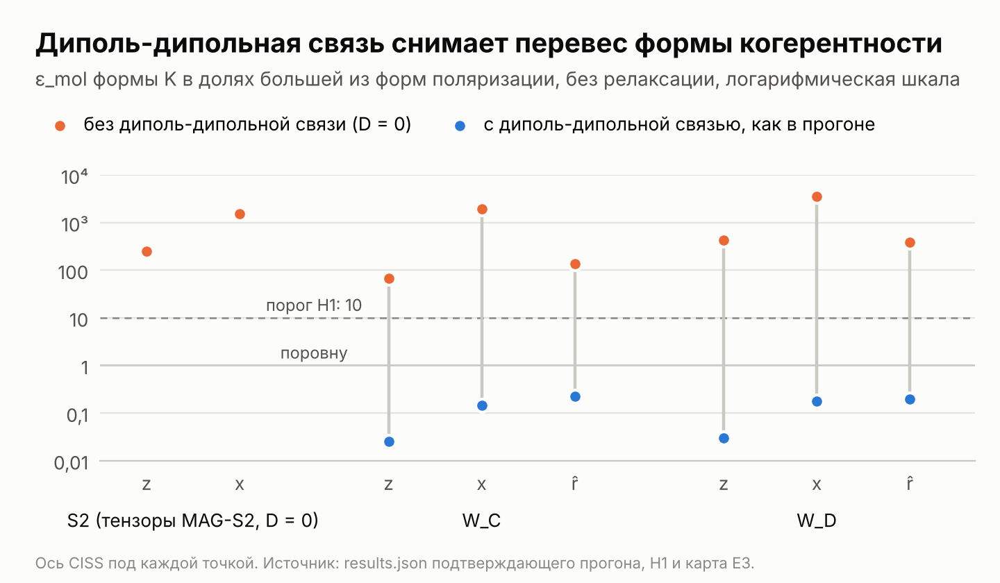

# MAG-S3c: real pair geometry and the decay of coherence

[](https://doi.org/10.5281/zenodo.24148799)

<p align="center"></p>

A pre-registered simulation study of whether the two main conclusions of MAG-S3b survive the real geometry of the radical pair in cryptochrome 4 and spin relaxation, and how much of the odd part of the compass code, the part that changes sign when the field is reversed, the singlet–triplet coherence itself carries.

Author: Julia Ryzhkova (Siriona, siriona.one; ORCID 0009-0005-4194-6059).
Status: part of release v0.3.0 of this repository, 12 November 2026, archived on Zenodo as https://doi.org/10.5281/zenodo.24148799. The protocol (v0.4, in Russian), the code, the requirements, the structure file, the reference calibration and the Colab notebook were frozen on 10 November 2026 at 19:40 UTC and are listed with their SHA-256 in FREEZE.txt; the hashes were posted in Telegram (https://t.me/attractordm/79) after the freeze and no later than 19:42 UTC, the minute the run started (FREEZE.txt records when the link to the post came). The confirmatory run took place on 10 and 11 November; it was continued in parts of 1.5 h after a flaw of the pause, see "Deviations". MAG-S3c builds on MAG-S3b (this repository, release v0.2.0, https://doi.org/10.5281/zenodo.24079875, and the notes of release v0.2.1, https://doi.org/10.5281/zenodo.24100330), MAG-S3 (release v0.1.0, https://doi.org/10.5281/zenodo.24043500) and MAG-S2 (release v0.1.2, https://doi.org/10.5281/zenodo.24030614) and imports their code unchanged.

## The question

MAG-S3b found, on the three-nucleus MAG-S2 pair without relaxation and at J = D = 0, that the coherence form K of chirality-induced spin selectivity (CISS) gives 253 times more odd part than the polarisation forms, and that the projection of the odd dipole on the receptor axis survives a CISS axis across the receptor, because the hyperfine tensors set its direction. MAG-S3c recomputes the same pair in three geometries: S2 (the tensors of MAG-S2), and the FAD–W_C (W318) and FAD–W_D (W369) pairs of pigeon cryptochrome 4 (ClCry4a) from PDB 6PU0, with the dipolar coupling of each pair (0.34 and 0.19 mT, 4–7 times the geomagnetic field). Singlet–triplet dephasing runs up to 10⁸ s⁻¹, beyond the 3–6·10⁷ s⁻¹ that Golesworthy et al. (2023) estimated from magnetic field effects in modified Cry4a of robin, pigeon and chicken (the protocol calls it the measured dephasing), and random fields up to 3·10⁷ s⁻¹.

Five hypotheses get a verdict per geometry, from 184 comparisons, 8 of which follow from published cells of MAG-S3b and are reported without a verdict:

1. **H1.** The coherence form stays at least 10 times stronger than the larger polarisation form, in ε_mol and in |F|, in each of 40 combinations of geometry, CISS axis and relaxation up to 10⁶ s⁻¹.
2. **H2.** In W_C and W_D the median |d_odd·z| over a circle of 360 CISS axes across the receptor is at least half its value at the axis z.
3. **H3.** At Δχ = 0.1π with the CISS axis along the radical-pair axis r̂, the responses F and F_amp of the real pairs reach the threshold 0.01 of the dipole test.
4. **H4.** Relaxation at 10⁶ s⁻¹ keeps at least half of d_odd·z, for both kinds, in every geometry and on every axis.
5. **H5.** The exact split of form K gives the coherence a share s_C of at least 0.9 of d_odd·z.

The main descriptive quantity is k½, the relaxation rate at which the odd dipole falls by half, compared with that estimated dephasing of 3–6·10⁷ s⁻¹. Exploratory maps E1–E14 add the microscopic CISS form of Denton et al. (2026), fast recombination of the pair, the composite pair W_C ⇌ W_D with hops of the hole, the sphere of CISS axes and the average over the P2₁2₁2₁ crystal packing of 6PU0 (point group 222).

## Results of the confirmatory run

The run is valid: all eleven invariants held, all 574 direct cells, 54 reference solutions, 24 cells of the composite pair and 24 time curves are in place, the grid, rates and curves match the protocol, and every step ran with one BLAS thread. It took 30 minutes on 10 November and 2 h 50 min on 11 November 2026 in Google Colab (TPU v6e-1 runtime, 44 processes). A reanalysis of the archive with the frozen analyze_s3c.py on the calibration machine reproduced all 174,753 values of results.json bit for bit. The hypotheses are deterministic, and no correction for multiplicity applies.

| Hypothesis | Geometry | Result | Threshold | Verdict |
|---|---|---|---|---|
| H1. Coherence form against polarisation forms | S2 | ratio 194–1713 in ε_mol, 134–789 in F | 10 | met |
| | W_C | 0.025–0.32 in ε_mol, 0.018–11.3 in F; 1 of 30 comparisons passed | 10 | not met |
| | W_D | 0.030–0.23 in ε_mol, 0.052–8.2 in F; none of 30 passed | 10 | not met |
| H2. Odd dipole with a CISS axis across the receptor | W_C | median of \|d_odd·z\| over the circle 3.29–3.58 times its value at the axis z | 0.5 | met |
| | W_D | 3.88–4.01 | 0.5 | met |
| H3. Visibility to the dipole test | W_C | stricter response F_amp = 0.050–0.060 (F = 0.47–0.71) | 0.01 | met |
| | W_D | F_amp = 0.153–0.184 (F = 3.9–4.9) | 0.01 | met |
| H4. Odd dipole at 10⁶ s⁻¹ | S2 | 0.79–0.99 with random fields, 0.99–1.06 with dephasing | 0.5 | met |
| | W_C | 0.80–0.88 and 0.98–1.04 | 0.5 | met |
| | W_D | 0.83–0.85 and 1.01–1.03 | 0.5 | met |
| H5. Share of the coherence s_C | S2 | 1.0004–1.084 | 0.9 | met |
| | W_C | 0.979–0.997 | 0.9 | met |
| | W_D | 0.976–1.000 | 0.9 | met |
| Q1. Harmonics are accurate | all | even residual at degree 10 at most 0.14% of its SD in all 974 cells at Cry4a rates, above 1% (up to 15%) in 22 of 42 cells of fast recombination (E12); the dipole is stable to 2·10⁻⁵ | 1% | not met |
| Q2. Weak relaxation barely changes the pair | all | 16 of 144 comparisons fail, all in polarisation forms and the controls P-0 and K-inc; form K changes by at most 8.9% | 10% | not met |
| Q3. Relaxation up to 10⁷ s⁻¹ narrows the even range | all | random fields narrow it in all 32 sequences; dephasing widens it by up to 12% in 9 of 32 (W_D and branch E7) | monotonic | not met |
| Q4. Time steps agree with the solver | W_C, W_D | to 1.4·10⁻⁷ | 10⁻⁵ | met |

The eight comparisons known in advance came out as published in MAG-S3b (H1 ratios 253 and 1541 in ε_mol and 460 and 218 in F; H5 shares 1.0006, 1.0012, 1.040 and 1.086). The sealed line of verdicts that a trial run at substitute rates printed before the freeze agrees with the run in 11 of 13 verdicts and differs in H3, which failed at the substitute rates in both real pairs and is met in the run. An exploratory recomputation after the run (results/exploratory) explains the difference by the grid of the trial. On 60 directions the harmonic fit of degree 10 is underdetermined: with the frozen code the ratio transfer F falls to about 10⁻⁴ at either rate set and F_amp to 74–76% of its value on 2000 directions, so H3 fails there, while on 2000 directions the substitute rates pass H3 with a margin of 7–8 times in W_C and 21–25 times in W_D. The trial itself ran on code from before the freeze, so the recomputation shows that the grid alone accounts for the difference without replaying the trial.

<p align="center"></p>

**The dipolar coupling takes the dominance away from the coherence form.** Both CISS forms carry singlet–triplet coherence: form K an imaginary one, which creates no spin polarisation, and the polarisation forms a real one, since they are born in a real singlet–T₀ superposition, which means opposite polarisations of the two spins along the CISS axis. H5 concerns the odd dipole of form K, and H1 compares the forms. In the real pairs the polarisation forms exceed form K in ε_mol in all 30 comparisons, while in |F| form K stays stronger in 15 of 30 comparisons, all but one by less than 10 times. Without relaxation, form P-same gives ε_mol of 0.56–1.49 in W_C and W_D, an odd part comparable to the even range or larger, against 0.038–0.24 for form K and at most 1.4·10⁻⁴ for the polarisation forms in S2. Branch E3 recomputes the same geometries at D = 0, and form K is again 68–2100 times (W_C) and 350–4200 times (W_D) stronger in ε_mol. The control P-0, born like the polarisation forms and recombining through the singlet, behaves the same way in ε_mol (K over P-0 0.046–0.61), so the polarised birth state alone carries the odd part. A likely mechanism, which the protocol did not test: the coupling shifts T₊ and T₋ alike with respect to the singlet, the field moves them apart, and the gaps T₊–S and T₋–S differ, so the yield depends on the sign of the polarisation relative to the field. The closest precedent is the sweep of D from −1 to 1 mT by Gwynn, Adams & Petruccione (2026) on a one-nucleus pair whose CISS birth state is a real singlet–T₀ superposition, a polarisation-type state; their birth and recombination states are those of our form P-LH, so in its CISS form their model is P-LH on a one-nucleus pair without relaxation. The antisymmetric part of their singlet yield is smallest at D = 0, and they suggest that dipolar and CISS symmetry breaking compete rather than cooperate. E3 carries the question over to the real geometries with three nuclei, both forms of CISS and relaxation. The protocol took J = 0; exchange at about 2 nm can partly offset the dipolar coupling (Efimova & Hore 2008), so, as an inference from that work, the size of the effect may depend on the J of the pair.

**k½ lies inside the estimated dephasing or above it.** The odd dipole of form K halves at a dephasing rate of 3.3–6.2·10⁷ s⁻¹ in W_C and W_D (above 10⁸ s⁻¹ for the axis z in W_D), against the 3–6·10⁷ s⁻¹ estimated from experiment in modified Cry4a. None of the 16 dephasing combinations falls below 3·10⁷ s⁻¹; 10 lie inside the measured range and 6 above it (8 and 4 of the 12 in the real pairs). The unfavourable reading of the protocol (k½ below 3·10⁷ s⁻¹) holds in none of them, the favourable one (above 6·10⁷ s⁻¹) in 6, and for the 10 inside the estimated range the protocol set no reading. At 3·10⁷ s⁻¹ the dipole keeps 0.53–0.86 of its value in the real pairs and at 10⁸ s⁻¹ 0.10–0.57, so at the upper end of the range, 6·10⁷ s⁻¹, less than half of it remains wherever k½ lies below that rate, in 8 of the 12 combinations of the real pairs. Random fields halve the dipole at 2.7–7.9·10⁶ s⁻¹, an order of magnitude earlier. At 3·10⁷ s⁻¹ of dephasing the contribution of the initial coherence along r̂ at Δχ = 0.1π stays 5–10 times above the threshold of the dipole test (E10), although the memory of that coherence lives about 90 ns (E9).

**Translation into physics.** A null result in the reference design R1 bounds ε_eff by 0.0010 (median over birds). With polar order (p = 1) it excludes in W_C and W_D every non-reciprocity of the grid, Δχ from 0.005π to 0.1π, for the CISS axes x and r̂ at any axial order S and every level of relaxation, with one exception (Δχ = 0.05π on the axis x of W_D at 3·10⁷ s⁻¹ of random fields for part of S). At 3·10⁷ and 10⁸ s⁻¹ of dephasing, the levels that span the estimated one, it excludes Δχ = 0.05π and 0.1π on all three axes of both pairs. Along r̂ the amplitude response is linear in Δχ to 9%, and the local estimate gives Δχ·p·g(S) ≲ 0.0016π for W_C and 0.0005π for W_D (0.29° and 0.09°), 3–9 times tighter than the bound of MAG-S3b for the S2 pair. Unlike in MAG-S3b, the record also limits the polarisation forms: with p = 1, R1 excludes P-same in all 120 combinations of axes, levels and S of each real pair, and the dipole test sees it in 94 and 104 of them.

**The scale of CISS.** Kobori et al. (2026) estimated the contribution of CISS in the cryptochrome-DASH of the frog *Xenopus laevis* by time-resolved EPR and a model fit at about 8% for the pair FAD–W_B and at most 6% for FAD–W_C (Kobe University press release); carrying these numbers over to Cry4 and to W_D is an assumption. If 6% is the amplitude of the CISS admixture (sin χ_b = 0.06, χ_b ≈ 0.019π), an exploratory recomputation from the reference solutions gives a stricter response of form K at m = 1 along r̂ of 0.010–0.012 in W_C and 0.031–0.038 in W_D without relaxation and at 10⁶ s⁻¹ (0.0097 and 0.020 at dephasing 3·10⁷ s⁻¹). With full polar and axial order (p = 1, S = 1) W_C then sits at the threshold of the dipole test even at full non-reciprocity, and W_D stays 2–4 times above it; axial disorder multiplies the response by g(S), which at S = 0.4 lifts W_C to 0.017–0.020, and 8%, the estimate for the pair with W_B, would give 0.014–0.016 and 0.041–0.050 in the same reading. If 6% is the triplet share (sin²χ_b = 0.06, χ_b ≈ 0.079π), the response is 0.041–0.049 and 0.12–0.15 without relaxation and at 10⁶ s⁻¹, and 0.039 and 0.078 at dephasing 3·10⁷ s⁻¹. Which reading holds, and in which form CISS enters their model, is a question for the authors: EPR tells real from imaginary singlet–triplet coherence only on oriented samples or in the first moments after the pair is born (Cantarella et al. 2026).

**Exploratory maps.** Without relaxation the dipole test sees form K at Δχ = 0.1π for 85–95% of CISS axes over the sphere (E5) and for 83–96% of receptor axes (E14). The principal values of Grüning et al. change F_amp along r̂ by at most 16% and flip the projection for the axis z (E7). The microscopic form E of Denton et al. gives an odd dipole turned 102–170° away from that of form K, 0.45–0.88 of its size along r̂ (E11). Hopping of the hole between W_C and W_D with recombination at both sites gives an odd part without CISS of 4–103% of that of form K in the same composite pair, and none when only the site of birth recombines (E13). The crystal 6PU0 cancels the dipolar part of the odd pattern, and the remaining xyz pattern of form K along r̂ is 0.87% (W_C) and 3.4% (W_D) of the even range of the crystal (E14).

The protocol with all numbers, the reading of each result and the interpretation is protocol/MAG-S3c_protocol_v0.4_with_results_ru.md (in Russian). All 184 comparisons, k½ of every combination, the admissible region of map E2 and the table of all 1016 cells are in results/tables.

## What it means

One of the two conclusions of MAG-S3b survives the real geometry. The odd dipole follows the hyperfine tensors, its projection on the receptor axis even grows when the CISS axis lies across the receptor, and the singlet–triplet coherence creates it. The dominance of the coherence form over the polarisation forms holds only without the dipolar coupling; in the real pairs both phenomenological forms of CISS give an odd part, so a null neural experiment limits polarisation at birth too. The odd dipole halves at a dephasing rate inside the range estimated from experiment for Cry4a or above it, never below, and at the upper end of that range less than half of it remains in 8 of the 12 combinations of the real pairs. The dipole test sees both candidate pairs with a margin of 5–18 times at Δχ = 0.1π along the transfer path, so the conclusion does not depend on which tryptophan ends the chain. That margin belongs to Δχ = 0.1π: at the CISS scale that Kobori et al. estimated for the pair with W_C, taken as the amplitude of the CISS admixture, the margin of W_C shrinks to the threshold even with full polar and axial order.

All numbers belong to three ¹⁴N nuclei in the crystal orientation of the rings of pigeon Cry4a, with J = 0 and isotropic models of relaxation. For oriented-sample tests of the symmetry the composite pair says that a control without CISS for the hopping scheme of the sample is needed, and a test on the crystal 6PU0 has to look for an xyz pattern of 0.9–3.4% of the even range with fields outside the planes of the cell.

## Deviations

- **Parts of 1.5 h.** Cell 5 started the run on 10 November at 19:42:44 UTC in parts of 0.5 h. At a pause the pair step stops every cell it is computing, and the next part starts that cell from zero; the 15 slowest cells (the direct P-same and P-LH cells of W_C and W_D and three references at dephasing 10⁸ s⁻¹) took 54–62 minutes each in Colab, and two references of branch E12 34 and 44 minutes, so parts of 0.5 h could never finish them. The blind check and the smoke runs never paused, so this path had not run. The runtime was stopped at about 20:30 UTC, the work of the second part was lost, and nothing of the output was read. Before the continuation the deviation was recorded in results/run_notes.md: the run went on from the archive of the first part with notebooks/MAG-S3c_colab_continuation.ipynb, whose cell 5a differs from cell 5 only in parts of 1.5 h and a copy of the log to Google Drive after each part, and asks for «запускай» again. The frozen files did not change.
- **Third blind check.** On the new runtime on 11 November cell 4 was started twice by mistake and stopped; its first action removes the marker of the passed blind check, so cell 5a refused to start. A clean third blind check of the same build ran from 17:07:39 to 17:53:47 UTC, and its I11 values equal those of 10 November bit for bit.
- **Trial verdicts.** Before the freeze, the first smoke run of 10 November printed its verdicts H1–H5 at substitute rates on 60 directions in front of the author of the code (FREEZE.txt). The line was sealed and opened after the run; it agrees with the run in 11 of 13 verdicts per geometry (results/checks/sealed_trial_verdicts_opened.txt), and the grid of the trial explains the difference in H3 (results/exploratory).

## Literature the protocol missed or used only in part

- Efimova O., Hore P. J. (2008), Role of exchange and dipolar interactions in the radical pair model of the avian magnetic compass, Biophys. J. 94: 1565–1574, https://doi.org/10.1529/biophysj.107.119362. The dipolar coupling attenuates the anisotropy of the yield, and exchange at radical separations near 2 nm can partly restore it. This explains the narrow even range of the real pairs at J = 0 and makes J the next parameter of H1.
- Gwynn T., Adams B., Petruccione F. (2026), Conditional enhancement of radical pair dynamics via chiral state preparation, arXiv:2605.22130, https://arxiv.org/abs/2605.22130. The protocol cited it for the odd part of a model pair, the relative orientation of the tensors and the suppression by a second collinear nucleus, and did not use its sweep of D; that sweep of the dipolar coupling from −1 to 1 mT is the closest precedent of branch E3.

## Contents

| Path | What it holds |
|---|---|
| FREEZE.txt | the freeze record: time, checks in Colab and the SHA-256 of the 16 frozen files |
| protocol/MAG-S3c_protocol_v0.4_ru.md | the frozen protocol, SHA-256 20353b73… |
| protocol/MAG-S3c_protocol_v0.4_with_results_ru.md | the same text with the results section added after the run |
| code/ | mag_s3c.py (pair in three geometries, relaxation, references and reconstruction, composite pair, receptor and maps, calibration), analyze_s3c.py (invariants I1–I11, expectations Q1–Q4, hypotheses H1–H5, k½, maps E1–E14), test_s3c.py (31 tests with known answers), scripts/ (pipeline, environment check, notebook builder), requirements.txt, data/6PU0.pdb and the frozen MAG-S3b v0.2.0 files it imports |
| notebooks/MAG-S3c_colab.ipynb | the notebook of the run, with the code and the reference calibration embedded with their SHA-256 |
| notebooks/MAG-S3c_colab_continuation.ipynb | the same notebook with cell 5a, which continued the run in parts of 1.5 h |
| results/calibration/ | calibration C1–C6 in three rounds; round3 is the reference on the final code, with its tests and smoke run in round3/checks |
| results/checks/ | the blind code reviews of versions 0.3 and 0.4; the tests, environment checks and blind pipeline checks in Colab of builds 8958037 and f994d9b, including the runtime of the continuation; i11_first_blind_check.md; the reanalysis of the archive; the two passes of the independent check of the results section; the opened sealed line of the trial run |
| results/exploratory/ | computations after the run that change no verdict: the CISS scale of Kobori et al. (2026) and the H3 cells of the trial run, with their script and outputs |
| results/confirmatory_run/ | the log of the run, the confirmations, results.json, and confirmatory_s3c.tar.gz (all cells, references, composite pair, checks, curves, receptor, maps, results and logs) with its SHA-256 |
| results/tables/ | comparisons_H1_H5.csv, k_half.csv, e2_regions.csv, cells.csv and the script that writes them from the archive |
| results/run_notes.md | the timeline of the run, the deviations and the transfer of the archive |
| figures/ | k_half.png, coherence_vs_polarisation.png and the script that draws them from the archive |
| SHA256SUMS.txt | SHA-256 of every file in this folder |

## Reproduce

Python 3.13.18 with `pip install -r code/requirements.txt` (NumPy 2.5.3, SciPy 1.18.1, RadicalPy 1.0.9). From code/:

```
python3 -I test_s3c.py                                       # 31 tests with known answers (--fast skips one)
python3 -I mag_s3c.py calibrate --out CAL --workers N        # calibration C1–C6
python3 -I scripts/env_check.py ../results/calibration/round3 CAL
bash scripts/pipeline.sh blind OUT                           # blind check at substitute rates, output deleted
```

The confirmatory run (`bash scripts/pipeline.sh confirmatory OUT`) needs OUT/confirmation.json, which cell 5 of the notebook writes after the answer «запускай»; without it the code computes nothing at the rates of the hypotheses. It costs about 53 processor hours. To repeat only the analysis, unpack the archive and run the frozen analysis on it:

```
mkdir RUN && tar -xzf ../results/confirmatory_run/confirmatory_s3c.tar.gz -C RUN
python3 -I analyze_s3c.py --run RUN/confirmatory_s3c/run --out RUN/reanalysis
python3 -I ../results/tables/make_tables.py RUN TABLES
python3 -I ../figures/make_figures.py RUN FIGURES
```

## Licence

Code is released under the MIT licence (LICENSE at the root of the repository); text, the protocol and the results are released under CC BY 4.0 (https://creativecommons.org/licenses/by/4.0/).
