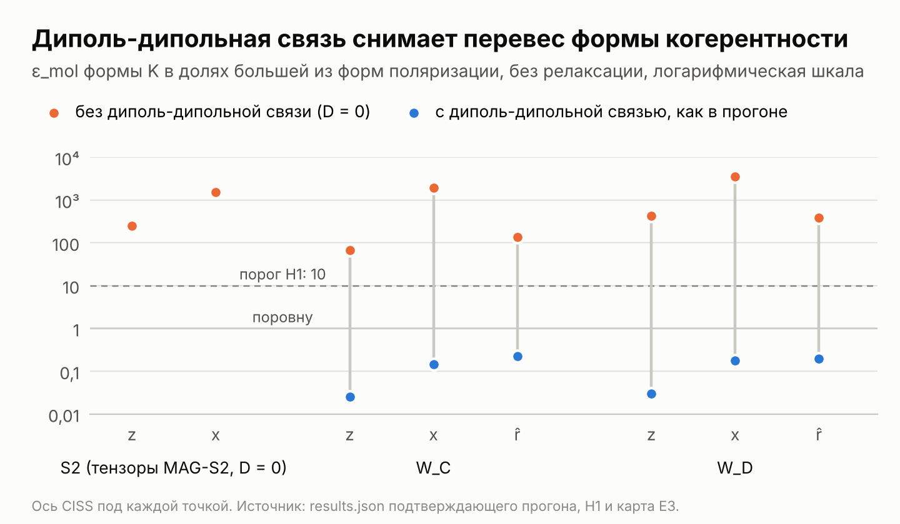
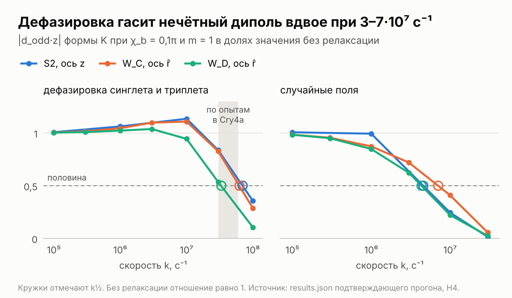

# MAG-S3c. Реальная геометрия пары и затухание когерентности – протокол

Nov 9, 2026 · @Julia Ryzhkova

## Статус

Версия 0.4 от 10 ноября 2026 года, заморожена перед подтверждающим прогоном после двух независимых рецензий, сверки литературы, калибровки нового кода, его слепой проверки и проверок в Colab. Версии 0.1–0.3 прошли независимую сверку с MAG-S3b, пилотом и дополнительными материалами Grüning et al., ввели контроль K-инк с гипотезой H5, временные кривые E9 и шкалу E10, записали два раунда калибровки и слепую проверку кода (раздел «Калибровка и пилот»).

Версия 0.4 вносит итоги рецензий Claude Fable 5.1 и Claude Fable 5.2 и сверки литературы 10 ноября. Шкала релаксации доходит до 10⁸ с⁻¹, то есть до измеренной в Cry4a дефазировки (Golesworthy et al. 2023), и главной величиной затухания становится скорость k½. Вердикты выносятся отдельно по геометриям, видимость судится по обоим переносам, H2 судит по кругу осей поперёк рецептора, а H5 – по точному разложению нечётной части на когерентность и выстраивание. Опорные решения при χ = 0 дают все формы с синглетной рекомбинацией и карты по всей сфере осей без нового счёта. Добавлены микроскопическая форма CISS Denton et al. (2026), быстрая рекомбинация пары с W\_C и составная пара W\_C ⇌ W\_D. Сравнения, исход которых следует из опубликованных ячеек MAG-S3b, помечены как известные заранее и в вердикты не входят.

MAG-S3c продолжает MAG-S3b (релиз v0.2.0 репозитория quantum-compass-recording, DOI [10.5281/zenodo.24079875](https://doi.org/10.5281/zenodo.24079875), и заметки после релиза v0.2.1, DOI [10.5281/zenodo.24100330](https://doi.org/10.5281/zenodo.24100330)) и берёт из неё без изменений формы CISS, рецептор, перенос в нейронную модель MAG-S3 и измеренные пороги тестов. Меняются две вещи, на которых стояли выводы MAG-S3b: взаимная ориентация радикалов пары и релаксация спинов.

## Зачем этот опыт

MAG-S3c проверяет, переживут ли два главных вывода MAG-S3b реальную геометрию пары и релаксацию спинов, и выделяет вклад самой когерентности. Оба вывода получены на паре MAG-S2 с тремя ядрами, без релаксации и при J = D = 0.

1. **Перевес формы когерентности.** В MAG-S3b форма K дала в 253 раза больше нечётной части, чем формы поляризации (H2). Она стоит на когерентности синглета и триплета, а релаксация гасит когерентность первой, поэтому разрыв может сильно сократиться. Микроскопическая модель Denton et al. (2026) выводит ту же мнимую когерентность из спин-орбитальной связи, но рекомбинирует через то же состояние, поэтому форма K при m = 1 служит пределом полной невзаимности, а ячейки с m = 0,1 ближе к микроскопической картине.
2. **Нечётный диполь следует за тензорами.** В MAG-S3b проекция нечётного диполя на ось рецептора сохранилась при оси CISS поперёк рецептора (H4), потому что его направление задают тензоры сверхтонкого взаимодействия. У реальных пар FAD–W\_C и FAD–W\_D кольцо триптофана повёрнуто к флавину по-разному, а радикалы разделены 1,8–2,1 нм, и диполь-дипольная связь 0,19–0,34 мТл в 4–7 раз сильнее геомагнитного поля.
3. **Вклад самой когерентности.** Состояния форм K и P – суперпозиции синглета и триплета, поэтому их сравнение показывает роль фазы когерентности. Точное разложение нечётной части формы K делит её на член когерентности и член выстраивания триплета, а временные кривые и шкала скоростей релаксации показывают, как быстро среда может разрушать когерентность, прежде чем её вклад перестанет обнаруживаться.
4. **Измеренная дефазировка.** Golesworthy et al. (2023) нашли в изменённых Cry4a синглет-триплетную дефазировку 3–6·10⁷ с⁻¹ и связывают её с прыжками электрона между вторым и третьим триптофанами. При такой скорости когерентность живёт 17–33 нс, а пара около 200 нс, поэтому MAG-S3c доводит шкалу до 10⁸ с⁻¹ и ищет скорость k½, при которой нечётный диполь падает вдвое.

От ответа зависят два письма. Группе Каттнига и Смита в Эксетере идут сравнение с их микроскопической моделью и нечётная часть составной пары без CISS, а группе Моуритсена в Ольденбурге – дипольный тест, отклик пар W\_C и W\_D и скорость k½ рядом с измеренной дефазировкой. Если выводы MAG-S3b устоят, дипольный тест и граница нулевого опыта относятся к паре Cry4a с реальной геометрией и тремя ядрами. Если нет, MAG-S3c покажет, в каких геометриях и при какой релаксации нечётная часть ещё доходит до порога дипольного теста, и вопросы к экспериментаторам станут точнее.

## Что уже существует

Сверка 9 и 10 ноября нашла две работы, которые считают нечётную при обращении поля часть выхода на уровне молекулы. Gwynn et al. (2026) разобрали её на модельной паре без релаксации, а Denton et al. (2026) – в микроскопической модели цепочки FAD–W\_B–W\_C с двумя ядрами без релаксации (приложение C). Реальные геометрии обоих кандидатов вместе с релаксацией до измеренной дефазировки и перевод в нейронный код в найденных работах не встречаются, и MAG-S3c соединяет их на замороженном конвейере MAG-S3b. Smith et al. (2025) взяли пару FAD–W\_C из ClCry4a, обе формы CISS и случайные поля, но считали чётную анизотропию.

| Что | Источник | Как использует MAG-S3c |
| --- | --- | --- |
| CISS при рождении и рекомбинации пары ломает симметрию к обращению поля | [Luo & Hore 2021](https://doi.org/10.1088/1367-2630/abed0b) | формы поляризации, как в MAG-S3b |
| CISS создаёт когерентность синглета и триплета без суммарной поляризации | [Fay 2021](https://arxiv.org/abs/2101.03104) | микроскопическая опора формы K |
| Микроскопический CISS в цепочке FAD–W\_B–W\_C при рождении и рекомбинации: спин-орбитальная связь даёт суперпозицию синглета и T₀ с мнимой фазой, как у формы K, обмен в мостике W\_B превращает её часть в поляризацию, а рекомбинация идёт через то же состояние; два ядра, точечный диполь, без релаксации; анизотропия на порядок ниже феноменологических моделей поляризации и наибольшая при рекомбинации 10²–10³ мкс⁻¹; приложение C делит выход по сфере на чётную и нечётную части и предлагает ориентированные образцы как проверку симметрии | [Denton, Pearse, Kattnig & Smith 2026](https://doi.org/10.1063/5.0348452) | форма E ветки E11, быстрая рекомбинация ветки E12, форма K при m = 1 как предел полной невзаимности |
| Обе формы CISS на паре FAD–W\_C из ClCry4a (PDB 6PU0) со случайными полями при γ = 1 мкс⁻¹ и τc = 1 нс; форма поляризации заметно повышает чувствительность, усиливая эффект Зенона, а когерентная форма чётную анизотропию заметно не повышает; релаксация снижает чувствительность примерно вдвое; симметрию при обращении поля статья не разбирает | [Smith, Tallapudi, Denton & Kattnig 2025](https://arxiv.org/abs/2505.01519) | модель и уровень случайных полей, сравнение форм с релаксацией |
| Антисимметричная часть устойчива при неколлинеарных осях сверхтонкого и дипольного взаимодействия и подавляется вторым коллинеарным ядром | [Gwynn, Adams & Petruccione 2026](https://arxiv.org/abs/2605.22130) | предшественник вопроса H4 MAG-S3b о роли взаимной ориентации тензоров |
| Вклад CISS в криптохроме лягушки по ЭПР с временным разрешением при −153…−33 °C: около 8% для промежуточного состояния и до 6% для позднего по подгонке модели | [Kobori et al. 2026](https://doi.org/10.1021/acs.jpclett.6c02747) | ориентир для χ: если речь о доле триплета, оценка лежит между уровнями сетки 2,4% и 9,5% |
| Действительную и мнимую синглет-триплетные когерентности ЭПР различает только на ориентированных образцах или в первые мгновения | [Cantarella et al. 2026](https://arxiv.org/abs/2610.10839) | различие форм P и K для опыта |
| Геометрии пар FAD–W\_C и FAD–W\_D в ErCry4a и ClCry4a по МД и DFT, 10 ядер, без J, D и релаксации; анизотропия 0,185 для W\_D и 0,105 для W\_C, а при большем числе ядер около 0,003; расстояния между радикалами около 1,8 и 2,1 нм | [Grüning et al. 2022](https://doi.org/10.1021/jacs.2c06233) | источник геометрий и тензоров для двух кандидатов в конце цепи |
| Какой триптофан замыкает пару, W\_C или W\_D, не решено, и ответ зависит от стартовой модели белка; реалистичная спиновая динамика гасит ориентационную зависимость при 50 мкТл | [Cascone, Cupellini & Mennucci 2026](https://doi.org/10.1021/acs.biochem.6c00516) | оба кандидата идут в сетку на равных правах |
| Флуктуации сверхтонких констант в движущемся белке | [Benjamin et al. 2025](https://www.quantbiolab.com/node/120297) | ориентир для диапазона релаксации |
| Спиновая релаксация от либраций радикалов в криптохроме; оптимальные времена жизни пары порядка микросекунд | [Kattnig, Solov'yov & Hore 2016](https://doi.org/10.1039/C5CP06731F) | диапазон скоростей релаксации |
| Синглет-триплетная дефазировка 3–6·10⁷ с⁻¹ в изменённых Cry4a зарянки, голубя и курицы, связанная с прыжками электрона между вторым и третьим триптофанами | [Golesworthy et al. 2023](https://doi.org/10.1063/5.0166675) | верх шкалы дефазировки и классы скорости k½ |
| Случайные поля и дефазировка могут повышать чувствительность компаса; в приложении D моделируются прыжки между парами с третьим и четвёртым триптофанами | [Luo 2024](https://doi.org/10.1063/5.0182172) | ожидание Q3 ограничено уровнями до 10⁷ с⁻¹; модель ветки E13 |
| Спиновая релаксация от движения белка в ErCry4a по теории Блоха – Редфилда – Вангснесса с МД и DFT; выигрыш чувствительности от движения при реалистичном числе ядер авторы считают пренебрежимо малым; симметрию при обращении поля и CISS статья не разбирает | [Grüning et al. 2024](https://read.qxmd.com/read/38668824/the-effect-of-spin-relaxation-on-magnetic-compass-sensitivity-in-ercry4a) | микроскопическая альтернатива феноменологическим моделям релаксации в разделе «Ограничения» |
| Прыжки электрона между W\_C и W\_D; для кристаллической структуры птичьего криптохрома они не поднимают чувствительность выше неподвижной пары с W\_C | [Ilott, Pearse, Tigg & Kattnig 2025](https://www.quantbiolab.com/node/129040) | ветка E13 |
| Релаксация в пространстве Лиувилля: случайные поля, дефазировка синглета и триплета, T1 и T2 | RadicalPy 1.0.9 ([Antill & Vatai 2024](https://doi.org/10.1021/acs.jctc.4c00887)) | уже в замороженном окружении MAG-S3b; даёт спиновые операторы и гамильтонианы, а матрицы его супероператоров служат проверкой решателя |
| Релаксация в больших спиновых системах, стохастическое уравнение Шрёдингера | MolSpin ([Gerhards et al. 2023](https://www.quantbiolab.com/node/97079)) | запасной путь, если пара выйдет за пределы трёх ядер |
| Нейроны вестибулярных ядер голубя настроены на полярность поля, а источник сигнала авторы ищут во внутреннем ухе | [Wu & Dickman 2012](https://doi.org/10.1126/science.1216567) | нечётный отклик в записи требует доказать сетчаточное происхождение |
| Критерий взаимности для цепочки узлов: выход чётен, если спин-селективная рекомбинация идёт только в узле рождения через инвариантный относительно обращения времени проектор рождения, а при рекомбинации в другом узле нечётная часть появляется и без CISS; симметрия кристалла 6PU0 гасит дипольную часть | заметки после релиза MAG-S3b v0.2.1 ([doi](https://doi.org/10.5281/zenodo.24100330)) | инварианты I10 и I11, ветки E13 и E14, чтение нечётной части как следа CISS |

Недостающие файлы приложены 9 ноября: координаты ClCry4a из записи PDB 6PU0 и дополнительные материалы Grüning et al. (2022). Материалы дают главные значения тензоров пар ErC и ErD (таблицы S1 и S2), а полные тензоры в системе координат флавина – только для пары ErC, в листинге входного файла MolSpin. Поэтому MAG-S3c строит ориентации тензоров по нормалям колец в кристаллической структуре, а листинг служит проверкой. Источник тензоров базы RadicalPy в файлах пакета не указан: главные оси N5 флавина и N1 триптофана в них расходятся на 46,3°, и эта ориентация входит в сетку как геометрия S2.

## Физика пары

MAG-S3c считает пару MAG-S2 в трёх геометриях и с двумя видами спиновой релаксации. Формы CISS, кинетика и три ядра остаются как в MAG-S3b, а главные значения меняются только усреднением двух малых, поэтому расхождение с MAG-S3b идёт от геометрии, релаксации и этого усреднения. Контроли K-инк, K-изо и P-0 разбирают нечётную часть формы K, а разведочные ветки добавляют микроскопическую форму CISS Denton et al. (2026), быструю рекомбинацию и составную пару W\_C ⇌ W\_D.

**Геометрии.** Система координат связана с флавином, как у Grüning et al. (2022): начало в центре центрального кольца изоаллоксазина, ось x направлена к атому N10, ось y – к середине связи C4X–C10 после ортогонализации к x, а ось z = x × y идёт по нормали к кольцу. В W\_C и W\_D ось рецептора совпадает с нормалью флавина z, а в S2 это ось z базы RadicalPy, от которой главные оси N5 и N10 отходят на 9,4°, а ось N1 – на 37,0°. Координаты берутся из кристаллической структуры ClCry4a, PDB 6PU0 (разрешение 1,9 Å), где номера триптофанов цепи совпадают с ErCry4a: W395, W372, W318 и W369.

| Геометрия | Ориентация тензоров | Угол между главными осями флавина и триптофана | Расстояние между центрами колец | Диполь-дипольная связь |
| --- | --- | --- | --- | --- |
| S2 | база RadicalPy 1.0.9, как в MAG-S2 и MAG-S3b | 46,3° | не задано | нет, J = D = 0 |
| W\_C | главные оси N5 и N10 вдоль нормали флавина, главная ось N1 вдоль нормали индола W318 | 50,0° | 17,61 Å | точечный диполь, d = 0,34 мТл |
| W\_D | то же с индолом W369 | 81,6° | 21,27 Å | точечный диполь, d = 0,19 мТл |

Тензоры трёх азотов в базе RadicalPy почти аксиальны: малые главные значения составляют не больше 6% большого. В геометриях W\_C и W\_D главные значения берутся из этой базы, большое кладётся на нормаль кольца, а два малых заменяются их средним, так что след тензора сохраняется, а малые значения сдвигаются не больше чем на 0,0054 мТл. Система координат правая, z = x × y. Диполь-дипольный тензор равен d(1 − 3r̂r̂ᵀ) с собственными значениями −2d, d и d, где d = μ₀gμ\_B/(4πr³), а r̂ – единичный вектор между центрами колец. Это формула функции dipolar\_interaction\_point\_dipole из RadicalPy, в обозначениях которой D = −3d/2 = −0,51 мТл для W\_C и −0,29 мТл для W\_D. Код строит тензор по этой формуле сам, потому что проверка собственных значений внутри функции сравнивает их в фиксированном порядке и при большинстве направлений r̂ останавливает расчёт. Обменное взаимодействие на 17,6–21,3 Å пренебрежимо мало, и J = 0.

**Проверка геометрии.** Листинг MolSpin в дополнительных материалах Grüning et al. (2022) задаёт полные тензоры пары ErC в системе координат флавина. Главная ось N5 в нём отходит от оси z на 1,6°, а главная ось N1 отходит от нормали индола W318 в кристалле на 3,9° после смены знака оси z и на 77,6° без неё. Для тензора второго ранга смена знака z равносильна повороту на 180° вокруг z, то есть смене знаков осей x и y, поэтому руку системы координат листинг не показывает, а с кристаллом он согласуется при противоположном направлении осей x и y. Подпись листинга не говорит, усреднены ли тензоры по молекулярной динамике, а одна значащая цифра в элементах тензора N1 даёт разброс угла 1,7–6,5°. При этой оговорке кольцо W\_C в кристалле ClCry4a и в модели ErCry4a ориентировано почти одинаково. У пары MAG-S2 главные оси N5 и N1 расходятся на 46,3°, что близко к паре W\_C, а у W\_D кольцо триптофана стоит почти перпендикулярно флавину.

**Ось CISS.** Операторы CISS действуют на спин флавина вдоль оси n\_b, и сетка берёт три направления: ось рецептора z, ось x и направление r̂ от флавина к триптофану пары. В структуре r̂ отклонён от оси рецептора на 72,4° для W\_C и на 78,8° для W\_D. Путь переноса изогнут, и направления на W\_A и W\_B отклонены от оси рецептора на 89,3° и 57,3°. При малых углах повороты на последовательных шагах переноса складываются как векторы, и если угол шага пропорционален его длине, сумма направлена вдоль r̂, поэтому r̂ служит представителем пути. Карта E5 по опорным решениям проходит ось CISS по всей сфере и отмечает направления на W\_A и W\_B отдельно. Для геометрии S2 вектор r̂ не определён, и она идёт с осями z и x, то есть при β = 0 и 90° как в MAG-S3b.

**Формы CISS и кинетика.** Операторы форм K, P-same и P-LH те же, что в MAG-S3b. Форма K идёт при χ\_b = 0,05π и 0,1π с долей расхождения m = 0,1 и 1, то есть при Δχ = 0,005π; 0,01π; 0,05π и 0,1π, а формы P-same и P-LH – при χ = 0,1π. При m = 1 пара рекомбинирует через P\_S, и форма K служит пределом полной невзаимности: CISS действует только при рождении. Три контроля рекомбинируют так же, через P\_S. Контроль K-инк берёт состояние рождения формы K без начальной когерентности, ρ\_инк(0) = P\_S ρ\_K(0) P\_S + P\_T ρ\_K(0) P\_T, где P\_T = 1 − P\_S, а контроль K-изо заменяет ещё и выстроенный триплет изотропным, ρ\_изо(0) = cos²χ\_b P\_S + sin²χ\_b P\_T/3. Населённости синглета и триплета у обоих те же, что у формы K, а при χ\_b = 0,05π – и те же, что у форм P. Контроль P-0 рождает пару в том же состоянии, что формы P-same и P-LH при χ = 0,1π, и рекомбинирует через P\_S, как форма K при m = 1, поэтому сравнение K и P-0 отделяет роль фазы когерентности при рождении от роли рекомбинации. Скорости берутся из Cry4a: k\_F = 5·10⁶ с⁻¹ для ухода в сигнальное состояние и k\_R = 3,4·10⁵ с⁻¹ для рекомбинации.

**Релаксация.** К уравнению Хаберкорна из MAG-S3b добавляется супероператор релаксации.

```latex
\frac{d\rho}{dt} = -i[H,\rho] - \frac{k_R}{2}\{P_{rec},\rho\} - k_F\,\rho + \mathcal{R}\rho, \qquad \Phi = k_F\int_0^{\infty}\mathrm{Tr}\,\rho\,dt
```

- Случайные поля действуют на каждый электрон независимо: R\_rf ρ = k Σ\_i (Σ\_a S\_ia ρ S\_ia − ¾ ρ), и k равна 1/T1 = 1/T2 каждого электрона. Уровень 10⁶ с⁻¹ соответствует по порядку величины γ = 1 мкс⁻¹ у Smith et al. (2025).
- Дефазировка синглета и триплета гасит когерентность между ними и не трогает населённости: R\_std ρ = k (P\_S ρ P\_S + P\_T ρ P\_T − ρ). Golesworthy et al. (2023) измерили её в изменённых Cry4a и связывают с прыжками электрона между W\_B и W\_C.
- Случайные поля идут при k = 10⁵, 10⁶, 10⁷ и 3·10⁷ с⁻¹, дефазировка – при k = 10⁵, 10⁶, 10⁷, 3·10⁷ и 10⁸ с⁻¹, и к ним добавляется уровень без релаксации. Уровни 3·10⁷ и 10⁸ с⁻¹ дефазировки охватывают измеренные 3–6·10⁷ с⁻¹, а случайные поля при 3·10⁷ с⁻¹ гасят мнимую когерентность так же быстро, как дефазировка при 6·10⁷ с⁻¹.

**Время жизни когерентности.** Без гамильтониана и реакций мнимая S–T0-когерентность формы K, двухэлектронная по природе, гаснет при случайных полях со скоростью 2k, а при дефазировке – со скоростью k; действительная когерентность форм P гаснет со скоростью k в обеих моделях. Уровень k = 10⁶ с⁻¹ поэтому соответствует времени жизни начальной когерентности формы K 0,5 мкс при случайных полях и 1 мкс при дефазировке, измеренная дефазировка 3–6·10⁷ с⁻¹ – 17–33 нс при времени жизни пары 1/k\_F = 200 нс, а вся шкала уровней – времени от 10 нс до 10 мкс. В полной паре сверхтонкое взаимодействие переводит когерентность в другие компоненты матрицы плотности, и её действительное время жизни показывает ветка E9.

Оба супероператора имеют вид Линдблада с эрмитовыми операторами скачка: они сохраняют след, совпадают со своими сопряжёнными и не меняются при обращении времени. Критерий взаимности MAG-S3b, тождество восстановления и равенство Φ + Φ\_R = 1 поэтому выполняются и с релаксацией, а инварианты I2–I4 и I8 проверяют это численно. Матрицы обоих супероператоров в пространстве Лиувилля совпадают с классами RandomFields и SingletTripletDephasing пакета RadicalPy 1.0.9 до 2·10⁻¹⁷ k, и тест проверяет это при каждом запуске.

Интеграл по времени X = ∫ρ dt решает линейное уравнение A′X + XB′ − R̃(X) = ρ(0), где A′ и B′ собирают гамильтониан, распад и сдвиг от релаксации, а R̃ – сумма сэндвичей из операторов релаксации. Решатель берёт GMRES в пространстве Лиувилля размерности 108² = 11 664 с предобусловливанием через решение уравнения Сильвестра A′X + XB′ = Y по формам Шура, то есть без сэндвич-членов R̃. Без релаксации он сводится к замороженному решателю MAG-S3.

**Форма E.** Ветка E11 берёт состояние рождения из микроскопической модели Denton et al. (2026), их формулу (7). Пара рождается из синглета через мостик W\_B, где спин-орбитальная связь создаёт мнимую синглет-триплетную когерентность, как у формы K, а обмен 2J\_Ex P\_S за время жизни мостика 1/k₂ поворачивает её фазу. При δε = 0 формулы (8) и (9) дают N = k₂² + 4J\_Ex² и A = k₂², и в знаке, принятом для формы K, состояние рождения равно ρ\_E(0) = cos²θ P\_S + sin²θ |T₀⟩⟨T₀| + (i/2) sin 2θ (η|S⟩⟨T₀| − η\*|T₀⟩⟨S|), где |T₀⟩ = σ|S⟩, θ = χ\_b, а η = k₂/(k₂ + 2iJ\_Ex) – множитель мостика. Без обмена η = 1, и ρ\_E(0) совпадает с состоянием рождения формы K. Рекомбинация идёт через то же состояние формы K, как у Denton et al., поэтому при η = 1 форма E совпадает с взаимной формой K инварианта I3 и чётна, а её нечётную часть целиком создаёт обмен в мостике. Ветка берёт J\_Ex = 1,39·10⁴ МГц, то есть 2π·1,39·10¹⁰ с⁻¹, и k₂ = 1,3·10¹⁰ с⁻¹ модели 1 и 5·10¹⁰ с⁻¹ модели 2 из их таблицы I. Тогда |η| = 0,074 и 0,28, а фаза когерентности поворачивается на 86° и 74°: от когерентности формы K остаётся 7% и 28% амплитуды, и почти вся она становится действительной, то есть поляризацией.

**Опорные решения и восстановление.** Для пары, которая рекомбинирует через P\_S, выход при любом состоянии рождения следует из одного решения на направление поля (заметка 5 к релизу MAG-S3b v0.2.1). Опорное решение X\_S(n) – интеграл по времени матрицы плотности пары, рождённой в синглете при χ = 0, и тождество Φ\_R(−n; ρ₀) = k\_R Tr\[Θρ₀Θ⁻¹ X\_S(n)\], где Θ = exp(−iπS\_y)K на каждом спине, даёт выход в −n для любого ρ₀. Тождество следует из обращения времени и верно с обоими видами релаксации, потому что оба их супероператора при обращении времени не меняются. Состояния рождения всех форм с синглетной рекомбинацией действуют только на электроны, поэтому код хранит след X\_S(n) по ядрам, матрицу 4 × 4 на направление в виде её 16 коэффициентов по произведениям матриц Паули двух электронов. Опорные решения идут на всей сетке из 2000 направлений для спиновых систем, уровней и скоростей, перечисленных в разделе «Дизайн и бюджет», и по ним без нового счёта восстанавливаются формы K при m = 1, K-инк, K-изо и P-0 при любой оси CISS. На прежних уровнях восстановленные ячейки сверяются с прямыми (инвариант I8).

**Разложение формы K.** При m = 1 состояние рождения формы K раскладывается точно: ρ\_K(0) = cos²χ\_b P\_S + sin χ\_b cos χ\_b C + sin²χ\_b A, где C = i(P\_S σ − σ P\_S) – мнимая синглет-триплетная когерентность, A = σ P\_S σ – триплет, выстроенный вдоль оси CISS, а σ = n\_b·σ\_A. Синглетный член чётен, поэтому нечётная часть формы K равна сумме члена когерентности sin χ\_b cos χ\_b·odd(C) и члена выстраивания sin²χ\_b·odd(A). Контроль K-инк сохраняет только член выстраивания, а у K-изо нечётной части нет. Доля когерентности в проекции нечётного диполя на ось рецептора, s\_C = 1 − d\_инк·z/d\_K·z, зависит от χ\_b только через tg χ\_b. Член когерентности линеен по оси CISS, а член выстраивания квадратичен по ней, поэтому на большом круге осей, перпендикулярных вектору члена когерентности, остаётся только выстраивание. Опорные решения дают оба члена при любой оси.

**Составная пара.** Ветка E13 считает пару, в которой дырка прыгает между W\_C и W\_D. Спиновая система содержит оба электрона, ядра N5 и N10 флавина и ядра N1 обоих триптофанов, всего размерности 324, и делится на два узла. В узле W\_C действуют тензоры и точечный диполь пары W\_C, а ядро N1 триптофана W\_D свободно, в узле W\_D – наоборот. Прыжки идут со скоростью k\_CD из W\_C в W\_D и k\_DC обратно и спинов не трогают. Пара рождается в узле W\_C, в обоих узлах уходит в сигнальное состояние со скоростью k\_F и рекомбинирует через P\_S либо только в W\_C, либо в обоих узлах с одной скоростью k\_R. Решатель – GMRES в вещественных координатах эрмитовых матриц. При k\_CD + k\_DC до 4·10⁸ с⁻¹ его предобусловливают уравнения Сильвестра каждого узла, и второй узел из системы исключён. При более быстрых прыжках предобусловливание идёт через пару из двух узлов с гамильтонианом и рекомбинацией, усреднёнными по населённостям узлов k\_DC : k\_CD, где прыжки учтены точно: такая пара распадается на две моды матрицы прыжков, со скоростями 0 и k\_CD + k\_DC, и каждая решается одним уравнением Сильвестра. По критерию взаимности для цепочки узлов (заметка 1 к релизу v0.2.1) выход без CISS чётен при любых скоростях прыжка, пока рекомбинирует только узел рождения, и инвариант I10 это проверяет. Рекомбинация во втором узле даёт нечётную часть и без CISS.

## Рецептор и перевод в опыт

Записи и обратная задача MAG-S3b зависят от пары только через эффективную примесь ε\_eff, поэтому MAG-S3c переводит каждую ячейку в опыт через пороги, которые MAG-S3b измерила на виртуальных птицах. Рецептор, перенос в нейронную модель MAG-S3 и пороги берутся без изменений.

**Рецептор.** Ось рецептора совпадает с осью z геометрии: с нормалью флавина в W\_C и W\_D и с осью z базы RadicalPy в S2. При свободном азимуте от узора молекулы остаются зональные гармоники, симметричные относительно этой оси, полярный порядок p умножает нечётные степени, а осевой порядок S умножает степень l на ⟨P\_l⟩\_κ, как в разделе «Рецептор» MAG-S3b. ε\_rec равна коэффициенту при cos θ, делённому на размах чётной части рецептора при S = 1.

**Отклик F и два переноса.** Эффективная примесь равна ε\_eff = p·g(S)·F. Здесь F = r·ε\_rec – отклик при p = 1 и S = 1, r = 0,9975, а g(S) = 1,13; 1,32 и 1,66 при S = 0,8; 0,6 и 0,4 по карте E7 MAG-S3b. Этот перенос по отношению предполагает, что нечётная часть реальной пары относится к её чётной части так же, как у пары с тремя ядрами. Релаксация сжимает чётную часть быстрее нечётной, и F при этом может расти, хотя сигнал слабеет. Поэтому MAG-S3c считает и перенос по амплитуде, как ветка E6 MAG-S3b: F\_amp = c₁/b, где c₁ – тот же коэффициент при cos θ в зональном разложении узора молекулы вокруг оси рецептора, а b = 1,27·10⁻³ – амплитуда модуляции модели MAG-S3, и при порядке p и S он берёт тот же множитель p·g(S). Видимость тестам и исключение нулевым опытом судятся по обоим переносам, и решает более строгий, то есть меньший по модулю отклик. F и F\_amp зависят только от пары, формы CISS, её оси и релаксации, и гипотезы MAG-S3c формулируются через них и величины молекулы.

**Пороги MAG-S3b.**

| Величина | Значение в MAG-S3b | Как использует MAG-S3c |
| --- | --- | --- |
| Порог дипольного теста в R1 | ε\_eff = 0,01; при нём тест нашёл нечётную часть у 97 птиц из 100 | ячейка видна дипольному тесту, если p·g(S)·F и p·g(S)·F\_amp по модулю не меньше 0,01 |
| Порог антиподального теста MAG-S3 | ε\_eff = 0,05 | то же для антиподального теста |
| Медиана верхней 95% границы при ε\_eff = 0 | 0,0010 в R1, 0,0022 в R2 и 0,0083 в R3 | сочетание исключено нулевым опытом точки записи, если его ε\_eff по обоим переносам выше медианы |

Пороги измерены на модели MAG-S3 с примесью ε·b·cos θ, а перенос берёт из рецептора только коэффициент при cos θ. Поэтому пороги относятся к любой ячейке MAG-S3c без новых записей.

**Перевод в физику.** Нулевой опыт ограничивает невзаимность вместе с порядком. Для каждой геометрии, оси CISS и уровня релаксации сочетание Δχ, p и S допустимо, когда его ε\_eff по более строгому переносу не выше медианы верхней границы, и отчёт даёт область допустимых сочетаний для R1–R3, как MAG-S3b. Эта область и служит основным результатом перевода: она относится только к проверенным сочетаниям и обходится без допущения о линейности отклика. Для оси r̂ отчёт приводит ещё локальную оценку при малых Δχ: с наклоном s₀ = F(m = 0,1)/(0,1·χ\_b) нулевой опыт R1 даёт Δχ·p·g(S) ≲ 0,0010/|s₀| при каждом χ\_b, и так же оценка идёт для F\_amp. Оценка верна, пока отклик линеен по Δχ ниже 0,1·χ\_b, и общей верхней границы на невзаимность не даёт, потому что при наклонной оси F нелинейна по m. В опубликованных ячейках MAG-S3b при χ\_b = 0,1π и β = 90° F(m = 0,1) в 3,5 раза больше 0,1·F(m = 1): почти взаимный CISS вдоль оси x сужает размах чётной части рецептора вчетверо.

**Закреплённый азимут.** При закреплённом азимуте и p = 0 переворот вокруг оси x оставляет от нечётного диполя компоненту вдоль местного меридиана, и в MAG-S3b её перенос ε\_x доходил по модулю до 0,43 (ветка E4). MAG-S3c считает ε\_x для W\_C и W\_D по трёхмерному узору тех же ячеек и сравнивает его с порогом дипольного теста (карта E4).

## Инварианты, ожидания и гипотезы

Проверки идут на трёх уровнях, как в MAG-S3b. Нарушение любого инварианта делает прогон недействительным, ожидания проверяют конвейер, а пять гипотез отвечают на вопросы протокола.

### Инварианты

| Проверка | Что утверждает | Критерий |
| --- | --- | --- |
| I1 | Замороженные файлы те же, что в релизе | SHA-256 файлов mag\_s3b.py, mag\_s3.py, analyze.py, mag\_s2.py и physics.json совпадают с релизом MAG-S3b v0.2.0 (DOI 10.5281/zenodo.24079875), файлы которого заметки v0.2.1 не меняли, а SHA-256 файла 6PU0.pdb – с записанным при заморозке |
| I2 | Без CISS выход чётен и с релаксацией | во всех опорных решениях, то есть во всех спиновых системах на всех их уровнях релаксации и наборах скоростей, наибольшая нечётная часть выхода пары, рождённой в синглете, на 2000 направлениях меньше 10⁻¹² |
| I3 | Взаимная форма K чётна и с релаксацией | при χ\_r = χ\_b = 0,1π и n\_r = n\_b во всех сочетаниях спиновой системы и оси на всех их уровнях релаксации и наборах скоростей наибольшая нечётная часть на 40 направлениях меньше 10⁻¹² |
| I4 | Вероятность сохраняется | во всех решениях, включая составную пару, модуль суммы выходов минус 1 меньше 10⁻¹⁰ |
| I5 | Решатель верен | относительная невязка полного уравнения во всех решениях меньше 10⁻¹⁰; на малой паре N5 + N1 на одном направлении решатель совпадает с прямым решением в пространстве Лиувилля до 10⁻¹⁰ при всех формах, включая форму E, и на всех уровнях релаксации и с шагами по времени через точный пропагатор до 10⁻⁶ без релаксации и при k = 10⁶ и 10⁷ с⁻¹; на малой составной паре с ядрами N1 двух триптофанов двухузловой решатель совпадает с прямым решением до 10⁻¹⁰ |
| I6 | Без релаксации S2 повторяет MAG-S3b | выходы 12 ячеек геометрии S2 без релаксации на всех 2000 направлениях совпадают с расчётом замороженного mag\_s3b.py до 10⁻¹², а ε\_mol, ε\_rec, размах чётной части рецептора и d\_odd – до 10⁻⁶ относительно, для d\_odd относительно модуля вектора |
| I7 | Неполярная стопка гасит нечётную часть | при свободном азимуте и p = 0 нечётная часть рецептора меньше 10⁻¹², а при p = 0,5 она равна половине значения при p = 1 до 10⁻¹², как I5 в MAG-S3b |
| I8 | Восстановление точно | выходы форм K при m = 1 и K-инк, восстановленные по опорным решениям, совпадают с прямыми решениями основной сетки на всех семи прежних уровнях и всех 2000 направлениях до 10⁻¹⁰ |
| I9 | Изотропный триплет не даёт нечётной части | во всех ячейках контроля K-изо наибольшая нечётная часть меньше 10⁻¹² |
| I10 | Составная пара без CISS чётна, пока рекомбинирует только узел рождения | в ячейках ветки E13 без CISS с рекомбинацией только в W\_C наибольшая нечётная часть на 500 направлениях меньше 10⁻¹² |
| I11 | Кристалл 222 гасит нечётную часть в плоскостях ячейки | в картах кристалла ветки E14 нечётная часть для полей в трёх плоскостях ячейки меньше 10⁻¹² наибольшей нечётной части молекулы и меняет знак при каждом отражении ячейки с той же точностью |

### Ожидания

| Проверка | Что ожидается | Критерий |
| --- | --- | --- |
| Q1 | Гармоники точны | во всех ячейках на 2000 направлениях чётная часть раскладывается до степени 10 с невязкой не больше 1% её стандартного отклонения, а нечётный диполь меняется меньше чем на 1% при переходе от степени 10 к степени 24; ячейки, где модуль d\_odd меньше 10⁻⁹ размаха чётной части молекулы, отчёт перечисляет и в сравнение диполя не берёт |
| Q2 | Слабая релаксация почти не меняет пару | при k = 10⁵ с⁻¹ обоих видов ε\_mol и F каждой ячейки отличаются от значений без релаксации не больше чем на 10% |
| Q3 | Релаксация до 10⁷ с⁻¹ гасит анизотропию | размах чётной части молекулы в ячейках формы K при m = 1, включая ветки E3, E7 и E10, убывает с ростом k от уровня без релаксации до 10⁷ с⁻¹ при обоих видах релаксации |
| Q4 | Шаги по времени согласованы с решателем | интеграл k\_F Tr ρ(t) по каждой кривой формы K ветки E9 совпадает с выходом решателя на том же направлении до 10⁻⁵ |

Q2 опирается на отношение k/k\_F = 0,02 при k = 10⁵ с⁻¹, Q3 – на снижение чувствительности при релаксации у Smith et al. (2025), а Q4 – на пилот, где шаги с шагом 0,25 нс совпали с решателем до 9·10⁻⁸. Luo (2024) показала, что случайные поля и дефазировка могут и повышать чувствительность, поэтому Q3 не распространяется на уровни 3·10⁷ и 10⁸ с⁻¹, и там отчёт только описывает размах.

### Гипотезы

H1–H5 проверяются один раз на детерминированных числах расчёта пары и рецептора. Каждая состоит из набора сравнений и получает вердикт отдельно для каждой геометрии, в которой она проверяется: в геометрии гипотеза выполнена, когда выполнены все её сравнения в этой геометрии. Сравнения, исход которых следует из опубликованных ячеек MAG-S3b, отчёт приводит как известные заранее, и в вердикт они не входят.

**H1. Перевес формы когерентности переживает геометрию и релаксацию.** Формы сравниваются при равной доле триплета, как в H2 MAG-S3b: K при χ\_b = 0,05π и m = 1 против P-same и P-LH при χ = 0,1π. В каждом из 40 сочетаний геометрии, оси CISS и уровня релаксации до 10⁶ с⁻¹ включительно форма K хотя бы в 10 раз сильнее наибольшей из двух форм поляризации по обеим мерам, по ε\_mol и по модулю F. Гипотеза проверяет 80 сравнений, и четыре из них, для S2 без релаксации, известны заранее: в MAG-S3b отношение по ε\_mol равно 253 при оси z и 1541 при оси x, а по F – 460 и 218. При m = 0,1 опубликованные отношения по ε\_mol равны 24 при оси z, 6,3 при оси под 45° и 159 при оси x, то есть при наклонной оси уже ниже порога, поэтому отношения при m = 0,1, как и отношения K к контролю P-0, отчёт даёт без вердикта (карта E1).

**H2. Нечётный диполь следует за тензорами и в реальной паре.** В геометриях W\_C и W\_D в форме K при m = 1 и χ\_b = 0,05π и 0,1π, без релаксации и при k = 10⁶ с⁻¹ обоих видов медиана модуля проекции нечётного диполя на ось рецептора d\_odd·z по кругу из 360 осей CISS, перпендикулярных оси рецептора, не меньше половины модуля d\_odd·z при оси z. Круг считается по опорным решениям без нового счёта. Член когерентности линеен по оси CISS, поэтому на круге есть две оси, где он равен нулю, и вердикт по одной оси сетки зависел бы от того, далеко ли она от них. По закону cos β медиана была бы равна нулю, а в MAG-S3b при оси x отношение равно 1,23 при χ\_b = 0,05π и 1,18 при 0,1π. Гипотеза проверяет 12 медиан, по шесть в каждой геометрии, а отношения при осях x и r̂ отчёт даёт без вердикта.

**H3. Реальная пара видна дипольному тесту.** В форме K при χ\_b = 0,1π и m = 1, то есть при Δχ = 0,1π, с осью CISS вдоль r̂ модули откликов F и F\_amp не меньше порога дипольного теста 0,01 без релаксации и при k = 10⁶ с⁻¹ обоих видов. Вердикт выносится отдельно для W\_C и для W\_D, по шесть сравнений в каждой, и решает более строгий перенос. В MAG-S3b при той же невзаимности F равен 0,021 при оси z и 0,044 при оси x, а F\_amp – 0,058 и 0,069.

**H4. Нечётный диполь переживает релаксацию 10⁶ с⁻¹.** В форме K при m = 1 и χ\_b = 0,05π и 0,1π во всех трёх геометриях и на всех их осях отношение d\_odd·z при k = 10⁶ с⁻¹ к его значению без релаксации не меньше 0,5 при обоих видах релаксации. Простая оценка, в которой мнимая S–T0-когерентность формы K гаснет со скоростью k при дефазировке и 2k при случайных полях за время жизни пары 1/k\_F = 200 нс, даёт k\_F/(k\_F + k) ≈ 0,83 и k\_F/(k\_F + 2k) ≈ 0,71. Уровень 10⁶ с⁻¹ равен 0,2 k\_F, поэтому H4 проверяет слабую релаксацию, а измеренную дефазировку описывает скорость k½. Гипотеза проверяет 32 отношения, 8 в S2 и по 12 в W\_C и W\_D.

**Скорость k½.** Главная величина затухания – скорость k½, при которой модуль d\_odd·z формы K при m = 1 падает до половины значения без релаксации. Отчёт находит её для каждой геометрии, оси CISS, χ\_b и вида релаксации по шкале уровней, в W\_C и W\_D вместе с уровнями ветки E10, с интерполяцией, линейной по lg k, между соседними уровнями и берёт первую скорость, при которой модуль доходит до половины. Шкала дефазировки идёт до 10⁸ с⁻¹, а случайных полей – до 3·10⁷ с⁻¹. Если модуль на верхнем уровне выше половины, отчёт записывает k½ выше этого уровня, а если он ниже половины уже на нижнем уровне – k½ ниже него. Для дефазировки отчёт относит k½ к одному из трёх классов по измеренным 3–6·10⁷ с⁻¹ (Golesworthy et al. 2023): ниже 3·10⁷ с⁻¹, от 3·10⁷ до 6·10⁷ с⁻¹ и выше 6·10⁷ с⁻¹. Граница 6·10⁷ с⁻¹ лежит между уровнями сетки, и класс у неё задаёт интерполяция. Карта E5 даёт k½ для любой оси CISS.

**H5. Нечётную часть формы K создаёт когерентность.** В каждой из трёх геометрий, на каждой их оси, при χ\_b = 0,05π и 0,1π и m = 1, без релаксации и при k = 10⁶ с⁻¹ обоих видов доля когерентности из точного разложения s\_C = 1 − d\_инк·z/d\_K·z не меньше 0,9, то есть выстроенный триплет даёт не больше десятой части проекции нечётного диполя на ось рецептора. Доля больше 1 означает, что член выстраивания направлен против члена когерентности. Гипотеза проверяет 48 долей, и четыре из них, для S2 без релаксации, известны заранее: две опубликованные ячейки MAG-S3b при χ\_b = 0,05π и 0,1π задают оба члена разложения, и s\_C равна 1,0006 и 1,0012 при оси z и 1,040 и 1,086 при оси x. Доли при 0,05π следуют из долей при 0,1π через tg χ\_b, и отчёт даёт обе.

H2, H4 и H5 исключают сравнение, где знаменатель по модулю меньше 10⁻⁹ размаха чётной части молекулы, и отчёт такие сравнения перечисляет. Это правило отсекает только численный нуль. Сравнения H4 и H5, у которых знаменатель меньше 5% наибольшего модуля d\_odd·z той же геометрии при том же χ\_b и уровне, отчёт помечает как лежащие у нулевого круга, и в вердикт они входят. Гипотеза, у которой в геометрии не осталось сравнений, в этой геометрии непроверяема.

### Разведочные карты

- **E1, карта пары.** E1 даёт для всех ячеек, прямых и восстановленных, на всех уровнях ε\_mol, ε\_rec, F, F\_amp, направление и модуль d\_odd, отношение проекций G к проекции при оси z, размах чётной части и долю когерентности s\_C, а также отношения формы K к формам поляризации при m = 0,1 и к контролю P-0.
- **E2, перевод в опыт.** E2 строит для каждой геометрии и уровня релаксации область допустимых сочетаний Δχ, p и S для R1–R3 по формам K, P-same и P-LH и отмечает ячейки, видимые дипольному и антиподальному тестам, по обоим переносам, и решает более строгий. Для оси r̂ она добавляет локальную оценку через модуль наклона s₀ для обоих откликов. На уровнях 3·10⁷ и 10⁸ с⁻¹ форма K входит в область только при m = 1.
- **E3, вклад диполь-дипольной связи.** E3 сравнивает W\_C и W\_D при D = 0 с теми же геометриями с D: форму K при χ\_b = 0,1π и m = 1 по ε\_mol, F, F\_amp и углу между направлениями нечётного диполя, а перевес формы K над формами поляризации и над P-0 – по обеим мерам H1. Так видно, отвечает ли диполь-дипольная связь, которая поворачивает фазу когерентности формы K, за изменения отношений H1.
- **E4, закреплённый азимут.** E4 считает перенос ε\_x остатка нечётной части при p = 0 для W\_C и W\_D в форме K при χ\_b = 0,1π и m = 1 на трёх осях, без релаксации, при k = 10⁶ с⁻¹ обоих видов и при k = 3·10⁷ с⁻¹ дефазировки, и сравнивает его с порогом 0,01.
- **E5, ось CISS.** E5 проходит по опорным решениям ось CISS по всей сфере, 2000 осей сетки, во всех трёх геометриях на всех уровнях в форме K при m = 1 и даёт для каждой оси F, F\_amp, ε\_mol, направление d\_odd, s\_C и k½. Направления от флавина на W\_A и W\_B карта отмечает отдельно.
- **E6, перенос амплитуды.** E6 даёт оба переноса при всех p и S во всех ячейках и отношение F\_amp/F, по которому видно, где релаксация завышает перенос по отношению.
- **E7, главные значения Grüning et al.** E7 заменяет главные значения базы RadicalPy значениями ErC для W\_C и ErD для W\_D из таблиц S1 и S2 (N5, N10 и N1) в форме K при χ\_b = 0,1π и m = 1 на осях z и r̂, без релаксации и при k = 10⁶ с⁻¹ обоих видов.
- **E8, сильная релаксация.** E8 повторяет сравнения H1, H4 и H5 на уровнях 10⁷ и 3·10⁷ с⁻¹ обоих видов и 10⁸ с⁻¹ дефазировки. На трёх новых уровнях сравнения H1 идут в W\_C и W\_D, где есть прямые ячейки форм поляризации.
- **E9, время когерентности.** E9 считает временные кривые для W\_C и W\_D в форме K при χ\_b = 0,1π и m = 1 с осью r̂, без релаксации, при k = 10⁶ с⁻¹ обоих видов и при k = 3·10⁷ с⁻¹ дефазировки, при поле вдоль оси рецептора и против неё. Кривые дают вероятность того, что пара ещё существует, Tr ρ(t), норму Фробениуса S–T-когерентности ‖P\_S ρ(t) P\_T‖, норму разности ρ\_K(t) − ρ\_инк(t), то есть память о начальной когерентности, и вклад начальной когерентности в нечётный выход вдоль оси рецептора вместе с его накопленным интегралом. Кривые идут до 4 мкс с выводом через 1 нс и считаются методом Рунге – Кутты четвёртого порядка с шагом 0,25 нс.
- **E10, порог затухания.** E10 добавляет уровни k = 3·10⁵ и 3·10⁶ с⁻¹ обоих видов для W\_C и W\_D по опорным решениям, так что шкала k идёт через полдекады до 10⁷ с⁻¹ и дальше через 3·10⁷ и 10⁸ с⁻¹. По всей шкале карта находит скорость, при которой вклад когерентности в отклик формы K при χ\_b = 0,1π и m = 1 с осью r̂, s\_C·F и s\_C·F\_amp, опускается ниже порога дипольного теста 0,01, и решает более строгий перенос; для остальных осей ту же скорость даёт карта E5.
- **E11, микроскопическая форма E.** E11 считает форму E в W\_C на осях z, x и r̂ при θ = 0,05π и 0,1π с множителем мостика моделей 1 и 2 Denton et al., без релаксации и при k = 10⁶ с⁻¹ обоих видов, и сравнивает её ε\_mol, F, F\_amp и d\_odd с формой K при m = 1 и формами поляризации.
- **E12, быстрая рекомбинация.** E12 считает пару W\_C в режиме, где Denton et al. нашли наибольшую анизотропию: k\_F = 10⁶ с⁻¹ и k\_R = 10⁸ и 10⁹ с⁻¹, то есть k\_SP = 1 мкс⁻¹ и k\_CR2 = 10² и 10³ мкс⁻¹. Формы K при χ\_b = 0,1π и m = 1 и P-0 восстанавливаются по опорным решениям без релаксации и при k = 3·10⁷ с⁻¹ дефазировки, а формы P-same, P-LH и E модели 1 при θ = 0,1π считаются прямо без релаксации, все на осях z, x и r̂.
- **E13, составная пара.** E13 считает составную пару W\_C ⇌ W\_D без CISS и в форме K при χ\_b = 0,1π и m = 1 с осью r̂ пары W\_C, с рекомбинацией только в W\_C и в обоих узлах, при k\_CD = 10⁷, 10⁸ и 10⁹ с⁻¹ и k\_DC = k\_CD или k\_CD/10, без релаксации, на 500 направлениях. Карта даёт нечётную часть без CISS в долях размаха и в единицах откликов F и F\_amp рядом с нечётной частью формы K той же составной пары.
- **E14, ось рецептора и кристалл.** E14 по гармоникам ячеек без новых решений проходит ось рецептора по 2000 осям сетки для форм K при m = 1 и даёт F и F\_amp для каждой оси. Для всех ячеек W\_C и W\_D она считает выход кристалла 6PU0, усреднённый по четырём молекулам ячейки P2₁2₁2₁. Нечётная часть кристалла дипольной части не имеет, и карта даёт амплитуду её младшего узора xyz в долях размаха чётной части.

## Дизайн и бюджет

Основная сетка – 484 прямые ячейки и 30 опорных решений на 2000 направлениях, и по опорным решениям восстанавливаются ещё 336 ячеек. Разведочные ветки добавляют 90 прямых ячеек и 24 опорных решения на 2000 направлениях, по которым восстанавливаются ещё 106 ячеек, ветка E13 – 24 ячейки составной пары на 500 направлениях, ветка E9 – 24 временные кривые, а проверки инвариантов – около 36 000 решений. Весь прогон стоит около 50 процессорных часов.

**Основная сетка.**

| Фактор | Уровни |
| --- | --- |
| Геометрия и оси CISS | S2 с осями z и x; W\_C и W\_D с осями z, x и r̂ |
| Релаксация | нет; случайные поля при k = 10⁵, 10⁶, 10⁷ и 3·10⁷ с⁻¹; дефазировка синглета и триплета при k = 10⁵, 10⁶, 10⁷, 3·10⁷ и 10⁸ с⁻¹ |
| Форма K | χ\_b = 0,05π и 0,1π; m = 0,1 и 1; контроли K-инк и K-изо при m = 1 |
| Формы P-same и P-LH | χ = 0,1π; контроль P-0 при χ = 0,1π |
| Скорости, с⁻¹ | Cry4a: k\_F = 5·10⁶ и k\_R = 3,4·10⁵ |
| Сетка направлений | 2000, замкнутая по антиподам, как в MAG-S3 и MAG-S3b |

На семи прежних уровнях восемь сочетаний геометрии и оси и восемь сочетаний формы вместе с контролем K-инк дают 448 прямых ячеек, как в версии 0.3. На новых уровнях, 3·10⁷ с⁻¹ обоих видов и 10⁸ с⁻¹ дефазировки, прямо считаются формы P-same и P-LH в W\_C и W\_D на трёх осях, 36 ячеек, а формы K при m = 0,1 там не считаются. Опорные решения при χ = 0 идут для трёх геометрий на всех десяти уровнях, и по ним восстанавливаются контроли K-изо и P-0 на всех уровнях, а формы K при m = 1 и K-инк – на новых уровнях, всего 336 ячеек.

**Разведочные ячейки.**

| Ветка | Система и оси | Формы | Релаксация и скорости | Объём |
| --- | --- | --- | --- | --- |
| E3 | W\_C и W\_D при D = 0; z, x и r̂ | K при χ\_b = 0,05π и 0,1π и m = 1 и P-0 по опорным решениям; P-same и P-LH прямо | нет; k = 10⁶ с⁻¹ обоих видов | 6 опорных решений, 36 прямых ячеек |
| E7 | W\_C с главными значениями ErC, W\_D с главными значениями ErD; z и r̂ | K при χ\_b = 0,1π и m = 1 по опорным решениям | нет; k = 10⁶ с⁻¹ обоих видов | 6 опорных решений |
| E10 | W\_C и W\_D; r̂, а любая ось по карте E5 | K и K-инк при χ\_b = 0,1π и m = 1 по опорным решениям | k = 3·10⁵ и 3·10⁶ с⁻¹ обоих видов | 8 опорных решений |
| E11 | W\_C; z, x и r̂ | E при θ = 0,05π и 0,1π, модели 1 и 2 | нет; k = 10⁶ с⁻¹ обоих видов | 36 прямых ячеек |
| E12 | W\_C; z, x и r̂ | K при χ\_b = 0,1π и m = 1 и P-0 по опорным решениям; P-same, P-LH и E модели 1 при θ = 0,1π прямо | k\_F = 10⁶, k\_R = 10⁸ и 10⁹ с⁻¹; опорные решения без релаксации и при 3·10⁷ с⁻¹ дефазировки, прямые ячейки без релаксации | 4 опорных решения, 18 прямых ячеек |
| E13 | составная пара W\_C ⇌ W\_D | без CISS и K при χ\_b = 0,1π и m = 1 с осью r̂; рекомбинация только в W\_C или в обоих узлах | нет; k\_CD = 10⁷, 10⁸ и 10⁹ с⁻¹, k\_DC = k\_CD и k\_CD/10 | 24 ячейки на 500 направлениях |
| E9 | W\_C и W\_D; r̂ | K и разность K и K-инк при χ\_b = 0,1π и m = 1 | нет; k = 10⁶ с⁻¹ обоих видов; 3·10⁷ с⁻¹ дефазировки | 24 временные кривые при поле вдоль оси рецептора и против неё |

**Проверки.** I2 идёт по опорным решениям на всей сетке. I3 идёт на 40 направлениях и противоположных им во всех 18 сочетаниях спиновой системы и оси, каждое на уровнях своей ветки, а в W\_C и W\_D ещё на уровнях ветки E10 и, в W\_C, на скоростях ветки E12; всего это 146 наборов по 80 решений. I6 сравнивает 12 ячеек S2 без релаксации из основной сетки с расчётом замороженного mag\_s3b.py. I5 сравнивает на малой паре в геометрии W\_C на одном направлении формы K, P-same, P-LH и E при всех десяти уровнях релаксации с прямым решением, формы K и P-LH без релаксации и при k = 10⁶ и 10⁷ с⁻¹ обоих видов – с шагами по времени через точный пропагатор с шагом 0,25 нс, а двухузловой решатель на малой составной паре – с прямым решением при обеих схемах рекомбинации и всех скоростях прыжка ветки E13. I8 и I9 идут по ячейкам основной сетки, I10 – по ячейкам ветки E13, а I11 – по картам кристалла, без новых решений.

**Рецептор и карты.** Свободный азимут считается для всех ячеек, прямых и восстановленных, при p = 1; 0,5 и 0 и S = 1; 0,8; 0,6 и 0,4 по гармоникам, без новых решений уравнения, и оба переноса берутся из тех же гармоник. Закреплённый азимут ветки E4 считается по трёхмерному узору ячеек W\_C и W\_D, а карты E5 и E14 – по опорным решениям и гармоникам ячеек, тоже без новых решений.

**Бюджет.** Пилоты 9 и 10 ноября измерили время одного решения в один поток BLAS на всех трёх геометриях; уровни 3·10⁷ и 10⁸ с⁻¹ пилот 10 ноября считал на подменённых скоростях слепой проверки.

| Релаксация | k = 10⁵ с⁻¹ | k = 10⁶ с⁻¹ | k = 10⁷ с⁻¹ | k = 3·10⁷ с⁻¹ | k = 10⁸ с⁻¹ |
| --- | --- | --- | --- | --- | --- |
| Случайные поля | 70–76 мс, 6–7 итераций GMRES | 95–100 мс, 11–12 итераций | 169–187 мс, 25–26 итераций | 260–290 мс, 37–40 итераций | не считается |
| Дефазировка синглета и триплета | 55–58 мс, 6 итераций | 73–76 мс, 11 итераций | 156–166 мс, 31–32 итерации | 340–380 мс, 60–66 итераций | 0,90–1,04 с, 168–191 итерация |

Без релаксации решение занимает 28–30 мс, как в MAG-S3b. Шаг Рунге – Кутты на полной паре занимает 9 мс при случайных полях и 4 мс при дефазировке. Основная сетка стоит около 38 процессорных часов: 24 часа прежних ячеек, 10,6 часа новых прямых ячеек, из которых 6,3 часа приходится на дефазировку 10⁸ с⁻¹, и 3,8 часа опорных решений. Разведочные ветки на 2000 направлениях стоят около 4,3 часа, временные кривые – около 0,5, проверки – около 0,8. Калибровка раунда 3 измерила время составной пары на подменённых скоростях: от 0,4 с на направление при k\_CD = 10⁷ и k\_DC = 10⁶ с⁻¹ до 6,0 с при k\_CD = k\_DC = 10⁸ с⁻¹, в среднем 2,9 с, то есть около 9,7 часа на ветку E13. Всего это около 53 процессорных часов, в Colab на 44 ядрах около 73 минут чистого счёта, а с запасом MAG-S3b в 2,3–2,6 раза – около трёх часов. Ноутбук считает прогон частями по полчаса и после каждой части кладёт архив на Google Диск.

## Анализ и правила решений

Вердикты считает замороженный код без ручного вмешательства. Единица анализа – ячейка расчёта пары, и все величины гипотез детерминированы.

- **Порядок.** Расчёт пары, затем опорные решения и восстановление, рецептор и перевод в опыт, затем анализ. До публикации хэшей замороженных файлов узоры с CISS в W\_C и W\_D, узоры с релаксацией и узоры веток E11–E13 считаются только на скоростях, которые не входят в гипотезы, ожидания и карты: в калибровке – на скоростях MAG-S2 и на подменённых, в слепой проверке конвейера – на подменённых.
- **Вердикты.** Инварианты получают «в порядке» или «ошибка», ожидания и гипотезы – «критерий выполнен», «критерий не выполнен» или «гипотеза непроверяема» с причиной, гипотезы – отдельно по геометриям. Прогон действителен, когда все одиннадцать инвариантов в порядке, сетка, скорости и длина кривых совпадают с протоколом, на месте все 574 прямые ячейки, 54 опорных решения, 24 ячейки составной пары и 24 кривые, а все шаги шли в один поток BLAS. Каждый вердикт идёт в отчёт вместе с числами, из которых он следует.
- **H1–H5.** Сравнения берутся из таблицы ячеек, и вердикт следует из них прямо. Отчёт даёт каждое из 184 сравнений, из них 8 известных заранее, и наименьший запас по каждой гипотезе в каждой геометрии. H1, H4 и H5 получают по три вердикта, H2 и H3 – по два, для W\_C и для W\_D. К H4 отчёт прилагает k½ каждого сочетания с её классом, а к H3 – во сколько раз более строгий отклик ниже порога.
- **Перевод в физику.** Сочетание Δχ, p и S допустимо, когда p·g(S), умноженное на меньший по модулю из откликов F и F\_amp, не выше медианы верхней границы точки записи. Отчёт даёт область допустимых сочетаний для каждой геометрии, оси и уровня релаксации, ячейки, видимые дипольному и антиподальному тестам по обоим переносам, а для оси r̂ ещё локальную оценку через модуль наклона s₀, которая общей границей не служит.
- **Множественность.** Гипотезы детерминированы, и поправка на множественность к ним неприменима.
- **Окружение.** Все шаги, включая анализ, идут в один поток BLAS, и анализ закрепляет число потоков сам, чего в MAG-S3b не делал analyze\_s3b.py.
- **После прогона.** Код, пороги и сетки не меняются, а всё посчитанное позже помечается как разведочное.

## Интерпретация

MAG-S3c меняет только пару, поэтому запрещённая область и смысл исходов нейронного опыта из MAG-S3b остаются в силе. Гипотезы решают, какие выводы MAG-S3b переносятся на модель с тремя ядрами ¹⁴N в кристаллической ориентации колец Cry4a голубя и что из них идёт в письма. Вывод о реальной паре с десятком и более связанных ядер требует следующего шага.

| Гипотеза | Если выполнена | Если не выполнена |
| --- | --- | --- |
| H1 | форма K остаётся главной в этой геометрии с диполь-дипольной связью и слабой релаксацией по обеим мерам, и граница нулевого опыта по-прежнему относится прежде всего к ней | формы поляризации в части сочетаний подходят к форме K ближе чем в 10 раз, отчёт показывает, где нулевой опыт начинает ограничивать и их, а ветка E3 – отвечает ли за это диполь-дипольная связь |
| H2 | проекция нечётного диполя на ось рецептора для типичной оси CISS поперёк рецептора остаётся не меньше половины значения при оси z, и нулевой опыт ограничивает Δχ почти при любой оси | проекция падает с наклоном оси, и перевод границы в Δχ требует оси CISS относительно тензоров, то есть знания пути переноса |
| H3 | невзаимность Δχ = 0,1π вдоль r̂ видна дипольному тесту по обоим переносам при полярном порядке, и письмо называет порог для этой пары | дипольному тесту в R1 нужна большая невзаимность или выигрыш g(S) от осевого беспорядка, и отчёт даёт, во сколько раз более строгий отклик ниже порога |
| H4 | слабая релаксация 10⁶ с⁻¹ гасит нечётный диполь не больше чем вдвое, как обещает простая оценка, и о реалистичной релаксации судит k½ | нечётный диполь чувствителен к релаксации уже при 0,2 k\_F, и k½ лежит ниже 10⁶ с⁻¹ |
| H5 | нечётную часть формы K создаёт когерентность синглета и триплета, и вопрос о CISS для нейронного опыта сводится к одному: создаёт ли CISS такую когерентность по-разному при рождении и рекомбинации | заметную часть нечётного сигнала даёт выстроенный вдоль оси CISS триплет, которого дефазировка не трогает; отчёт даёт его долю, и вывод MAG-S3b о когерентности сужается до оставшейся части |

**W\_C или W\_D.** Какой триптофан замыкает пару, не решено (Cascone, Cupellini & Mennucci 2026), поэтому все гипотезы судят каждую геометрию отдельно. При одинаковых вердиктах вывод от выбора не зависит, а при разных письмо называет, при каком триптофане дипольный тест видит пару.

**S2 против структуры.** Расхождение S2 с W\_C и W\_D без релаксации показывает, насколько числа MAG-S3b зависели от ориентации тензоров базы RadicalPy. Ветка E3 отделяет вклад диполь-дипольной связи от вклада ориентации, в том числе для перевеса формы K над формами поляризации, а ветка E7 – вклад главных значений. Микроскопическая форма E ветки E11 показывает, сколько нечётной части остаётся, когда мнимую когерентность создаёт спин-орбитальная связь, а обмен в мостике её поворачивает и ослабляет.

**k½ и измеренная дефазировка.** Если k½ дефазировки выше 6·10⁷ с⁻¹, нечётный диполь модели переживает измеренную в Cry4a дефазировку больше чем наполовину, и возражение о быстром затухании когерентности в белке получает ответ числом. Если k½ ниже 3·10⁷ с⁻¹, механизму нужна защита от дефазировки, и отношение измеренной скорости к k½ показывает, во сколько раз белок должен её ослабить. Доля когерентности на уровнях 3·10⁷ и 10⁸ с⁻¹ (ветка E8) показывает, держится ли выживший сигнал на когерентности или на выстроенном триплете, которого дефазировка не трогает.

**Одиночная пара и цепочка.** Нечётная часть служит следом CISS у пары, которая рекомбинирует спин-селективно только там, где родилась (заметки 1 и 2 к релизу MAG-S3b v0.2.1), и основная сетка считает именно такую пару. Ветка E13 показывает, какую нечётную часть без CISS даёт рекомбинация из обеих пар W\_C ⇌ W\_D в геометрии кристалла и как она соотносится с нечётной частью формы K. Если они сравнимы, проверке симметрии на ориентированных образцах нужен контроль без CISS для схемы прыжков образца. Неполярная стопка при свободном азимуте гасит нечётную часть любого происхождения, поэтому компас наклонения сохраняется в обоих случаях. Карта кристалла E14 показывает, какой амплитуды узор xyz может увидеть такая проверка на кристалле 6PU0, которой нужны поля вне плоскостей ячейки.

**Письма.** В письмо группе Моуритсена в Ольденбурге идут оба отклика для пар W\_C и W\_D с осью CISS вдоль пути переноса, область сочетаний Δχ, p и S, которую нулевой опыт оставляет для этой оси, доля когерентности и k½ рядом с измеренной дефазировкой. Вопросы о порядке криптохромов остаются как в MAG-S3b, а к ним добавляются два: относится ли дефазировка, измеренная в изменённых Cry4a, к паре ErCry4a дикого типа и какой триптофан замыкает пару в ErCry4a. Группе Каттнига и Смита в Эксетере MAG-S3c даёт сравнение формы E с формой K и формами поляризации на реальной геометрии с релаксацией и нечётную часть составной пары без CISS как контроль к проверке симметрии на ориентированных образцах, а вопросы к ним касаются сдвига δε и тензоров их дополнительных материалов.

## Калибровка и пилот

Пилоты 9 и 10 ноября 2026 года считали только точные нули, невязки, итерации и время, а калибровка проверяет исправность частей до заморозки. До регистрации ни один узор с CISS в геометриях W\_C и W\_D, ни один узор с релаксацией на скоростях Cry4a и ни один узор веток E11–E13 не считался. Калибровка C1 считает такие узоры на скоростях MAG-S2 и на подменённых скоростях и печатает только относительные изменения, а операторы CISS при скоростях Cry4a появлялись только на малой паре в сравнении решателей на одном направлении.

**Пилот.**

- Без релаксации новый решатель совпадает с замороженным решателем Сильвестра MAG-S3 на паре S2 до 2,3·10⁻¹⁵ без CISS и до 3,2·10⁻¹⁵ на операторах форм K и P-LH.
- На малой паре N5 + N1 размерности 36 в геометрии W\_C решатель совпадает с прямым решением в пространстве Лиувилля до 1,7·10⁻¹⁴ при трёх формах и семи уровнях релаксации, а с шагами по времени через точный пропагатор – до 1,4·10⁻⁷; эту величину задаёт правило трапеций с шагом 0,25 нс.
- На полных парах S2, W\_C и W\_D без CISS нечётная часть с релаксацией не больше 5,8·10⁻¹⁵, модуль Φ + Φ\_R − 1 не больше 8,7·10⁻¹⁵, а относительная невязка полного уравнения не больше 3,1·10⁻¹³.
- В геометриях W\_C и W\_D главные значения тензоров равны значениям базы RadicalPy после усреднения малых, а главные оси лежат на нормалях колец точно. Время одного решения приведено в разделе «Дизайн и бюджет».
- На голой паре электронов без гамильтониана и реакций мнимая S–T0-когерентность гаснет со скоростью 2,000k при случайных полях и 1,000k при дефазировке, а действительная – 1,000k в обеих моделях; обе когерентности точно собственные для обоих супероператоров.
- Шаги Рунге – Кутты четвёртого порядка с шагом 0,25 нс на полной паре W\_C без CISS при k = 10⁶ с⁻¹ случайных полей с правилом трапеций до 3 мкс совпадают с решателем до 9·10⁻⁸.
- Пилот 10 ноября проверил решатель на новых уровнях на скоростях MAG-S2 и на подменённых скоростях слепой проверки в формах K при m = 1 и P-LH на четырёх направлениях в каждой из трёх геометрий и печатал только итерации, невязки и время. На подменённых скоростях GMRES сходится за 37–40 итераций при случайных полях 3·10⁷ с⁻¹, за 60–66 при дефазировке 3·10⁷ с⁻¹ и за 168–191 при дефазировке 10⁸ с⁻¹, относительная невязка не больше 5,4·10⁻¹³, а модуль Φ + Φ\_R − 1 не больше 10⁻¹³. На скоростях MAG-S2 дефазировка 10⁸ с⁻¹ требует до 949 итераций, 4,5 с на решение, при той же точности, так что решатель переделывать не нужно.
- Тождество восстановления проверено на малой паре N5 + N1 в геометрии W\_C на подменённых скоростях без релаксации, при случайных полях 10⁶ и 10⁷ с⁻¹ и при дефазировке 10⁷ с⁻¹: выходы форм K при m = 1, K-инк, K-изо и P-0, восстановленные по решению для пары, рождённой в синглете, совпадают с прямым решением в обратном поле до 1,4·10⁻¹⁵, а нечётная часть K-изо остаётся на уровне 10⁻¹⁶.

**Расчёты до протокола.** Числа с CISS, на которые опираются пороги и ориентиры гипотез, взяты из опубликованных ячеек MAG-S3b для пары S2 без релаксации. Отношение форм по ε\_mol равно 253 при оси z, 60 при оси под 45° и 1541 при оси x, по F – 460, 184 и 218, а при m = 0,1 по ε\_mol – 24, 6,3 и 159. Проекция диполя при оси x в 1,23 и 1,18 раза больше, чем при оси z, при χ\_b = 0,05π и 0,1π. При Δχ = 0,1π F = 0,021 и 0,044, а F\_amp = 0,058 и 0,069 при осях z и x, и F нелинейна по m при наклонной оси. Две ячейки формы K при χ\_b = 0,05π и 0,1π задают оба члена разложения, поэтому из тех же ячеек следуют доли когерентности s\_C для S2 без релаксации: 1,0006 и 1,0012 при оси z и 1,040 и 1,086 при оси x. Версия 0.3 утверждала, что для контроля K-инк до регистрации не посчитано ни одного числа. Точнее так: K-инк считался только на малой пробной паре как невязка тождества восстановления, а для S2 без релаксации его нечётная часть следует из опубликованных ячеек через разложение. Пороги H1–H5 выбраны с учётом этих чисел, а сравнения, которые из них следуют, в вердикты не входят.

| Критерий | Цель |
| --- | --- |
| C1. Сетка направлений достаточна | удвоение сетки до 4000 направлений меняет ε\_mol, F, F\_amp и d\_odd·z меньше чем на 1% в ячейках, которые гипотезы не используют: W\_C с осью r̂, форма K при χ\_b = 0,1π и m = 1 и форма P-same при k = 10⁶ с⁻¹ случайных полей на скоростях MAG-S2 k\_F = k\_R = 10⁶ с⁻¹ и форма K при k = 10⁸ с⁻¹ дефазировки на подменённых скоростях слепой проверки; калибровка печатает только относительные изменения |
| C2. Степени гармоник достаточно | разложение до степени 12 меняет ε\_rec меньше чем на 1% в ячейках C1 |
| C3. Решатель с запасом | в ячейках C1 и на 40 направлениях каждого уровня релаксации без CISS, включая 3·10⁷ и 10⁸ с⁻¹, невязка и модуль суммы выходов минус 1 хотя бы в 10 раз ниже порогов I4 и I5, а GMRES сходится не больше чем за 50 перезапусков; то же для составной пары без CISS на 40 направлениях при всех скоростях прыжка ветки E13 и подменённых скоростях слепой проверки |
| C4. Геометрия воспроизводится | повторное построение из 6PU0 даёт углы и расстояния раздела «Физика пары» до 0,1° и 0,01 Å, а угол между главной осью N1 листинга Grüning et al. и нормалью W318 после смены знака z повторяет 3,9° до 0,1°, как и углы осей базы RadicalPy в S2 (9,4°; 9,4°; 37,0° и 46,3°); запись CRYST1 файла 6PU0 даёт группу P2₁2₁2₁ с прямыми углами ячейки, а поворот поля от молекулы цепи A к каждой из трёх других молекул ячейки, построенных по операциям симметрии группы, совпадает с поворотом усреднения кристалла до 10⁻¹² |
| C5. Восстановление и составная пара точны | на малой паре N5 + N1 восстановление по опорному решению совпадает с прямым решением до 10⁻¹² при формах K при m = 1, K-инк, K-изо и P-0 на всех десяти уровнях, а разложение формы K выполняется до 10⁻¹²; на малой составной паре с ядрами N1 двух триптофанов двухузловой решатель совпадает с прямым решением до 10⁻¹⁰ при обеих схемах рекомбинации и всех скоростях прыжка, а без CISS с рекомбинацией только в W\_C нечётная часть меньше 10⁻¹² |
| C6. Форма E воспроизводит Denton et al. | состояние рождения, полученное прямым решением уравнений образования (5) и (6) Denton et al. на электронном пространстве, совпадает с формулой (7) с N и A из (8) и (9) до 10⁻¹² при δε = 0 и при δε ≠ 0, а поляризация и когерентность повторяют формулы (10) и (11) |

Если критерий не выполнен, исправляется код или правило, и причина записывается в этот раздел.

**Раунд 1.** Калибровка на первой версии кода выполнила все четыре критерия за 16 минут на двух процессорах.

| Критерий | Результат | Вердикт |
| --- | --- | --- |
| C1 | удвоение сетки меняет ε\_mol не больше чем на 0,53% (форма P-same, у формы K – 0,062%), F – на 1,3·10⁻⁵ и d\_odd·z – на 3,5·10⁻⁷ относительно | выполнен |
| C2 | разложение до степени 12 меняет ε\_rec на 2,9·10⁻⁴ у формы P-same и на 1,1·10⁻⁵ у формы K относительно | выполнен |
| C3 | невязка не больше 6,2·10⁻¹³, модуль Φ + Φ\_R − 1 не больше 3,2·10⁻¹⁴, GMRES сходится не больше чем за 81 итерацию, то есть за два перезапуска | выполнен |
| C4 | углы раздела «Физика пары» повторяются до 0,05°, расстояния – до 0,004 Å, а угол листинга Grüning et al. – до 0,02° | выполнен |

На малой паре N5 + N1 при скоростях Cry4a решатель первой версии кода совпал с прямым решением до 1,9·10⁻¹⁴ при трёх формах и семи уровнях релаксации и с шагами точного пропагатора – до 1,4·10⁻⁷, как в пилоте.

**Уточнения версии 0.3.** Код и слепая проверка кода потребовали уточнить протокол в одиннадцати местах, а гипотезы, пороги и сетки остались прежними.

- Проверки I2 и I3 идут и на уровнях ветки E10 (3·10⁵ и 3·10⁶ с⁻¹) для W\_C и W\_D, поэтому их 135 наборов по 80 решений, а все проверки вместе с I6 стоят около 35 000 решений.
- Q1 перечисляет ячейки с модулем d\_odd меньше 10⁻⁹ размаха чётной части и не берёт их в сравнение диполя, как H2, H4 и H5 поступают со знаменателями.
- Q3 проверяет убывание размаха и в ячейках веток E3, E7 и E10.
- Прогон действителен, только когда на месте все 534 ячейки и 18 кривых полной длины и все шаги шли в один поток BLAS, а I4 и I5 охватывают и решения проверок вместе с малой парой, и решение на кривых формы K ветки E9.
- Область E2 строится по формам K, P-same и P-LH, а контроль K-инк в неё не входит.
- К H4 отчёт прилагает пару уровней k, где d\_odd·z впервые падает ниже половины, а к H3 – во сколько раз модуль F ниже порога, как обещает раздел «Интерпретация».
- C4 сверяет все углы раздела «Физика пары» с одним знаком после запятой, включая оси базы RadicalPy в S2 и угол листинга без смены знака.
- mag\_s3c.py считает пару, проверки и кривые на скоростях Cry4a только с флагом подтверждающего прогона, а скрипт прогона ставит этот флаг лишь после ответа «запускай» и сверки SHA-256 файлов с подтверждёнными.
- Слепая проверка конвейера идёт на 500 направлениях вместе с проверками и кривыми E9 полной длины и завершается ошибкой, если нарушен инвариант или результат неполон, а ячейка подтверждающего прогона принимает только отметку слепой проверки той же сборки ноутбука.
- Ноутбук собирается детерминированно, так что те же файлы всегда дают тот же SHA-256, а метафайл каждого шага записывает SHA-256 всех файлов кода, структуры и окружения.
- Тест сверяет супероператоры решателя с классами RandomFields и SingletTripletDephasing пакета RadicalPy 1.0.9.

**Слепая проверка кода.** Отдельный рецензент получил снимок кода и этот протокол и не считал величин, на которые опираются гипотезы. Ошибок в физике, решателе и вердиктах он не нашёл, а в слое процесса нашёл одно блокирующее замечание, четыре важных и семь мелких. Блокирующее касалось ворот подтверждающего прогона: слепая проверка возвращала успех при любом итоге, а её отметка не была привязана к сборке ноутбука. Все двенадцать замечаний исправлены, их перечень с исправлениями лежит в results/checks/blind\_code\_review.md, а калибровка и пробный прогон конвейера повторены на исправленном коде.

**Раунд 2.** Калибровка на исправленном коде повторила все числа первого раунда до последнего знака и выполнила все четыре критерия. C4 теперь сверяет и оси базы RadicalPy в S2, отклонения которых не больше 0,05°, и угол листинга без смены знака, 77,6° до 0,01°, а GMRES в C3 сходится не больше чем за два перезапуска. На том же коде проходят все 21 тест, а пробный прогон всего конвейера на подменённых скоростях с 30 направлениями и кривыми до 50 нс прошёл за 34 минуты на двух процессорах: все 534 ячейки, все семь инвариантов в порядке, один поток BLAS во всех шагах, выход стёрт непросмотренным. Калибровка второго раунда служит эталоном для сверки окружения в Colab и вшита в ноутбук.

**Раунд 3.** Код версии 0.4 прошёл калибровку на двух процессорах за 84 минуты, и все шесть критериев выполнены. Калибровка шла на коде после слепой проверки и служит эталоном для сверки окружения в Colab.

| Критерий | Результат | Вердикт |
| --- | --- | --- |
| C1 | удвоение сетки меняет ε\_mol не больше чем на 0,53% (форма P-same; у формы K – 0,062% на скоростях MAG-S2 и 0,005% при дефазировке 10⁸ с⁻¹ на подменённых скоростях), F – на 1,3·10⁻⁵, F\_amp и d\_odd·z – на 3,5·10⁻⁷ относительно | выполнен |
| C2 | разложение до степени 12 меняет ε\_rec не больше чем на 2,9·10⁻⁴ относительно | выполнен |
| C3 | невязка не больше 6,2·10⁻¹³, модуль Φ + Φ\_R − 1 не больше 6,7·10⁻¹⁴; GMRES сходится не больше чем за 633 итерации, то есть за 11 перезапусков, при дефазировке 10⁸ с⁻¹ на скоростях MAG-S2; составная пара без CISS на 40 направлениях при всех скоростях прыжка и обеих схемах рекомбинации сходится не больше чем за 162 итерации, два перезапуска, с невязкой до 7,1·10⁻¹⁴ и суммой выходов до 3,2·10⁻¹⁴ | выполнен |
| C4 | углы раздела «Физика пары» повторяются до 0,05°, расстояния – до 0,004 Å; CRYST1 даёт P2₁ 2₁ 2₁ с прямыми углами, а повороты молекул ячейки совпадают с поворотами усреднения кристалла до 2,9·10⁻¹⁵ | выполнен |
| C5 | восстановление по опорному решению совпадает с прямым решением до 2,5·10⁻¹⁴ на всех десяти уровнях, разложение формы K выполняется до 2,2·10⁻¹⁷, двухузловой решатель на малой составной паре совпадает с прямым решением до 1,2·10⁻¹⁴, а нечётная часть без CISS при рекомбинации только в W\_C не больше 5,1·10⁻¹⁵ | выполнен |
| C6 | формула (7) повторяется из уравнений образования до 4,8·10⁻¹⁵ при δε = 0 и δε ≠ 0, формулы (10) и (11) – до 8,3·10⁻¹⁷ и 1,4·10⁻¹⁶, а форма E кода совпадает с решением уравнений образования в полном пространстве малой пары до 1,1·10⁻¹⁶ | выполнен |

Все 30 тестов с известным ответом проходят за 2,5 минуты. Первый пробный прогон всех шагов на подменённых скоростях с 60 направлениями, составной парой на 50 направлениях и кривыми до 50 нс прошёл за 1 ч 47 мин на двух процессорах: все 574 прямые и 442 восстановленные ячейки, 54 опорных решения, 24 ячейки составной пары и 24 кривые на месте, все 184 сравнения и 14 карт на месте, десять инвариантов в порядке (I8 до 1,9·10⁻¹⁴, I10 до 1,5·10⁻¹⁴, I11 до 7,7·10⁻¹⁵), а I1 отметил ячейки прежней сборки, потому что код исправлялся по замечаниям рецензента во время прогона. Выход стёрт.

Затем весь конвейер прошёл через scripts/pipeline.sh на финальном коде за 1 ч 40 мин на двух процессорах с теми же сетками. Все ячейки, опорные решения, составная пара и кривые на месте, все одиннадцать инвариантов в порядке, сетки и подменённые скорости совпали с задуманными, в каждом шаге работал один поток BLAS, а вердикты на экран и в журнал не попали. Выход стёрт непросмотренным, и калибровка раунда 3 вшита в ноутбук как эталон для сверки окружения.

**Слепая проверка кода версии 0.4.** Отдельный рецензент получил изменения кода с версии 0.3 и этот протокол и не считал величин, на которые опираются гипотезы. Он нашёл два блокирующих замечания, два важных и одиннадцать мелких. Первое блокирующее касалось кристалла 222: код брал транспонированную матрицу системы флавина и усреднял кристалл вокруг осей, отстоящих на 64–89° от осей ячейки 6PU0, а I11 этого видеть не мог. Второе касалось ячейки 3 ноутбука: ноутбук не вшивал скрипт своей сборки, нужный одному из тестов, и та же нехватка стояла в версии 0.3. Важные касались теста составной пары, сверявшего решатель с той же моделью, и ворот подтверждающего прогона, которые в mag\_s3c.py держались на одном флаге. Все пятнадцать замечаний исправлены до калибровки раунда 3, и их перечень с исправлениями лежит в results/checks/blind\_code\_review\_v04.md. Рецензент независимо пересобрал модель составной пары и нашёл её верной до 2·10⁻¹⁴, а в физике, решателях, восстановлении, картах и правилах анализа ошибок не нашёл.

**Уточнения версии 0.4.** Код, калибровка и слепая проверка потребовали уточнить протокол в десяти местах, а гипотезы, пороги и сетки остались прежними.

- Решатель составной пары описан в разделе «Физика пары». Первая его версия с предобусловливанием по узлам при k\_CD = k\_DC = 10⁹ с⁻¹ сходилась за 2982 итерации, около 6 минут на направление, и раунд 3 заменил её.
- Опорное решение хранит след X\_S(n) по ядрам в виде его 16 коэффициентов по произведениям матриц Паули двух электронов.
- Q2 не берёт контроль K-изо: его нечётная часть равна нулю (I9), и относительное изменение у него не определено.
- I11 считает нечётную часть кристалла по нечётным гармоникам и меряет её нули в плоскостях ячейки и смену знака при отражениях в долях наибольшей нечётной части молекулы, а снизу знаменатель ограничен 10⁻⁹ размаха чётной части кристалла. Округление среднего по кристаллу идёт от нечётной части молекулы, а кристалл 222 гасит её почти целиком, поэтому нормировка по нечётной части самого кристалла дала в первой слепой проверке в Colab ложную ошибку I11 (абзац «Проверки в Colab» ниже).
- k½ считается по опорным решениям для всех трёх осей CISS на всех уровнях, в W\_C и W\_D вместе с уровнями ветки E10; на прежних уровнях опорные решения совпадают с прямыми ячейками по I8. Для каждой оси карты E5 анализ записывает k½ с её классом и скорость ветки E10 в файл maps\_axes.npz рядом с results.json.
- Метка нулевого круга в H4 и H5 сравнивает знаменатель с наибольшим модулем d\_odd·z по всем осям карты E5.
- Прогон действителен только тогда, когда анализ насчитал 184 сравнения и 8 известных заранее.
- Карта E14 считает кристалл и для ячеек составной пары и вариантов веток E3 и E7, а C4 сверяет повороты усреднения с молекулами ячейки.
- mag\_s3c.py сам проверяет подтверждение ячейки 5: ответ «запускай», SHA-256 всех файлов исследования, идентичность сборки и отметку слепой проверки той же сборки, а на скоростях и сетках проверок analyze\_s3c.py вердиктов не печатает.
- Формула (3) Denton et al. в напечатанном виде отличается знаком от оператора S\_Ax S\_Dy − S\_Ay S\_Dx при |S⟩ = (|↑↓⟩ − |↓↑⟩)/√2 и стандартных матрицах спина. C6 сверяет формулу (11) с оператором в напечатанном виде, а форма E опирается только на формулу (7), поэтому на расчёт расхождение не влияет; письмо в Эксетер называет его отдельно.

**Отклонение 10 ноября.** Первый пробный прогон шёл на подменённых скоростях слепой проверки. Проверяя, что анализ закончился, автор кода вывел последнюю строку его журнала, и в ней оказались вердикты H1–H5 по геометриям этого прогона. Они посчитаны при k\_F = 6·10⁶ и k\_R = 5·10⁵ с⁻¹ и на 60 направлениях вместо 2000, но близки к вердиктам подтверждающего прогона, поэтому протокол считает их предварительным знанием автора кода. Выход прогона стёрт, analyze\_s3c.py с тех пор на скоростях и сетках проверок вердиктов не печатает, а гипотезы, пороги и правила записаны в этом протоколе раньше и после этого не менялись. Строка сохранена в файле на Google Диске, SHA-256 файла равен 3ea921e030a4df4eca4789a671f401a6cd8132814897ae978dfd040290a94d78, и файл открывается вместе с результатами подтверждающего прогона.

**Проверки в Colab.** 10 ноября ноутбук MAG-S3c\_colab.ipynb прошёл ячейки 1–4 в Google Colab на TPU v6e-1 с 44 ядрами, с тем же Python 3.13.18, теми же версиями пакетов и тем же ядром OpenBLAS SkylakeX, что и калибровка раунда 3. На сборке 895803767c9c0b57 ячейка 3 прогнала 29 быстрых тестов и повторила калибровку C1–C6. Сверка с эталоном дала 192 одинаковых числа и 31 совпавшее в пределах допусков, все 31 – невязки и ошибки двухузлового решателя составной пары от 2·10⁻¹⁶ до 5·10⁻¹⁴, и ни одного расхождения. Слепая проверка конвейера в ячейке 4 этой сборки прошла все шаги с кодом 0, и десять инвариантов были в порядке. I11 дал ошибку, поэтому проверка закончилась кодом 1, выход удалён непросмотренным, а ячейка 5 осталась закрытой. Причиной была нормировка I11 по нечётной части самого кристалла (пункт об I11 в уточнениях выше, разбор в results/checks/i11\_first\_blind\_check.md). Перед этим первая попытка, начатая в 15:22 UTC, оборвалась после шага пары, когда вкладка потеряла связь и Colab сменил машину. Colab отметил ячейку 4 как выполненную, хотя проверка вернула код 1, поэтому в новой сборке ячейки 3–5 при неудаче заканчиваются ошибкой. На исправленной сборке f994d9b191aa9dbb ячейка 3 прогнала 30 быстрых тестов и дала ту же сверку окружения. Слепая проверка этой сборки шла с 18:43 до 19:31 UTC, все шаги вышли с кодом 0, и пара заняла 27 минут. Все одиннадцать инвариантов в порядке: I11 по нечётной части молекулы равен 2,5·10⁻¹⁵, а прежняя мера по нечётной части кристалла дала 5,2·10⁻¹² и снова прошла бы порог 10⁻¹². Ячейки и составная пара полны, сетки и подменённые скорости совпали с задуманными, и выход удалён непросмотренным. После этого протокол, код и ноутбук заморожены, и их SHA-256 публикуются в Telegram до прогона.

## Ограничения

Главное ограничение остаётся прежним: пара с тремя ядрами. MAG-S3c делает геометрию пары реальной и добавляет релаксацию при прежних трёх ядрах.

- **Три ядра.** Пара даёт чётную анизотропию около 21% против 0,1–0,3% у моделей с 15–21 ядром, и перенос отношения нечётной части к чётной остаётся допущением, поэтому видимость и исключение судятся и по переносу амплитуды. Второе коллинеарное ядро подавляет антисимметричную часть (Gwynn, Adams & Petruccione 2026), поэтому пара с тремя ядрами может её завышать. Путь к паре с десятью и более ядрами лежит через MolSpin или тензорные сети (Hino et al. 2026).
- **Неподвижная структура.** Ориентации взяты из кристалла ClCry4a голубя. Проверка по листингу Grüning et al. (2022) показывает, что кольцо W\_C в модели ErCry4a зарянки ориентировано почти так же, а для W\_D такой проверки нет. Либрации колец и флуктуации сверхтонких констант входят в расчёт только через феноменологическую релаксацию.
- **Модели релаксации.** Случайные поля и дефазировка синглета и триплета изотропны и одинаковы для всех ядерных состояний, а релаксация от движения белка анизотропна и связана с тензорами (Kattnig, Solov'yov & Hore 2016; Grüning et al. 2024). Шкала идёт до 10⁸ с⁻¹ дефазировки и до 3·10⁷ с⁻¹ случайных полей и охватывает дефазировку 3–6·10⁷ с⁻¹, измеренную в изменённых Cry4a (Golesworthy et al. 2023), а для пары дикого типа скорость не измерена. Релаксация может и повышать чувствительность (Luo 2024), поэтому Q3 ограничено уровнями до 10⁷ с⁻¹. Почему белок или каркас могут замедлять затухание, остаётся следующему шагу, который свяжет движения белка с релаксацией.
- **Одиночная пара.** Основная сетка считает пару, которая рекомбинирует только там, где родилась. Прыжки дырки между W\_C и W\_D ветка E13 считает только без релаксации и на 500 направлениях, а прыжки в ранних парах с W\_A и W\_B MAG-S3c не считает, и они могут дать свою нечётную часть без CISS.
- **Форма E.** Ветка E11 берёт формулу (7) Denton et al. при δε = 0, потому что сдвиг δε зависит от неизмеренной спин-орбитальной связи, и обмен в мостике по их оценке J\_Ex = 1,39·10⁴ МГц, для которой их дополнительные материалы разбирают диапазон от 1,39·10¹ до 1,39·10⁵ МГц. Рекомбинацию из мостика и обратные переходы в него одиночная пара не учитывает.
- **Ось CISS.** Один поворот спина флавина вдоль одной оси представляет перенос по изогнутому пути из четырёх триптофанов; карта E5 показывает, насколько ответ зависит от оси.
- **Ось рецептора.** Нормаль флавина вдоль оси фоторецептора – допущение MAG-S2, а ориентация Cry4a в наружном сегменте не измерена; карта E14 показывает отклик при любой оси рецептора.
- **Точечный диполь.** Спиновая плотность распределена по кольцам, а тензор считается для точечных диполей в центрах колец, и ошибку этого приближения MAG-S3c не оценивает.
- **Скорости и поле.** Основная сетка считает k\_F = 5·10⁶ с⁻¹ и 50 мкТл, а быструю рекомбинацию ветка E12 считает только для W\_C, и прямые формы в ней – только без релаксации.
- **Пороги из MAG-S3b.** Пороги тестов измерены в опорном дизайне R1 при оценке, знающей сетчатку птицы и S; цену незнания показывают карты E3 и E8 MAG-S3b.
- **Контроль без когерентности.** K-инк убирает когерентность только в момент рождения пары. Дальше сверхтонкое взаимодействие создаёт её заново, и этот вклад остаётся в обоих членах разложения, поэтому H5 и E10 измеряют роль именно начальной когерентности.

## Код и порядок работы

MAG-S3c добавляет три новых файла и файл структуры к замороженному коду MAG-S3b и проходит тот же путь от калибровки до публикации, что MAG-S3b.

| Файл | Что делает |
| --- | --- |
| mag\_s3c.py, новый | геометрии из 6PU0, спиновые системы с тензорами по структуре и точечным диполем, решатель в пространстве Лиувилля, опорные решения и восстановление, формы K-изо, P-0 и E, двухузловой решатель составной пары, шаги по времени, ячейки, рецептор, карты по осям CISS и рецептора и кристалл 222 |
| analyze\_s3c.py, новый | инварианты, ожидания, вердикты по геометриям с обоими переносами, доля когерентности s\_C, k½ с классами, карты и таблица всех ячеек tables/cells.csv |
| test\_s3c.py, новый | тесты с известным ответом: решатель против прямого решения и шагов по времени, восстановление против прямого решения, разложение формы K, форма E против формул Denton et al., двухузловой решатель против прямого решения, точные нули, сохранение вероятности, симметрия кристалла 222, кривые ветки E9, перенос, края правил гипотез, сверка релаксации с RadicalPy, ворота конвейера и воспроизводимость сборки ноутбука |
| scripts/pipeline.sh, scripts/env\_check.py, scripts/make\_colab\_notebook.py, новые | прогон по шагам с паузами по времени, сверка калибровки нового окружения с эталоном и сборка ноутбука с вшитыми файлами и их SHA-256 |
| data/6PU0.pdb | координаты ClCry4a из PDB (Zoltowski et al. 2019), SHA-256 в FREEZE.txt |
| mag\_s3b.py, mag\_s3.py, analyze.py, mag\_s2.py, physics.json | замороженные файлы релиза MAG-S3b v0.2.0, сверка SHA-256 при каждом запуске |

Окружение то же, что в MAG-S3b: Python 3.13.18, NumPy 2.5.3, SciPy 1.18.1 и RadicalPy 1.0.9. Все шаги, включая анализ, идут в один поток BLAS, а каждый прогон записывает в метафайл хэши всех файлов, параметры и версии пакетов.

**Состояние кода.** Код версии 0.4 написан и прошёл слепую проверку: mag\_s3c.py, analyze\_s3c.py, test\_s3c.py и три скрипта в scripts/, и все 31 тест с известным ответом проходят. Ноутбук MAG-S3c\_colab.ipynb собран из этих файлов и эталонной калибровки раунда 3 и заморожен вместе с ними.

1. Код версии 0.4, тесты с известным ответом и калибровка раунда 3 (C1–C6).
2. Слепая проверка изменений кода отдельным рецензентом, который получает снимок кода и текст протокола и не считает величин, на которые опираются гипотезы; повтор калибровки на финальном коде.
3. Повтор калибровки в Colab со сверкой окружения и слепая проверка конвейера: все ячейки на подменённых скоростях на 500 направлениях вместе с проверками, кривыми ветки E9 полной длины и составной парой на 100 направлениях. Подменённые скорости равны k\_F = 6·10⁶ и k\_R = 5·10⁵ с⁻¹ вместо скоростей Cry4a, а скорости ветки E12 и скорости прыжка ветки E13 умножаются на 1,2. Выход удаляется непросмотренным при любом завершении, кроме паузы по времени, а проверка завершается ошибкой, если нарушен инвариант или результат неполон.
4. Заморозка и публикация SHA-256 протокола, кода, ноутбука и файла структуры в Telegram.
5. Подтверждающий прогон в Colab. Ячейка прогона стартует только после ответа «запускай», введённого в неё вручную, и после успешной слепой проверки той же сборки ноутбука, а без записанного ею подтверждения скрипт прогона и mag\_s3c.py ничего не считают на скоростях гипотез; так закрыто отклонение по времени MAG-S3b, где прогон стартовал до заморозки.
6. Результаты в этом документе и публикация: папка mag\_s3c в репозитории quantum-compass-recording и релиз v0.3.0.

## Результаты подтверждающего прогона

Подтверждающий прогон 10 и 11 ноября 2026 года действителен: все одиннадцать инвариантов в порядке, на месте все 574 прямые ячейки, 54 опорных решения, 24 ячейки составной пары и 24 временные кривые, сетка, скорости и длина кривых совпадают с протоколом, а все шаги шли в один поток BLAS. H2, H3, H4 и H5 выполнены во всех геометриях, где они проверяются. H1 выполнена в S2 и не выполнена в W\_C и W\_D. Ожидание Q4 выполнено, а Q1, Q2 и Q3 не выполнены, и вердиктов гипотез это не касается (подраздел «Ожидания и инварианты»).

Раздел добавлен после прогона. Текст выше него остался в замороженной редакции v0.4, чей SHA-256 `20353b73daf239e4ab392f37772a2af93524417a80605e90ece2433a664aed02` опубликован в Telegram 10 ноября после заморозки в 19:40 UTC и не позже 19:42 UTC, минуты старта прогона ([пост](https://t.me/attractordm/79); время, когда пришла ссылка на пост, записано в FREEZE.txt), а всё посчитанное после прогона помечено как разведочное.

Протокол, код, ноутбуки, калибровка, проверки и архив прогона опубликованы в папке mag\_s3c репозитория quantum-compass-recording, релиз v0.3.0 (DOI 10.5281/zenodo.24148799). Релиз v0.3.1 (DOI 10.5281/zenodo.24157274) добавляет к этому тексту раздел «Заметки после релиза», а релиз v0.3.2 (DOI 10.5281/zenodo.24158610) уточняет в нём четыре формулировки.

### Проверка прогона

- Все выходные файлы записаны замороженным кодом. Все 574 прямые ячейки, 54 опорных решения и 24 ячейки составной пары несут SHA-256 замороженного mag\_s3c.py, а метаданные шагов pair, composite, checks, curves, receptor и analyze несут SHA-256 всех замороженных файлов кода, совпадающие с FREEZE.txt.
- Подтверждение прогона несёт ответ «запускай», введённый 11 ноября в 18:08:50 UTC в ячейку 5а, SHA-256 четырнадцати файлов исследования, совпадающие с FREEZE.txt, и отметку слепой проверки той же сборки f994d9b191aa9dbb, записанную в 17:53:47 UTC.
- Архив прогона, 48 804 217 байт с SHA-256 `99e6288ba6d583181cb2e18fbf8df5bd00dbd1fce5c8568fbe68dda6f9c8446a`, пришёл с Google Диска частями и прошёл проверку gzip. Замороженный analyze\_s3c.py, запущенный заново на машине калибровки по этому архиву, повторил results.json бит в бит: совпали все 174 753 значения вне метаданных, таблица ячеек и карты по осям, а строка вердиктов совпала с журналом шага анализа.
- Прогон шёл в Google Colab на TPU v6e-1 с 44 ядрами, на Python 3.13.18, NumPy 2.5.3, SciPy 1.18.1 и RadicalPy 1.0.9, и занял 30 минут 10 ноября и 2 часа 50 минут 11 ноября.

**Отклонение: части по полтора часа.** Ячейка 5 запустила прогон 10 ноября в 19:42:44 UTC частями по полчаса. На паузе шаг расчёта пары останавливает каждую ячейку, которую считает в эту минуту, и следующая часть считает её заново. Пятнадцать самых долгих ячеек, прямые P-same и P-LH пар W\_C и W\_D и три опорных решения при дефазировке 10⁸ с⁻¹, шли в Colab по 54–62 минуты каждая, а два опорных решения ветки E12 при дефазировке 3·10⁷ с⁻¹ – 34 и 44 минуты, поэтому части по полчаса не могли их закончить. Слепая проверка и дымовые прогоны ни разу не уходили на паузу, и этот путь кода до прогона не работал. Среда была остановлена около 20:30 UTC, работа второй части пропала, а выход никто не читал. До продолжения отклонение записано в results/run\_notes.md: прогон продолжен от архива первой части ноутбуком MAG-S3c\_colab\_continuation.ipynb, чья ячейка 5а отличается от ячейки 5 только частями по полтора часа и копией журнала на Google Диск после каждой части. Замороженные файлы не менялись, и ячейка 5а снова потребовала ответа «запускай».

**Отклонение: повторная слепая проверка.** 11 ноября на новой среде ячейка 4 была запущена по ошибке дважды, в 16:54:15 и 16:56:08 UTC, и остановлена. Первое её действие удаляет отметку слепой проверки, поэтому ячейка 5а не стартовала. Оба процесса проверки остановлены, их выход удалён непрочитанным, и отметка вручную не писалась. Третья слепая проверка сборки f994d9b прошла на новой среде с 17:07:39 до 17:53:47 UTC, и её значения I11 совпали со значениями 10 ноября бит в бит.

**Пробные вердикты.** До заморозки первый дымовой прогон 10 ноября напечатал вердикты H1–H5 на своих подменённых скоростях и сетке из 60 направлений перед автором кода (FREEZE.txt). Запечатанный файл с этой строкой вскрыт после подтверждающего прогона, и его SHA-256 совпал с опубликованным `3ea921e0…`. Строка начинается словом INVALID: пробный прогон шёл на подменённых скоростях и малой сетке и действительным быть не мог, а I1 отметил в нём ячейки прежней сборки, потому что код исправлялся во время прогона (раздел «Раунд 3»). Пробная строка совпадает с прогоном в 11 вердиктах из 13 и расходится в H3: на подменённых скоростях H3 не выполнена в обеих геометриях, а в прогоне выполнена. Разведочный пересчёт после прогона (results/exploratory) объясняет расхождение сеткой пробы. На 60 направлениях подгонка гармоник до степени 10 недоопределена: 66 чётных и 55 нечётных коэффициентов приходятся на 30 пар антиподов. Ячейки H3, восстановленные замороженным кодом по опорным решениям, заново посчитанным на 60 направлениях, дают перенос по отношению F около 10⁻⁴ и при скоростях Cry4a, и при подменённых, а F\_amp ниже своего значения на 2000 направлениях на 24–26%, так что на сетке пробы H3 не выполнена и на замороженном коде. На 2000 направлениях при подменённых скоростях H3 выполнена с запасом в 7–8 раз в W\_C и в 21–25 раз в W\_D. Проба шла на коде до заморозки, поэтому пересчёт показывает, что для расхождения достаточно одной сетки, но повтором пробы не служит.

### Гипотезы

Прогон подтвердил, что нечётный диполь следует за тензорами (H2), что реальные пары видны дипольному тесту (H3), что слабая релаксация оставляет большую часть диполя (H4) и что нечётную часть формы K создаёт когерентность (H5). Перевес формы когерентности над формами поляризации подтвердился только в S2 (H1). В реальных парах по ε\_mol он обратился во всех сравнениях, а по |F| форма K сильнее форм поляризации в 15 сравнениях из 30, но кроме одного меньше чем в 10 раз. Восемь сравнений, известных заранее, совпали с опубликованными ячейками MAG-S3b: отношения H1 в S2 без релаксации равны 253 и 1541 по ε\_mol и 460 и 218 по F, а доли H5 – 1,0006; 1,0012; 1,040 и 1,086. Все 184 сравнения с наименьшими запасами лежат в таблице results/tables/comparisons\_H1\_H5.csv.

| Гипотеза | Геометрия | Что получено | Порог | Вердикт |
| --- | --- | --- | --- | --- |
| H1, форма K против форм поляризации | S2 | отношение 194–1713 по ε\_mol и 134–789 по F | 10 | выполнена |
| | W\_C | 0,025–0,32 по ε\_mol и 0,018–11,3 по F; прошло 1 сравнение из 30 | 10 | не выполнена |
| | W\_D | 0,030–0,23 по ε\_mol и 0,052–8,2 по F; не прошло ни одно из 30 | 10 | не выполнена |
| H2, диполь при оси поперёк рецептора | W\_C | медиана \|d\_odd·z\| по кругу из 360 осей равна 3,29–3,58 значения при оси z | 0,5 | выполнена |
| | W\_D | 3,88–4,01 | 0,5 | выполнена |
| H3, видимость дипольному тесту | W\_C | более строгий отклик F\_amp = 0,050–0,060 при F = 0,47–0,71 | 0,01 | выполнена |
| | W\_D | F\_amp = 0,153–0,184 при F = 3,9–4,9 | 0,01 | выполнена |
| H4, диполь при k = 10⁶ с⁻¹ | S2 | 0,79–0,99 при случайных полях и 0,99–1,06 при дефазировке | 0,5 | выполнена |
| | W\_C | 0,80–0,88 и 0,98–1,04 | 0,5 | выполнена |
| | W\_D | 0,83–0,85 и 1,01–1,03 | 0,5 | выполнена |
| H5, доля когерентности s\_C | S2 | 1,0004–1,084 | 0,9 | выполнена |
| | W\_C | 0,979–0,997 | 0,9 | выполнена |
| | W\_D | 0,976–1,000 | 0,9 | выполнена |



*Рисунок построен по results.json подтверждающего прогона (H1 и карта E3) для формы K при χ\_b = 0,05π и m = 1 и форм поляризации при χ = 0,1π без релаксации.*

**H1.** Без релаксации форма P-same даёт в W\_C и W\_D ε\_mol 0,56–1,49, то есть нечётную часть, сравнимую с размахом чётной части и больше него, а форма K при χ\_b = 0,05π и m = 1 – 0,038–0,24. Большей из двух форм поляризации во всех 60 сравнениях оказалась P-same. В S2 у форм поляризации без релаксации ε\_mol не выше 1,4·10⁻⁴, как в MAG-S3b, так что в реальных парах она выросла примерно в 10⁴ раз. Ветка E3 показывает, что причина в диполь-дипольной связи: в тех же геометриях при D = 0 форма K сильнее форм поляризации по ε\_mol в 68–2100 раз в W\_C и в 350–4200 раз в W\_D, а по F – во всех сочетаниях, кроме оси x в W\_D, где отношение равно 4,6–5,7. Контроль P-0, рождённый как формы поляризации и рекомбинирующий через P\_S, даёт с диполь-дипольной связью ту же картину (отношение K к P-0 по ε\_mol равно 0,046–0,61), поэтому нечётную часть создаёт уже поляризованное состояние рождения, без участия CISS при рекомбинации. Вероятный механизм таков: связь 0,19–0,34 мТл сдвигает T₊ и T₋ относительно синглета одинаково, поле в 50 мкТл разносит их в разные стороны, и зазоры T₊–S и T₋–S становятся разными, поэтому выход начинает зависеть от знака поляризации относительно поля. Проверка механизма в протокол не входит. Ближайший предшественник этого вывода – развёртка D от −1 до 1 мТл у Gwynn, Adams & Petruccione (2026) на паре с одним ядром. CISS рождает там суперпозицию синглета и T₀ с действительными коэффициентами, то есть состояние поляризационного типа, а состояния рождения и рекомбинации у них те же, что у нашей формы P-LH, так что по форме CISS их модель совпадает с P-LH на паре с одним ядром без релаксации. Антисимметричная часть синглетного выхода у них наименьшая при D = 0, а нарушения симметрии от связи и от CISS авторы считают скорее конкурирующими. Ветка E3 переносит этот вопрос на реальные геометрии с тремя ядрами, на обе формы CISS и на релаксацию. По правилу протокола формы поляризации подходят к форме K ближе чем в 10 раз в 59 сравнениях из 60, а по ε\_mol превосходят её во всех 30, и нулевой опыт ограничивает и их (подраздел «Перевод в физику»).

**H2.** В реальных парах ось z, нормаль флавина, оказалась для проекции худшей из трёх осей основной сетки: при оси x отношение к значению при оси z равно 3,09–3,39 в W\_C и 2,46–2,53 в W\_D, а при оси r̂ – 4,14–4,50 и 5,19–5,36 (без вердикта; в MAG-S3b при оси x 1,23 и 1,18). Медиана по кругу лежит между ними, и порог 0,5 пройден с запасом в 6,6–8,0 раза. Ветка E7 показывает, что проекция при оси z хрупка: главные значения Grüning et al. меняют её знак, а при оси r̂ меняют F\_amp не больше чем на 16%.

**H3.** Решает перенос по амплитуде, как предусмотрено протоколом. Диполь-дипольная связь сужает чётный размах молекулы: без релаксации у формы K он равен 3,1–4,1·10⁻³ в S2, 3,0–3,5·10⁻⁴ в W\_C и 6,1–7,8·10⁻⁴ в W\_D, а при D = 0 (ветка E3) – 3,5–3,9·10⁻³ в W\_C и 3,4–3,7·10⁻³ в W\_D. Размах чётной части рецептора сужается ещё сильнее, поэтому в ячейках H3 перенос по отношению F в 8–32 раза больше переноса по амплитуде, а при D = 0 F снова меньше F\_amp. Более строгий отклик выше порога в 5,0–6,0 раза в W\_C и в 15–18 раз в W\_D, а в MAG-S3b при той же невзаимности F\_amp был равен 0,058 при оси z и 0,069 при оси x.

**H4.** Нечётный диполь держится лучше простой оценки, которая давала 0,71 при случайных полях и 0,83 при дефазировке. При дефазировке 10⁷ с⁻¹ проекция сохраняет 0,80–1,13 своего значения без релаксации и быстро падает только выше этого уровня.

**H5.** Выстроенный триплет даёт в W\_C и W\_D не больше 2,4% проекции нечётного диполя на ось рецептора, а в S2 направлен против члена когерентности, поэтому доля там больше единицы. Ветка E8 продлевает это на сильную релаксацию: при 10⁷ и 3·10⁷ с⁻¹ обоих видов доля когерентности не ниже 0,925, а при дефазировке 10⁸ с⁻¹ одно сравнение из шести в W\_C опускается до 0,846, и одно из четырёх в S2 – до 0,897.

### Скорость k½



*Рисунок построен по results.json подтверждающего прогона (H4) для формы K при χ\_b = 0,1π и m = 1.*

| Геометрия и ось CISS | k½ дефазировки при χ\_b = 0,05π и 0,1π, с⁻¹ | Класс | k½ случайных полей при χ\_b = 0,05π и 0,1π, с⁻¹ |
| --- | --- | --- | --- |
| S2, z | 7,0·10⁷ и 7,0·10⁷ | выше 6·10⁷ | 4,6·10⁶ и 4,6·10⁶ |
| S2, x | 4,9·10⁷ и 5,5·10⁷ | 3–6·10⁷ | 2,7·10⁶ и 2,7·10⁶ |
| W\_C, z | 3,3·10⁷ и 3,6·10⁷ | 3–6·10⁷ | 3,6·10⁶ и 3,6·10⁶ |
| W\_C, x | 5,6·10⁷ и 5,5·10⁷ | 3–6·10⁷ | 7,9·10⁶ и 7,8·10⁶ |
| W\_C, r̂ | 6,2·10⁷ и 6,2·10⁷ | выше 6·10⁷ | 7,1·10⁶ и 7,0·10⁶ |
| W\_D, z | выше 10⁸ | выше 6·10⁷ | 4,7·10⁶ и 4,7·10⁶ |
| W\_D, x | 4,4·10⁷ и 4,3·10⁷ | 3–6·10⁷ | 4,3·10⁶ и 4,3·10⁶ |
| W\_D, r̂ | 3,3·10⁷ и 3,3·10⁷ | 3–6·10⁷ | 4,3·10⁶ и 4,3·10⁶ |

Диапазон 3–6·10⁷ с⁻¹ Golesworthy et al. (2023) получили анализом опытных данных о магнитных эффектах в изменённых Cry4a зарянки, голубя и курицы вместе с расчётом спиновой динамики, и протокол называет его измеренной дефазировкой. Ни одна k½ дефазировки не легла ниже 3·10⁷ с⁻¹: в 10 сочетаниях из 16 она лежит внутри измеренных 3–6·10⁷ с⁻¹, в 6 – выше. Благоприятное прочтение протокола, k½ выше 6·10⁷ с⁻¹, выполнено в 6 сочетаниях из 16, неблагоприятное, k½ ниже 3·10⁷ с⁻¹, – ни в одном, а для 10 сочетаний внутри измеренного диапазона протокол прочтения не задал: там нечётный диполь падает примерно вдвое. При 3·10⁷ с⁻¹ он сохраняет в реальных парах 0,53–0,86 своего значения без релаксации, при 10⁸ с⁻¹ – 0,10–0,57, и у верхнего края диапазона, при 6·10⁷ с⁻¹, от него остаётся меньше половины везде, где k½ ниже этой скорости, то есть в 8 сочетаниях реальных пар из 12. У W\_C с осью r̂ k½ = 6,2·10⁷ с⁻¹ лежит чуть выше границы классов 6·10⁷ с⁻¹, и класс здесь задаёт интерполяция между уровнями 3·10⁷ и 10⁸ с⁻¹. Случайные поля гасят диполь на порядок раньше, при 2,7–7,9·10⁶ с⁻¹. По всей сфере осей CISS (карта E5) k½ дефазировки ниже 3·10⁷ с⁻¹ у 8% осей в W\_C и у 27–28% в W\_D, выше 10⁸ с⁻¹ – у 4–7% и 7%, а медиана по осям, где k½ лежит на шкале, равна 5,8–5,9·10⁷ с⁻¹ в W\_C и 3,5·10⁷ с⁻¹ в W\_D. Таблица всех 32 сочетаний с d\_odd·z на каждом уровне лежит в results/tables/k\_half.csv.

### Ожидания и инварианты

| Проверка | Что получено | Вердикт |
| --- | --- | --- |
| Q1 | чётная невязка при степени 10 не выше 0,14% стандартного отклонения во всех 974 ячейках со скоростями Cry4a; в 22 из 42 ячеек быстрой рекомбинации E12 она выше 1%, до 15%; нечётный диполь меняется от степени 10 к степени 24 не больше чем на 2·10⁻⁵ относительно во всех ячейках, кроме 160 ячеек K-изо без диполя | не выполнено |
| Q2 | при k = 10⁵ с⁻¹ не прошли 16 сравнений из 144, все в формах поляризации, контроле P-0 и контроле K-инк; форма K меняется не больше чем на 8,9% по ε\_mol и на 8,1% по F | не выполнено |
| Q3 | при случайных полях чётный размах формы K убывает во всех 32 последовательностях; при дефазировке он не убывает монотонно в 9 из 32, в W\_D и в ветке E7, и растёт до 12% к 10⁷ с⁻¹ | не выполнено |
| Q4 | интеграл кривой ветки E9 совпадает с решателем до 1,4·10⁻⁷ | выполнено |

**Q1.** Невязку выше 1% дают только ячейки ветки E12 с k\_F = 10⁶ с⁻¹ и k\_R = 10⁸ или 10⁹ с⁻¹, где пара живёт впятеро дольше и рекомбинирует быстро; вероятно, узор там несёт более тонкую угловую структуру. Гипотезы считаются на скоростях Cry4a, и их ячейки раскладываются с невязкой не выше 0,14%. В ветке E12 надёжен перенос по амплитуде, который берёт только диполь, а перенос по отношению несёт ошибку подгонки чётной части.

**Q2.** Все 16 провалов приходятся на формы поляризации, контроль P-0 и контроль K-инк, а форма K, на которой стоят гипотезы, меняется при 10⁵ с⁻¹ не больше чем на 9%. Сильнее всего меняется F: у P-same при оси x в реальных парах на 20–83%, у K-инк на 10–23%. Худшее изменение, +103% у F формы P-same в S2 при дефазировке, приходится на отклик 5,6·10⁻⁶.

**Q3.** Дефазировка поднимает чётный размах в W\_D при всех трёх осях и при главных значениях Grüning et al. в обеих парах. Протокол допускал рост чувствительности при релаксации (Luo 2024) и поэтому ограничил Q3 уровнями до 10⁷ с⁻¹, а прогон показал рост уже ниже этого уровня.

**Инварианты.** Все одиннадцать инвариантов в порядке. Наибольшая нечётная часть без CISS равна 3,4·10⁻¹⁴ в I2, у взаимной формы K – 3,6·10⁻¹⁴ в I3, у контроля K-изо – 6,1·10⁻¹⁶ в I9 и у составной пары с рекомбинацией в узле рождения – 1,9·10⁻¹⁴ в I10. Вероятность сохраняется до 1,1·10⁻¹³ (I4). Невязка решателя не выше 5,4·10⁻¹³, на малой паре он совпадает с прямым решением до 2,3·10⁻¹⁴ и с шагами по времени до 1,4·10⁻⁷ при допуске 10⁻⁶, двухузловой решатель совпадает с прямым до 1,9·10⁻¹⁴, а GMRES понадобилось не больше 244 итераций (I5). Ячейки S2 повторяют замороженный mag\_s3b.py до 1,0·10⁻¹⁴ по выходам и до 6·10⁻⁹ относительно по производным величинам (I6). Восстановление совпадает с прямыми ячейками до 1,7·10⁻¹⁴ на 224 ячейках (I8), неполярная стопка гасит нечётную часть до 1,1·10⁻¹⁶ (I7), а кристалл 222 – до 1,2·10⁻¹⁵ в плоскостях ячейки и 1,5·10⁻¹⁵ при отражениях в долях нечётной части молекулы на 844 картах (I11). В нормировке первой слепой проверки I11 дал бы 3,9·10⁻¹² и снова не прошёл бы.

### Перевод в физику и граница нулевого опыта

Нулевой опыт ограничивает невзаимность вместе с порядком, и сочетание Δχ, p и S допустимо, когда его ε\_eff по более строгому переносу не выше медианы верхней границы. Из 5136 сочетаний основной сетки и ветки E10 (ячейки форм K, P-same и P-LH со скоростями Cry4a при трёх уровнях p и четырёх уровнях S) R1 допускает 2445, R2 – 2804, а R3 – 3573. Дипольному тесту видны 1442 сочетания, антиподальному – 457. Все сочетания с решениями о допустимости и видимости лежат в results/tables/e2\_regions.csv.

**Форма K.** При полярном порядке p = 1 запись R1 исключает в W\_C и W\_D при осях x и r̂ все невзаимности сетки, от 0,005π до 0,1π, при любом S и на всех уровнях обоих видов релаксации. Единственное исключение – Δχ = 0,05π при оси x в W\_D при случайных полях 3·10⁷ с⁻¹ и части значений S. При оси z без релаксации допустимой остаётся только Δχ = 0,005π в W\_C при части значений S, а при случайных полях 10⁷–3·10⁷ с⁻¹ допустимы и ячейки, чей сигнал эти поля погасили. При дефазировке 3·10⁷ и 10⁸ с⁻¹, на уровнях, охватывающих измеренную, R1 исключает при p = 1 все ячейки формы K с Δχ = 0,05π и 0,1π на всех трёх осях обеих пар при любом S. При p = 0,5 при оси z без релаксации допустимы Δχ = 0,005π (в W\_D только при части S) и в W\_C при части S ещё 0,01π; при случайных полях 10⁷ с⁻¹ допустимы Δχ до 0,05π в W\_C и до 0,01π в W\_D, при 3·10⁷ с⁻¹ – 0,05π и 0,1π в обеих парах, а при дефазировке 10⁸ с⁻¹ – 0,05π в W\_C при части S. При осях x и r̂ и p = 0,5 исключено всё без релаксации и при дефазировке любой скорости; при случайных полях 10⁷ с⁻¹ в части сочетаний допустимы Δχ = 0,005π и 0,01π, а при 3·10⁷ с⁻¹ – Δχ = 0,05π при оси r̂ в W\_C и 0,05π и 0,1π при оси x в W\_D при части значений S.

**Формы поляризации.** В MAG-S3b запись не ограничивала их ни при каком порядке. В W\_C и W\_D при p = 1 R1 исключает P-same во всех 120 сочетаниях осей, уровней релаксации и S в каждой паре, а P-LH – в 53 из 120. Дипольный тест видит P-same в 94 и 104 сочетаниях из 120, антиподальный – в 55 и 56. В S2 формы поляризации допустимы во всех сочетаниях, как в MAG-S3b.

**Локальная оценка вдоль r̂.** Перенос по амплитуде почти линеен по Δχ: F\_amp при m = 0,1 отличается от десятой доли значения при m = 1 не больше чем на 9%. Поэтому граница с одним наклоном s₀ при оси r̂ описывает область допустимых сочетаний хорошо, хотя общей границей не служит.

| Точка записи | Медиана верхней 95% границы ε\_eff | Δχ·p·g(S) в W\_C, ×π | Δχ·p·g(S) в W\_D, ×π |
| --- | --- | --- | --- |
| R1 | 0,0010 | 0,0016 (0,0051 рад, 0,29°) | 0,00052 (0,0016 рад, 0,09°) |
| R2 | 0,0022 | 0,0036 | 0,0011 |
| R3 | 0,0083 | 0,013 | 0,0043 |

Оценка дана без релаксации по более строгому переносу и как наименьшая из оценок при двух значениях χ\_b. При дефазировке 10⁷ с⁻¹ она почти не меняется (0,0014π и 0,00055π в R1), а при случайных полях 10⁷ с⁻¹ слабеет до 0,0039π и 0,0023π. В MAG-S3b граница R1 для пары S2 при β = 0 была равна 0,014–0,015 рад при S = 1, так что реальные пары ограничивают невзаимность в 3–9 раз строже.

### Разведочные карты

- **E1, карта пары.** Таблица всех 1016 ячеек, прямых и восстановленных, с ε\_mol, ε\_rec, F, F\_amp, проекцией и модулем нечётного диполя, размахом чётной части, G и s\_C лежит в results/tables/cells.csv, а направления диполя и отношения форм – в results.json. Отношения формы K при χ\_b = 0,05π и m = 0,1 к большей из форм поляризации на уровнях H1, которые протокол велел давать без вердикта, равны 18–177 по ε\_mol и 13–79 по F в S2, 0,003–0,03 и 0,002–1,4 в W\_C и 0,003–0,02 и 0,005–0,96 в W\_D.
- **E3, вклад диполь-дипольной связи.** При D = 0 форма K при χ\_b = 0,1π сохраняет ε\_mol в пределах 0,5–1,35 его значения со связью, а направление её нечётного диполя поворачивается на 15–24° при оси z и на 22–94° при осях x и r̂. Перевес формы K над формами поляризации при D = 0 возвращается (пояснение к H1). Отношение K к контролю P-0 при D = 0 равно 7,5–780 по ε\_mol и 0,5–3900 по |F|, и при оси x в W\_D P-0 сильнее K по |F|. F при D = 0 снова меньше F\_amp, в 0,37–0,94 его значения.
- **E4, закреплённый азимут.** При p = 0 и закреплённом азимуте остаток ε\_x формы K при χ\_b = 0,1π по переносу отношения равен по модулю 0,04–3,8 во всех 24 сочетаниях пары, оси и уровня, включая дефазировку 3·10⁷ с⁻¹, и везде выше порога дипольного теста.
- **E5, ось CISS по всей сфере.** При χ\_b = 0,1π без релаксации более строгий отклик формы K не ниже 0,01 у 85% осей CISS в W\_C и у 95% в W\_D, при дефазировке 3·10⁷ с⁻¹ – у 81% и 91%, при 10⁸ с⁻¹ – у 45% и 68%, а при случайных полях 3·10⁷ с⁻¹ – ни у одной. Для направлений от флавина на W\_A, W\_B, W\_C и W\_D F\_amp равен 0,049–0,064 в паре W\_C и 0,136–0,182 в паре W\_D, а доля когерентности – 0,93–1,01.
- **E6, перенос амплитуды.** Отношение F\_amp/F формы K при m = 1 имеет медиану 1,5 в S2, 0,07 в W\_C и 0,04 в W\_D: в реальных парах решает перенос по амплитуде почти во всех ячейках.
- **E7, главные значения Grüning et al.** При оси r̂ значения ErC и ErD меняют F\_amp в 1,13–1,16 раза в W\_C и в 1,02–1,04 раза в W\_D и поворачивают диполь на 17–18° и 5–6°. При оси z знак проекции меняется, F\_amp падает по модулю до 0,12–0,25 и 0,01–0,11 своего значения, а диполь поворачивается на 113–117° и 85–93°.
- **E8, сильная релаксация.** При 10⁷, 3·10⁷ и 10⁸ с⁻¹ отношение формы K к формам поляризации в W\_C и W\_D во всех сравнениях равно 0,007–2,4, ниже порога 10, а в S2 при 10⁷ с⁻¹ форма K сильнее в 63–3400 раз. При дефазировке 10⁷ и 3·10⁷ с⁻¹ нечётный диполь сохраняет 0,53–1,13 значения без релаксации во всех геометриях, при 10⁸ с⁻¹ – 0,10–0,57, а при случайных полях 10⁷ с⁻¹ – 0,11–0,44. Доля когерентности описана в пояснении к H5.
- **E9, время когерентности.** Пара доживает до 100 нс с вероятностью 0,60, до 200 нс – 0,36, до 500 нс – 0,08. Память о начальной когерентности падает до 1/e своего значения без релаксации за 0,61–0,62 мкс при случайных полях 10⁶ с⁻¹, за 2,7–2,8 мкс при дефазировке 10⁶ с⁻¹ и за 90–92 нс при дефазировке 3·10⁷ с⁻¹. Половина вклада начальной когерентности в нечётный выход набирается за 140–180 нс в W\_C и за 240–300 нс в W\_D, и при дефазировке 3·10⁷ с⁻¹ от этого вклада остаётся 83% в W\_C и 50% в W\_D.
- **E10, порог затухания.** Вклад когерентности s\_C·F\_amp формы K при χ\_b = 0,1π с осью r̂ остаётся выше порога дипольного теста на всей шкале дефазировки: при 3·10⁷ с⁻¹ он равен 0,047 в W\_C и 0,097 в W\_D, при 10⁸ с⁻¹ – 0,016 и 0,019. При случайных полях он опускается ниже 0,01 при 2,1·10⁷ с⁻¹ в W\_C и 2,5·10⁷ с⁻¹ в W\_D.
- **E11, форма E Denton et al.** В W\_C форма E даёт ε\_mol 0,085–0,56, а при оси r̂ F\_amp от −0,014 до −0,045, что по модулю составляет 0,45–0,88 F\_amp формы K. Нечётный диполь формы E повёрнут к диполю формы K на 102–170°. При оси z он почти совпадает по направлению с диполями форм поляризации (5–19°), а при осях x и r̂ расходится с ними на 70–140°. При оси z F\_amp формы E по модулю больше, чем у формы K, в 2,7–8,7 раза. Мостик оставляет от когерентности формы K 7% и 28% амплитуды и поворачивает её почти целиком в действительную, то есть в поляризацию.
- **E12, быстрая рекомбинация.** При k\_F = 10⁶ и k\_R = 10⁸ с⁻¹ все формы в W\_C видны дипольному тесту: F\_amp формы K при оси r̂ равен 0,24, формы E модели 1 – −0,41, P-LH – до −1,32. При k\_R = 10⁹ с⁻¹ F\_amp формы K при оси r̂ падает до 0,025, а P-same на всех трёх осях и P-0 при оси z уходят ниже порога. Дефазировка 3·10⁷ с⁻¹ уменьшает F\_amp формы K на 36–48% при k\_R = 10⁸ с⁻¹ и почти не меняет его при 10⁹ с⁻¹. Чётный размах формы K при оси r̂ при k\_R = 10⁸ с⁻¹ в 3,8 раза шире, чем при скоростях Cry4a. Числа E12 читаются с оговоркой Q1 о переносе по отношению.
- **E13, составная пара.** Без CISS при рекомбинации только в W\_C нечётная часть равна нулю до 2,6·10⁻¹⁰ размаха чётной части при всех скоростях прыжка. При рекомбинации в обоих узлах она достигает 0,07–0,36 размаха, а её F\_amp составляет по модулю от 0,04 до 1,03 F\_amp формы K той же составной пары и при k\_CD = 10⁷ с⁻¹ доходит до 0,029. Нечётная часть без CISS в цепочке прыжков сравнима поэтому с нечётной частью CISS.
- **E14, ось рецептора и кристалл.** По 2000 осям рецептора более строгий отклик формы K при χ\_b = 0,1π с осью CISS вдоль r̂ без релаксации не ниже 0,01 у 83% осей в W\_C и у 96% в W\_D, а его наибольшее значение, 0,061 в W\_C и 0,23 в W\_D, выше значения при нормали флавина, 0,058 и 0,18, на 5% и 27%. Дипольная часть среднего по четырём молекулам кристалла 6PU0 равна нулю до 10⁻¹⁹, а амплитуда узора xyz формы K с осью r̂ равна 0,87% размаха чётной части кристалла в W\_C и 3,4% в W\_D. По всем 844 картам кристалла медиана этой доли равна 0,08%, а наибольшее значение, 20%, даёт P-same при оси x в W\_D.

### Что это значит

Из двух выводов MAG-S3b реальную геометрию пережил один. Нечётный диполь следует за тензорами, его проекция на ось рецептора при оси CISS поперёк рецептора даже растёт, и создаёт его когерентность синглета и триплета. Такая когерентность есть у обеих форм CISS: у формы K она мнимая и поляризации спинов не создаёт, а формы поляризации рождаются в действительной суперпозиции синглета и T₀, и их действительная когерентность означает противоположную поляризацию двух спинов вдоль оси CISS. H5 говорит о нечётном диполе формы K, а H1 сравнивает формы между собой, и перевес формы когерентности над формами поляризации держится только без диполь-дипольной связи. Все числа относятся к паре с тремя ядрами ¹⁴N в кристаллической ориентации колец Cry4a голубя, с J = 0 и изотропными моделями релаксации, как записано в разделе «Ограничения», и к скоростям Cry4a, где скорость рекомбинации – оценка для пары FAD–W\_D, примерно в 35 раз ниже оценки для FAD–W\_C (заметка 9).

- **Физика CISS.** В реальной паре нечётную часть дают обе феноменологические формы CISS. Связь 0,19–0,34 мТл, в 4–7 раз сильнее поля, делает формы поляризации по ε\_mol в 3–40 раз сильнее формы когерентности, а без связи форма когерентности сильнее по ε\_mol в 68–4200 раз. Нулевой нейронный опыт поэтому ограничивает и поляризацию при рождении пары. Микроскопическая форма E Denton et al., где обмен в мостике поворачивает почти всю когерентность в поляризацию, тоже видна дипольному тесту, и её нечётный диполь повёрнут к диполю формы K на 102–170°. Протокол принял J = 0, а Efimova & Hore (2008) показали, что обменное взаимодействие на расстоянии около 2 нм может частично гасить действие диполь-дипольной связи. Отсюда следует, что перевес форм поляризации может зависеть от J пары, которая в Cry4a не измерена; в прогоне J = 0, и эта зависимость не проверялась.
- **Геометрия пары.** Проекция нечётного диполя на нормаль флавина при оси CISS вдоль r̂ в 4–5 раз больше, чем при оси z, и устойчива к главным значениям тензоров. Без релаксации дипольный тест видит форму K при Δχ = 0,1π у 85–95% осей CISS и у 83–96% осей рецептора, так что вывод о видимости слабо зависит от неизвестной оси переноса и от ориентации Cry4a в наружном сегменте. Пара W\_D даёт отклик в 3 раза больше пары W\_C, а вердикты у обеих одинаковы, поэтому вывод от выбора триптофана не зависит.
- **Релаксация.** k½ дефазировки, 3,3–6,2·10⁷ с⁻¹ и выше 10⁸ с⁻¹ при оси z в W\_D, лежит внутри измеренной в изменённых Cry4a дефазировки 3–6·10⁷ с⁻¹ или выше неё: в реальных парах в 8 сочетаниях из 12 внутри и в 4 выше, а вместе с S2 в 10 из 16 внутри и в 6 выше. Неблагоприятное прочтение протокола, k½ ниже 3·10⁷ с⁻¹, не выполнено ни в одном сочетании, а благоприятное, k½ выше 6·10⁷ с⁻¹, – в 6 из 16, из них в 4 в реальных парах. У верхнего края диапазона, при 6·10⁷ с⁻¹, от диполя остаётся меньше половины в 8 сочетаниях реальных пар из 12. При 3·10⁷ с⁻¹ вклад когерентности остаётся в 5–10 раз выше порога дипольного теста (E10), хотя память о начальной когерентности живёт около 90 нс. Случайные поля гасят диполь уже при 3–8·10⁶ с⁻¹, поэтому для живого опыта важно, какой вид релаксации преобладает в белке.
- **Живой опыт.** Дипольный тест видит реальные пары при Δχ = 0,1π с осью вдоль пути переноса с запасом в 5–18 раз по более строгому переносу. Этот запас относится к Δχ = 0,1π, то есть к 19% CISS в мере Kobori et al.; при их 6% у формы K остаётся запас около 3 в W\_C и 9–11 в W\_D, а форма их модели вдоль оси пары по более строгому переносу остаётся ниже порога при скоростях Cry4a и поднимается намного выше него при быстрой рекомбинации, в том числе при скорости рекомбинации, оценённой для самой пары W\_C (исправлено в v0.3.1 и v0.3.3, заметки 1 и 9). Нулевой результат в опорном дизайне R1 по локальной оценке ограничит Δχ·p·g(S) значением 0,0016π для W\_C и 0,0005π для W\_D, то есть 0,29° и 0,09°, в 3–9 раз строже, чем для пары S2 в MAG-S3b. Полярный порядок по-прежнему нужен для свободного азимута, а при закреплённом азимуте нечётная часть по переносу отношения доходит до нейрона и при p = 0 (E4).
- **Масштаб CISS** (исправлено в v0.3.1 и v0.3.3, заметки 1 и 9). Kobori et al. (2026) определяют долю CISS как 100(1 − cos χ) для состояния рождения cos(χ/2)|S⟩ + sin(χ/2)|T₀⟩ и подгоняют 6% (χ = 20°) для пары FAD–W\_C и 8% (χ = 23°) для пары FAD–W\_B в криптохроме-DASH шпорцевой лягушки Xenopus laevis; перенос этих чисел на Cry4 и на пару W\_D остаётся допущением. Формы поляризации прогона (χ = 18°) и форма K при χ\_b = 0,05π несут в этой мере 4,9%, форма K – по равенству населённостей. При их углах и скоростях Cry4a, где скорость рекомбинации – оценка для пары FAD–W\_D (заметка 9), форма их модели, P-LH, вдоль оси пары по более строгому переносу остаётся ниже порога дипольного теста (0,0022–0,0041 в W\_C), а формы K (0,029–0,035 в W\_C), P-0 и P-same остаются видны; при быстрой рекомбинации (E12) P-LH лежит намного выше порога, а в W\_C при скорости рекомбинации, оценённой для этой пары, около 1,2·10⁷ с⁻¹, – в 35–48 раз выше него (заметка 9). ЭПР различает действительную и мнимую когерентность только на ориентированных образцах или в первые мгновения после рождения пары (Cantarella et al. 2026), поэтому какая форма и какие скорости верны, нужно спросить у авторов.
- **Цепочка и кристалл.** Прыжки дырки между W\_C и W\_D с рекомбинацией в обоих узлах дают нечётную часть без CISS, сравнимую с нечётной частью формы K (E13). Проверке симметрии на ориентированных образцах поэтому нужен контроль без CISS со схемой прыжков образца. Кристалл 6PU0 гасит дипольную часть полностью, и такая проверка на кристалле должна искать узор xyz амплитудой 0,9–3,4% чётного размаха при полях вне плоскостей ячейки (E14).
- **Письма.** Группе Каттнига и Смита в Эксетере идёт перенос их сравнения форм CISS на паре FAD–W\_C (Smith et al. 2025) с чётной анизотропии на нечётную часть: перевес форм поляризации при диполь-дипольной связи и его исчезновение при D = 0 со ссылкой на Gwynn et al. (2026), форма E с диполем, повёрнутым к диполю формы K на 102–170°, нечётная часть составной пары без CISS как контроль к проверке на ориентированных образцах и амплитуда узора xyz кристалла 6PU0 (P2₁2₁2₁, точечная группа 222), а вопросы к ним касаются сдвига δε, тензоров их дополнительных материалов и обмена J в паре. Группе Моуритсена в Ольденбурге идут отклики обеих пар с осью вдоль пути переноса, область допустимых сочетаний и k½ рядом с измеренной дефазировкой, а вопросы о порядке криптохромов дополняются двумя: относится ли измеренная дефазировка к ErCry4a дикого типа и какой триптофан замыкает пару. Группе Кобори в Кобе идут отклики их формы P-LH и остальных форм при их угле 20° со скоростью рекомбинации пары W\_D и со скоростью самой пары W\_C и влияние их J (заметки 1, 2 и 9 после релиза), а вопросы касаются скоростей рекомбинации и прямых каналов реакции для FAD–W\_C, того, ограничивают ли их спектры рекомбинацию при −χ, и температурной зависимости χ.

**Литература, которую протокол не учёл или учёл не полностью.**

- Efimova O., Hore P. J. 2008. Role of exchange and dipolar interactions in the radical pair model of the avian magnetic compass. Biophys. J. 94: 1565–1574, [doi](https://doi.org/10.1529/biophysj.107.119362). Работа показывает, что диполь-дипольная связь подавляет анизотропию выхода, а обменное взаимодействие при расстоянии около 2 нм может её частично восстановить. Это объясняет узкий чётный размах реальных пар при J = 0 и делает J следующим параметром проверки H1.
- Gwynn T., Adams B., Petruccione F. 2026. Conditional enhancement of radical pair dynamics via chiral state preparation. [arXiv:2605.22130](https://arxiv.org/abs/2605.22130). Протокол ссылался на неё по поводу нечётной части модельной пары, взаимной ориентации тензоров и подавления вторым коллинеарным ядром, а её развёртку D не использовал. Эта развёртка диполь-дипольной связи от −1 до 1 мТл служит ближайшим предшественником ветки E3 (пояснение к H1).

## Заметки после релиза (v0.3.1)

После выхода релиза v0.3.0 сверка с препринтом Kobori et al. (2026) показала, что релиз неверно прочитал их масштаб CISS, а несколько утверждений релиза потребовали уточнения. Расчёты заметок 1 и 2 следуют плану, записанному в репозиторий до запуска (results/exploratory/README.md, раздел 3). Colab не подключился, поэтому ядро плана посчитано на рабочей машине замороженным кодом: четыре контрольные ячейки совпали с прогоном бит в бит, а контрольная ячейка с обменным членом при J = 0 совпала с замороженной системой бит в бит. Сырые ячейки, журналы и скрипты лежат в results/exploratory/after\_release/. Замороженный текст выше, код, прогон и вердикты остаются прежними. Заметка 1 снимает одно утверждение релиза v0.3.0.

**1. Масштаб CISS у Kobori et al.** (исправление). Их препринт (ChemRxiv, [doi](https://doi.org/10.26434/chemrxiv.15000186/v2)) подгоняет спектры ЭПР с временным разрешением криптохрома-DASH шпорцевой лягушки Xenopus laevis состоянием рождения cos(χ/2)|S⟩ + sin(χ/2)|T₀⟩ (их уравнение 6) и определяет долю CISS как 100(1 − cos χ). Их 8% для пары FAD–W\_B соответствуют χ = 23°, а 6% для пары FAD–W\_C (W324) – χ = 20°. Рекомбинация у них идёт при χ\_CR = −χ (их уравнение 16), то есть по нашей форме P-LH, а ось CISS лежит вдоль оси диполь-дипольной связи, то есть вдоль нашей оси r̂. Оба прочтения 6% в релизе v0.3.0, как амплитуды и как доли триплета, этому определению не соответствуют, и утверждение, что на их масштабе пара W\_C стоит у порога дипольного теста, снимается. Углы подогнаны на другом белке, и здесь они служат сценарием параметров для Cry4 птиц. В этой мере формы поляризации прогона (χ = 0,1π = 18°) несут 4,9% CISS. Форма K при χ\_b = 0,05π имеет ту же долю триплета и потому соответствует тем же 4,9% по равенству населённостей, а форма K при χ\_b = 0,1π, уровень H3, – 19%; для формы K эти проценты сравнивают только населённости, потому что состояние, которое подгоняют Kobori et al., несёт действительную когерентность форм поляризации. Ячейки при их углах на оси r̂ при скоростях Cry4a прогона (P-LH и P-same посчитаны прямо, K и P-0 – по опорным решениям) дают такие более строгие отклики при p = 1 и S = 1 (пороги: дипольный тест 0,01 из MAG-S3b, антиподальный 0,05 из MAG-S3):

| Форма CISS при χ = 20° (6%) | W\_C, без релаксации и 10⁶ с⁻¹ обоих видов | W\_C, дефазировка 3·10⁷ с⁻¹ | W\_D, без релаксации и 10⁶ с⁻¹ обоих видов | W\_D, дефазировка 3·10⁷ с⁻¹ |
| --- | --- | --- | --- | --- |
| P-LH, форма их модели | 0,0022–0,0041 | 0,00047 | 0,0010–0,0026 | 0,0010 |
| K при той же доле триплета | 0,029–0,035 | 0,028 | 0,089–0,107 | 0,056 |
| P-0 | 0,032–0,064 | 0,026 | 0,012–0,046 | 0,041 |
| P-same | 0,055–0,112 | 0,051 | 0,015–0,075 | 0,078 |

На масштабе опыта нейронный тест чётности видит нечётную часть или нет в зависимости от того, как CISS входит в рекомбинацию и как быстро пара рекомбинирует. При скоростях Cry4a прогона форма, которую подгоняют Kobori et al., остаётся ниже порога дипольного теста вдоль оси пары, а при быстрой рекомбинации, в том числе при скорости рекомбинации самой пары W\_C (заметка 9), лежит намного выше него (подробности ниже). Видимость прогон судит по более строгому из двух переносов, по амплитуде (F\_amp) и по отношению нечётной части к чётной (F), и у всех ячеек этой заметки более строгим оказывается перенос по амплитуде. По нему P-LH в W\_C остаётся в 2,4–4,5 раза ниже порога, а при дефазировке 3·10⁷ с⁻¹ – примерно в 20 раз ниже; перенос по отношению даёт ей 0,024–0,026 в W\_C и 0,039–0,050 в W\_D, выше порога. Формы K, P-0 и P-same остаются видны, а P-same в W\_C при J = 0 проходит и антиподальный тест (с J Kobori et al. её отклик падает до 0,021–0,065, заметка 2). При 23° (8%) картина та же, и большинство чисел выше на 10–15%, а ячейки прогона при 18° дают её примерно на 10% ниже. Отклик пропорционален p, поэтому дипольному тесту нужен полярный порядок не ниже 0,29–0,34 для формы K в W\_C, 0,09–0,11 в W\_D и 0,09–0,18 для P-same в W\_C при S = 1 без релаксации и при 10⁶ с⁻¹ обоих видов; осевой беспорядок снижает эти границы в g(S) раз, при исследованных S не больше чем в 1,66 раза. Полярный порядок криптохромов в сетчатке неизвестен.

Основная сетка берёт скорости Cry4a, при которых сигнальное состояние образуется со скоростью k\_F = 5·10⁶ с⁻¹, в 15 раз быстрее рекомбинации пары (k\_R = 3,4·10⁵ с⁻¹). Эта скорость рекомбинации – оценка Xu et al. (2021) для пары FAD–W\_D, а для FAD–W\_C они оценивают около 1,2·10⁷ с⁻¹ (заметка 9). Kobori et al. считают выход с синглетной рекомбинацией k\_S = 5 мкс⁻¹ для 310 K и образованием сигнального состояния со скоростью k\_SS = 10⁴ с⁻¹, в 500 раз медленнее (раздел препринта «Predicting impact of minor CISS on signaling anisotropy»). Ближе всего к их режиму в прогоне ветка E12: W\_C при χ = 18°, k\_F = 10⁶ с⁻¹ и рекомбинация в 100 и 1000 раз быстрее, то есть режим асимметричных скоростей, в котором Smith et al. (2025) нашли, что поляризация от CISS поднимает чувствительность пары FAD–W\_C из 6PU0 через квантовый эффект Зенона. Там P-LH даёт более строгий отклик 0,31–1,32 при k\_R = 10⁸ с⁻¹ и 0,13–0,35 при 10⁹ с⁻¹ на трёх осях, в 13–130 раз выше дипольного порога. Q1 проверяет численную точность гармоник: в E12 подгонка чётной части ошибается больше чем на 1% в 22 ячейках из 42, а диполь, на котором стоит перенос по амплитуде, устойчив, поэтому эти значения численно надёжны; верен ли сам перенос для молекулы со многими ядрами, остаётся открытым вопросом заметки 5. Эти ячейки посчитаны без релаксации, хотя пара живёт до микросекунды; в той же ветке дефазировка 3·10⁷ с⁻¹ снижает более строгий отклик форм K и P-0 на 33–63% при k\_R = 10⁸ с⁻¹ и меняет его меньше чем на 9% при 10⁹ с⁻¹. P-LH с релаксацией при этих скоростях и при скоростях самих Kobori et al., где пара живёт намного дольше, не считалась (заметка 8).

Пороги относятся к моделям нейронной записи MAG-S3 и MAG-S3b, а ЭПР у Kobori et al. измеряет спиновую поляризацию пары. Их аннотация называет влияние CISS на эту поляризацию незначительным и предсказывает, что даже такой CISS может создать большую анизотропию выхода через нарушение симметрии при обращении поля. Анизотропию выхода сигнального состояния (их уравнение 17) они считают в геометрии FAD–W318 из 6PU0, то есть в нашей паре W\_C, с 14 анизотропными сверхтонкими взаимодействиями ядер и находят, что 6% CISS поднимают её с 0,3% до 1,6%. Раздел препринта «Connection between the magnetoreception and the yield anisotropy at high-field» указывает, что этот расчёт идёт в приближении сильного поля, как в их ЭПР X-диапазона, без членов, смешивающих S с T₊ и T₋, а прогон считает полный гамильтониан в поле 50 мкТл.

**2. Обменное взаимодействие.** Замороженный раздел физики называет обмен на 17,6–21,3 Å пренебрежимо малым и берёт J = 0, тогда как Efimova & Hore (2008) показали, что около 2 нм обмен может частично гасить диполь-дипольную связь, а Kobori et al. подогнали J = 22 мкТл для своей пары FAD–W\_C (2J = E\_S − E\_T₀). Babcock & Kattnig (2020) заключили, что в криптохроме такая взаимная компенсация вряд ли снимает подавление анизотропного отклика диполь-дипольной связью. Поэтому J = 0 служит допущением модели. Добавленный обменный член даёт E\_S − E\_T₀ = 2J при обоих знаках с машинной точностью (exchange.log), а с ним при J = 0 контрольная ячейка совпадает с замороженной W\_C. Обменные ячейки берут P-LH и P-same при 20° на оси r̂ в W\_C и W\_D без релаксации и при 10⁶ с⁻¹ случайных полей и дефазировки (24 ячейки), и каждый диапазон ниже охватывает эти три уровня. С J = +22 и −22 мкТл, добавленными к W\_C, отклик P-LH снижается на 5–17% (0,0019–0,0037 против 0,0022–0,0041 при J = 0). P-same от J зависит: со знаком Kobori et al. её отклик в W\_C падает до 0,021–0,065, и дипольному тесту нужен полярный порядок не ниже 0,15–0,48, а ε\_mol падает с 0,54–0,63 до 0,32–0,41; при −22 мкТл они растут до 0,064–0,117 и 0,75–0,88. Значение 22 мкТл относится к паре с W\_C, а обмен быстро падает с расстоянием, поэтому ячейки W\_D с тем же J служат проверкой чувствительности: P-LH там остаётся не выше 0,003, а +22 мкТл меняет знак нечётного диполя P-same вдоль r̂. Форма K с обменом не считалась. Вердикты относятся к J = 0, как его зафиксировал протокол.

**3. Две когерентности и две формы поляризации.** Синглет-триплетную когерентность несут обе формы CISS: у формы K она мнимая, и состояние рождения не несёт поляризации отдельных спинов, а у форм поляризации действительная и означает противоположную поляризацию двух спинов вдоль оси CISS. H5 говорит о нечётном диполе формы K, а H1 сравнивает формы. Перевес в 3–40 раз по ε\_mol в реальных парах принадлежит P-same, а P-LH вдоль оси пары при скоростях Cry4a в дипольном тесте слабее формы K.

**4. Нечётная часть от прыжков.** Самому неожиданному результату, нечётной части составной пары W\_C ⇌ W\_D без CISS, нужен контроль: пара, рождённая и считанная в одном месте, обязана сохранять чётность. Этот контроль стоит в протоколе как инвариант I10, и он выполнен: при рекомбинации только в W\_C нечётная часть во всех шести ячейках осталась не больше 1,93·10⁻¹⁴ по абсолютной величине и не больше 2,62·10⁻¹⁰ чётного размаха, а рекомбинация в обоих узлах даёт нечётную часть в 0,07–0,36 чётного размаха (E13), сравнимую с нечётной частью CISS. Нечётный вклад предсказывает заданная кинетическая модель, он согласуется с её контролем взаимности и не даёт читать любую нечётную часть как знак хиральности. Его подпись, нечётная часть, которую видит дипольный тест и не видит антиподальный (F\_amp до 0,0291), подходит и к CISS при малых углах. Один из возможных контролей – сравнение на ориентированных образцах в пробирке с вариантом белка без четвёртого триптофана вместе с измерением того, как меняются кинетика переноса электрона и приготовление состояния CISS. В таком варианте остаются прыжки W\_B ⇌ W\_C, с которыми Golesworthy et al. (2023) связывают дефазировку, а эту пару узлов прогон не считал, поэтому контроль неполон. Под I10 лежит критерий взаимности из заметок к релизу MAG-S3b v0.2.1; формулировалось ли его следствие для цепочек узлов раньше, ещё нужно проверить по литературе.

**5. Форма кода.** Центральная гипотеза серии – осевой код в форме RP². Ненулевая нечётная часть нарушает точную антиподальную симметрию. Образ популяции без шума гомеоморфен S², если полное отображение откликов непрерывно и инъективно, а из одной ненулевой нечётной части это не следует. В основной сетке при опорных скоростях Cry4a наибольший более строгий отклик в реальных парах равен 0,52 (P-same в W\_D на оси z при p = 1 и S = 1). Меньший полярный порядок p уменьшает его пропорционально, а осевой беспорядок поднимает множителем g(S), при исследованных S (1; 0,8; 0,6 и 0,4) не больше 1,66, то есть до 0,86. Эти амплитуды остаются ниже приближённого ориентира ε ≈ 1, при котором топология в MAG-S3 узнаёт сферу в опорных условиях записи, и лучшая запись этот ориентир опустит; различит ли запись код и RP², покажет топологический анализ её собственных сигналов. По переносу отношения P-same доходит до 9,3 без релаксации и при релаксации до 10⁶ с⁻¹ и до 35 при случайных полях 10⁷ с⁻¹, где чётный размах сжимается. Вне основной сетки ориентир уже превышен: при быстрой рекомбинации (E12) P-LH в W\_C на оси r̂ без релаксации даёт по более строгому переносу 1,32. При скорости рекомбинации, оценённой для самой W\_C (заметка 9), форма K при доле триплета угла Kobori et al. даёт 0,64–0,73 при S = 1 и 1,07–1,21 при S = 0,4, то есть выше ориентира уже на масштабе опыта. Какой перенос ближе к правде, решает то, как чётная и нечётная части меняются с числом ядер, поэтому для P-same вопрос открыт, а для P-LH ответ зависит ещё и от кинетики. Поведение птиц с наклонным компасом могло бы ограничить модель целиком, вместе с молекулой, ориентацией и нейронным считыванием, если предсказанная информация о полярности доходит до поведения.

**6. Что измеряет k½.** Протокол определяет k½ по модулю d\_odd·z, проекции нечётного диполя формы K при m = 1 на ось рецептора: именно её читает популяция со свободным азимутом вокруг этой оси. Дефазировка ещё и поворачивает диполь, поэтому его полная длина затухает медленнее. По тому же правилу на уровнях прогона длина падает вдвое при 4,5–6,7·10⁷ с⁻¹ в W\_C на осях z и r̂ и выше 10⁸ с⁻¹ на оси x, а в W\_D – выше 10⁸ с⁻¹ на всех трёх осях, тогда как проекция падает вдвое при 3,3–6,2·10⁷ с⁻¹ (выше 10⁸ с⁻¹ при оси z в W\_D). Угловые измерения выхода, у которых направлений поля хватает, чтобы отделить диполь от высших нечётных гармоник, позволяют восстановить нечётный диполь, если распределение ориентаций образца известно и не стирает оцениваемые компоненты: образец, выстроенный вдоль одной оси со свободным азимутом, сохраняет только проекцию на эту ось, а укладка кристалла 6PU0 гасит диполь (заметка 7). В рассчитанных случаях W\_D на всех трёх осях длина диполя остаётся выше половины значения без дефазировки на всех уровнях дефазировки до 10⁸ с⁻¹.

**7. Мелкие уточнения.**

- Golesworthy et al. (2023) получили 3–6·10⁷ с⁻¹ анализом магнитных эффектов в изменённых Cry4a зарянки, голубя и курицы; это оценка для выделенных белков, а релаксация рецептора живой птицы не измерена.
- Кристалл 6PU0 гасит дипольную часть нечётного узора тремя осями второго порядка, как подтверждает инвариант I11 (невязка не больше 1,5·10⁻¹⁵); укладка криптохромов в сетчатке может отличаться от кристаллической.
- Наименьшая доля s\_C равна 0,97555 (W\_D); таблицы округляют её до 0,976, а нижняя граница в тексте равна 0,975.
- Перевес формы K над более сильной формой поляризации при D = 0 (E3), в 68–2100 раз в W\_C и в 350–4200 раз в W\_D по ε\_mol, относится к трём уровням H1, без релаксации и при 10⁶ с⁻¹ обоих видов; без релаксации он равен 68–1900 и 380–3500 раз.

**8. Что осталось посчитать.** Остаток плана ждёт Colab: P-LH и P-same на осях z и x и при дефазировке 10⁸ с⁻¹ и опорные решения при дефазировке 4–8·10⁷ с⁻¹ для более узкой численной вилки k½. Оси z и x касаются вопроса из работы Cantarella et al. (2026): обычные описания CISS считают оси поляризации, диполь-дипольной связи и переноса заряда коллинеарными, а атомистические модели с геометрической спин-орбитальной связью дают заметную временную поляризацию поперёк оси переноса. Следующее исследование возьмёт пару с большим числом ядер, P-LH при быстрой рекомбинации с релаксацией и при скоростях Kobori et al., обменное взаимодействие для всех форм, включая форму K, и прыжки W\_B ⇌ W\_C. При скорости рекомбинации W\_C пока не посчитаны дефазировка выше 10⁶ с⁻¹ и k½, обмен, оси z и x и другие углы CISS (заметка 9).

**9. Скорость рекомбинации W\_C** (добавлено в v0.3.3). Скорости Cry4a основной сетки, k\_F = 5·10⁶ с⁻¹ и k\_R = 3,4·10⁵ с⁻¹, взяты у Xu et al. (2021) по сводке Wong et al. (2021). По этой сводке прямой шаг, депротонирование радикала триптофана, идёт со скоростью 5–10·10⁶ с⁻¹ в обеих парах, а рекомбинация – около 3,4·10⁵ с⁻¹ в FAD–W\_D и около 1,2·10⁷ с⁻¹ в FAD–W\_C. Протокол, не оговорив этого, взял значения пары с W\_D для обеих геометрий, поэтому все числа W\_C в этом тексте относятся к геометрии W\_C со скоростью рекомбинации W\_D. Расчёт, план которого записан до запуска (results/exploratory/after\_release/wc\_rate.py, написан 12 ноября 2026 года в 16:53:58 UTC и внесён в репозиторий коммитом 3a1ca48, пока расчёт шёл и ни один его результат ещё не был прочитан; results/exploratory/README.md, раздел 4), повторяет ячейки заметки 1 в W\_C на оси r̂ при χ = 20° с k\_R = 1,2·10⁷ с⁻¹ и прежним k\_F замороженным кодом; две контрольные ячейки, посчитанные первыми, совпали с архивом прогона бит в бит. Более строгие отклики при p = 1 и S = 1 без релаксации и при 10⁶ с⁻¹ случайных полей и дефазировки:

| Форма CISS при χ = 20° (6%) | W\_C, k\_R = 1,2·10⁷ с⁻¹ | W\_C, скорости Cry4a (заметка 1) |
| --- | --- | --- |
| P-LH, форма их модели | 0,35–0,48 | 0,0022–0,0041 |
| K при той же доле триплета | 0,64–0,73 | 0,029–0,035 |
| P-0 | 0,020–0,12 | 0,032–0,064 |
| P-same | 0,22–0,31 | 0,055–0,112 |

При скорости рекомбинации своей пары все формы лежат выше порога дипольного теста: форма Kobori et al. – в 35–48 раз, и теперь она сильнее P-same, хотя при скоростях Cry4a их порядок обратный. Поэтому в W\_C на масштабе опыта нечётная часть видна у каждой из четырёх форм, если полярный порядок криптохромов не ниже 0,03 для формы Kobori et al., 0,02 для K, 0,05 для P-same и 0,49 для P-0, а утверждения заметки 1 и пункта «Масштаб CISS», что P-LH остаётся ниже порога, верны только при скорости рекомбинации W\_D. Отклики касаются и заметки 5: с множителем g(S) = 1,66 осевого порядка S = 0,4 форма K даёт по более строгому переносу 1,07–1,21, а P-LH – 0,58–0,80 (1,05 по переносу по амплитуде), так что при своей скорости и S = 0,4 нечётная часть W\_C уже на масштабе опыта превышает приближённый ориентир сферы MAG-S3 (ε ≈ 1); различит ли запись код и RP², по-прежнему покажет топологический анализ, названный в заметке 5. При этой скорости не посчитаны дефазировка выше 10⁶ с⁻¹ и k½, обмен, оси z и x, другие углы CISS и пара W\_D, у которой скорости свои. Скрипт, журнал, сводка и сырые ячейки: results/exploratory/after\_release/ (wc\_rate.py, wc\_rate.log, wc\_rate\_summary.json, wc\_rate\_cells.tar.gz).

**Работы, найденные после релиза**

- Kobori Y., Hamada M., Iwata T., Nagashima H., Fuki M., Kandori H., Weber S. 2026. Vector model of chiral-induced spin selectivity in photoinduced charge-separations of cryptochrome for magnetoreception. ChemRxiv. [doi](https://doi.org/10.26434/chemrxiv.15000186/v2). Препринт статьи Kobori et al. (2026) в J. Phys. Chem. Lett., на которую ссылается протокол: определение доли CISS, подгонки 8% и 6%, рекомбинация при −χ, обмен пары FAD–W\_C, кинетика и прогноз для 6PU0, на которых стоят заметки 1 и 2.
- Babcock N. S., Kattnig D. R. 2020. Electron–electron dipolar interaction poses a challenge to the radical pair mechanism of magnetoreception. J. Phys. Chem. Lett. 11: 2414–2421. [doi](https://doi.org/10.1021/acs.jpclett.0c00370). Диполь-дипольная связь подавляет анизотропный отклик радикальной пары в криптохроме, взаимная компенсация с обменом вряд ли его восстанавливает, а третий, нереагирующий радикал может это ограничение обойти (заметка 2).

**Исправления в тексте выше.** Пункты «Живой опыт», «Масштаб CISS» и «Письма» раздела «Что это значит» и раздел 1 файла results/exploratory/README.md теперь дают прочтение заметки 1; релиз v0.3.0 хранит исходный текст.

**Уточнения формулировок в v0.3.2.** Заметка 6 говорит, когда ориентированный образец видит весь нечётный диполь, заметка 1 – что проверяет Q1, границы I10, I11 и F\_amp и изменение форм K и P-0 при k\_R = 10⁹ с⁻¹ округлены вверх, а заметки 1 и 2 называют уровни релаксации своих ячеек. Числа те же, что в v0.3.1.

**Уточнение после v0.3.2.** Заметка 6 называет условие, при котором ориентированный образец позволяет восстановить нечётный диполь: угловое разрешение выхода и известное распределение ориентаций, сохраняющее оцениваемые компоненты.

**Исправления в v0.3.3.** Заметка 9 новая. Пункты «Живой опыт», «Масштаб CISS» и «Письма» раздела «Что это значит», его первый абзац и заметки 1, 5 и 8 теперь говорят, что скорость рекомбинации набора Cry4a – оценка для пары FAD–W\_D, и дают результат при скорости W\_C, а раздел 4 файла results/exploratory/README.md описывает расчёт. Числа v0.3.2 не меняются, а замороженные файлы, прогон и вердикты остаются теми же, что в v0.3.0.

## Источники

- Antill L. M., Vatai E. 2024. RadicalPy: a tool for spin dynamics simulations. J. Chem. Theory Comput. [doi](https://doi.org/10.1021/acs.jctc.4c00887)
- Benjamin P. L., Gerhards L., Solov'yov I. A., Hore P. J. 2025. Magnetosensitivity of model flavin–tryptophan radical pairs in a dynamic protein environment. J. Phys. Chem. B 129: 5937–5947. [запись](https://www.quantbiolab.com/node/120297)
- Cantarella A., Phan Huu D. K. A., Santini P., Wasielewski M. R., Chiesa A., Carretta S. 2026. EPR as a probe for the mechanisms of chirality-induced spin selectivity in photoinduced charge transfer. [arXiv:2610.10839](https://arxiv.org/abs/2610.10839)
- Cascone M., Cupellini L., Mennucci B. 2026. What computational simulations tell us about cryptochromes in magnetoreception. Biochemistry 65: 3311–3321. [doi](https://doi.org/10.1021/acs.biochem.6c00516)
- Chirality-bolstered quantum Zeno effect enhances radical pair-based magnetoreception (Smith, Tallapudi, Denton & Kattnig). 2025. [arXiv:2505.01519](https://arxiv.org/abs/2505.01519)
- Denton M. C. J., Pearse C. D., Kattnig D. R., Smith L. D. 2026. Microscopic dissection of chirality-induced spin selectivity in cryptochrome. J. Chem. Phys. 165: 125101. [doi](https://doi.org/10.1063/5.0348452)
- Fay T. P. 2021. Chirality-induced spin coherence in electron transfer reactions. J. Phys. Chem. Lett. 12. [doi](https://doi.org/10.1021/acs.jpclett.1c00009)
- Gerhards L. et al. 2023. Modeling spin relaxation in complex radical systems using MolSpin. J. Comput. Chem. 44: 1704–1714. [запись](https://www.quantbiolab.com/node/97079)
- Golesworthy M. J. et al. 2023. Singlet–triplet dephasing in radical pairs in avian cryptochromes leads to time-dependent magnetic field effects. J. Chem. Phys. 159: 105102. [doi](https://doi.org/10.1063/5.0166675)
- Grüning G. et al. 2022. Effects of dynamical degrees of freedom on magnetic compass sensitivity: a comparison of plant and avian cryptochromes. J. Am. Chem. Soc. 144: 22902–22914, дополнительные материалы ja2c06233\_si\_001. [doi](https://doi.org/10.1021/jacs.2c06233)
- Grüning G., Gerhards L., Wong S. Y., Kattnig D. R., Solov'yov I. A. 2024. The effect of spin relaxation on magnetic compass sensitivity in ErCry4a. ChemPhysChem: e202400129. [запись](https://read.qxmd.com/read/38668824/the-effect-of-spin-relaxation-on-magnetic-compass-sensitivity-in-ercry4a)
- Gwynn T., Adams B., Petruccione F. 2026. Conditional enhancement of radical pair dynamics via chiral state preparation. [arXiv:2605.22130](https://arxiv.org/abs/2605.22130)
- Hino et al. 2026. Introduction to modeling radical pair quantum spin dynamics with tensor networks. J. Chem. Phys. 164. [doi](https://doi.org/10.1063/5.0314129)
- Ilott S. I., Pearse C. D., Tigg B., Kattnig D. R. 2025. Electron hopping in cryptochrome: implications for radical pair magnetoreception and the role of the fourth tryptophan. J. Chem. Phys. 163: 024110. [запись](https://www.quantbiolab.com/node/129040)
- Kattnig D. R., Solov'yov I. A., Hore P. J. 2016. Electron spin relaxation in cryptochrome-based magnetoreception. Phys. Chem. Chem. Phys. 18: 12443. [doi](https://doi.org/10.1039/C5CP06731F)
- Kobori Y. et al. 2026. J. Phys. Chem. Lett. [doi](https://doi.org/10.1021/acs.jpclett.6c02747)
- Luo J. 2024. Sensitivity enhancement of radical-pair magnetoreceptors as a result of spin decoherence. J. Chem. Phys. 160: 074306. [doi](https://doi.org/10.1063/5.0182172)
- Luo J., Hore P. J. 2021. Chiral-induced spin selectivity in the formation and recombination of radical pairs: cryptochrome magnetoreception and EPR detection. New J. Phys. 23: 043032. [doi](https://doi.org/10.1088/1367-2630/abed0b)
- Ryzhkova J. 2026. MAG-S2: the shape of the quantum compass signal (v0.1.2). Zenodo. [doi](https://doi.org/10.5281/zenodo.24030614)
- Ryzhkova J. 2026. MAG-S3 (v0.1.0). Zenodo. [doi](https://doi.org/10.5281/zenodo.24043500)
- Ryzhkova J. 2026. MAG-S3b: CISS non-reciprocity, cryptochrome order and the blind inverse problem (v0.2.0). Zenodo. [doi](https://doi.org/10.5281/zenodo.24079875)
- Ryzhkova J. 2026. MAG-S3 and MAG-S3b: recording the quantum compass, CISS non-reciprocity and cryptochrome order (v0.2.1, заметки после релиза). Zenodo. [doi](https://doi.org/10.5281/zenodo.24100330)
- Wong S. Y. et al. 2021. Cryptochrome magnetoreception: four tryptophans could be better than three. J. R. Soc. Interface 18: 20210601. [doi](https://doi.org/10.1098/rsif.2021.0601)
- Wu L.-Q., Dickman J. D. 2012. Neural correlates of a magnetic sense. Science 336: 1054–1057. [doi](https://doi.org/10.1126/science.1216567)
- Xu J. et al. 2021. Magnetic sensitivity of cryptochrome 4 from a migratory songbird. Nature 594: 535–540. [doi](https://doi.org/10.1038/s41586-021-03618-9)
- Zoltowski B. D. et al. 2019. Chemical and structural analysis of a photoactive vertebrate cryptochrome from pigeon. PNAS 116: 19449. [doi](https://doi.org/10.1073/pnas.1907875116); структура [PDB 6PU0](https://www.rcsb.org/structure/6PU0)
